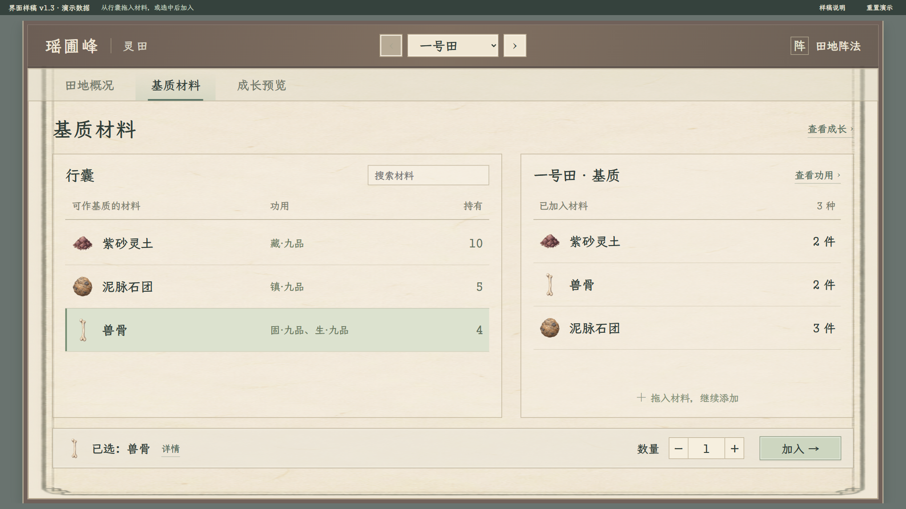

# 种植界面 v1.3：从行囊直接加入基质（历史）

当前评审已转到 [2026-11-09 灵圃界面 v2.2](../种植灵圃界面样稿_20261109/README.md)，田图暂撤、阵法移入正文，按钮与输入按全局现行规范校准；本目录保留旧图与对应验收。

2026-11-08。用户本轮明确：把行囊内可作基质的物品列出来，拖拽加入，或选中后加入。当前取代 v1.2 的材料卡片、常驻详情及保存方案流程。

[打开基质页面](index.html#substrates) · [田地概况](index.html#overview) · [成长预览](index.html#growth)

[主案](../../plans/百工技艺/种植/种植系统设定流程与界面规划_20261107.md) · [功用与阵法边界](../../plans/百工技艺/阵法/种植功用接入与多类环境阵法_20261108.md)

## 基质页面

[1280 窗口](基质列表_v13_1280.png)。左边是行囊中可用基质列表，右边是当前田地已加入的材料。底部只有选中物品、详情、数量与“加入”。

- 拖入右侧接收区，直接加入；选中材料后也可调整数量并点击“加入”。
- 默认一件；拖拽已选材料使用当前数量，拖拽其他材料默认一件。
- 同材合并，行囊剩余数同步减少，耗尽后退出可用列表；拖到区域外不添加。
- 没有大材料卡、常驻详情、独立方案、保存／还原或二次提交。功用说明点开查看，右侧“查看功用”列本田材料来源。
- 列表先过滤资格与持有量，再执行搜索；不显示不合资格、无持有量或已耗尽物品，不因带有功用就全部允许入田。

## 其他页面

[田地概况 1920](田地概况_v13_1920.png) · [1280](田地概况_v13_1280.png)

[成长预览 1920](成长预览_v13_1920.png) · [1280](成长预览_v13_1280.png)

三页共用当前田地，各田加入记录独立；同一演示行囊的剩余数量跨田共用。概况与成长立即读取加入记录。阵法仍只保留右上角独立入口，不设计具体阵式。

## 资料与范围

原型沿用项目真实材料名称、图标、材性及单项功用品级。单项数据1为九品，9为一品，不使用物品总品阶代替。

行囊持有量与可作基质标识是独立演示夹具，**不是正式物品白名单或玩家库存**。当前以紫砂灵土、泥脉石团、兽骨展示可用项，地脉焰炭作为未获演示资格的过滤项；不修改真实物品定义。正式资格必须由物品／种植规则提供，未定义不能自动放行。

“直接加入”只更新当前页面内存中的演示记录与剩余量，不读取或写入真实人物、行囊或存档。刷新恢复初始演示。真实投料的计量、费用、时间、培育作用与返还规则未定，不因省去方案保存就默认零成本。月露苔需求仍为定性示例，雾铃花完整需求未配置。

可直接本地打开 index.html，使用项目内字体与图片，无网络依赖。

## 验证

当前 v1.3 通过44项实际浏览器交互与两档排版检查，包括真实拖拽、拖出取消、重复投递保护、选中加入、数量校验、资格及持有量筛选、同材合并、耗尽移出、跨田剩余数、资料明细、即时成长读取与刷新恢复。

[本轮验收](基质列表拖拽验收_v13_20261108.json) · [数据与素材来源](数据来源.json) · [目录及演示资格](catalog.js)

[v1.2 的55项](基质与独立阵法入口验收_v12_20261108.json)、[v1.1 的131项](功用与多阵法验收_20261108.json)及[更早72项](交互与布局验收.json)均属历史。当前仍是独立交互样稿，未运行 Godot 编译或正式种植场景测试。

