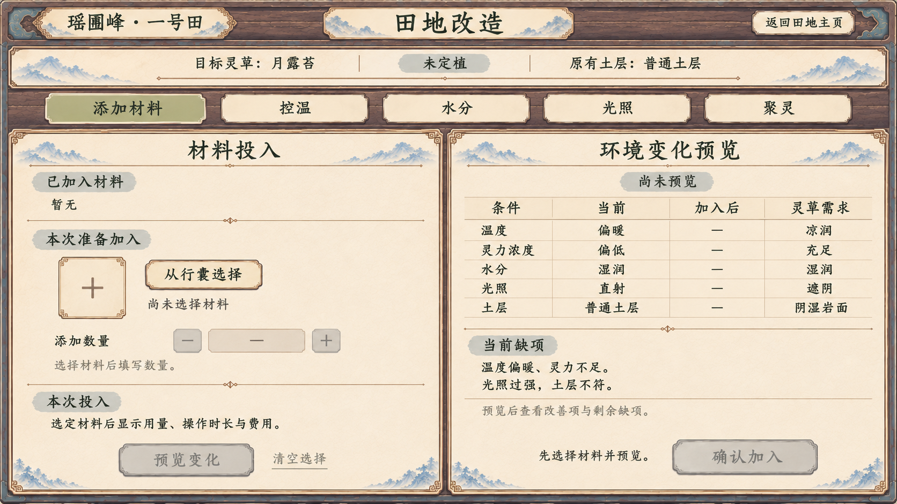
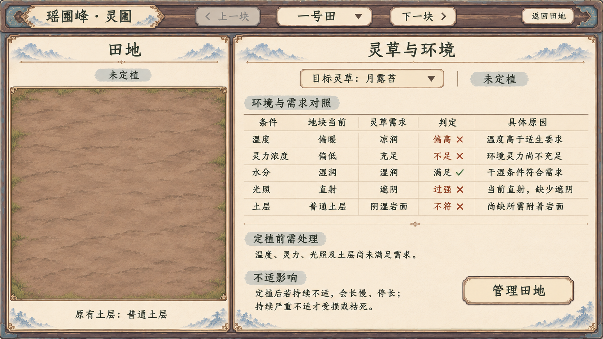

# 种植系统界面规划

> 当前入口已改为[种植系统四页交互原型](../种植系统分页面原型_20261107/README.md)。用户否定本页集中工作台，新增阵法布置、材料作为基质与成长预览，并要求分页面展开。下列 v10 主页面、改造子页 v1 及旧图保留历史，不继续作为当前布局依据。

2026-11-07。当前主页面 v10 与田地改造子页 v1 配套：主页面缩小田面、提供田地切换与详细信息，子页展开材料和环境改造操作。保留一地一页、管理子页承载材料与改造、善功堂风格与不照搬背景要求。图稿待评审，未接入游戏。

规则见[生境与培育专题](../../plans/百工技艺/种植/灵植生境与培育规则候选_20261107.md)，总入口见[种植系统规划](../../plans/百工技艺/种植/种植系统设定流程与界面规划_20261107.md)。

## 田地改造子页 v1

从主页面“管理田地”进入，页面标题使用“田地改造”。当前固定为一号田，未定植、普通土层，目标为月露苔；返回入口回到该地的主页面。本轮补画的是独立子页，不覆盖 v10 主页面，也没有实现点击交互。

| 区域 | 内容 |
| --- | --- |
| 顶部 | 当前地块身份、田地改造标题、返回田地主页；目标灵草、未定植与原有土层 |
| 分类 | 添加材料、控温、水分、光照、聚灵；本图只展开添加材料 |
| 左侧材料投入 | 实际已加入、本次准备加入、从行囊选择、添加数量、本次投入及预览变化 |
| 右侧环境预览 | 条件、当前、加入后、灵草需求，说明当前缺项与预览后的剩余缺项 |
| 确认 | 完成选择、数量、预览和投入核对后再确认加入 |

图中尚未选择材料，已加入显示“暂无”，数量和“加入后”显示空状态“—”，预览和确认灰置。空状态不代表数值为零、所有条件可改善或任何材料都有培育用途。材料未选时不显示虚构配方、用量、时长、费用或改善结果。

“已加入”属于地块实际记录，“本次准备加入”属于未提交选择。材料仍是往原地加入实物，未预览的改变不会提前作用于田面，也不清除既有不适或损伤。各材料及其他改造方向的正式作用、用量、费用和维持规则仍待逐项设计；分类标签不等于全部能力已经开放。

子页固定当前田地，避免准备投入时误切到别的地块；本图不重复主页面的上一块／下一块或大田面。已查看 v10 与善功堂实机，两张图作为连续性和风格参照生成：木框、暖纸、灰蓝与楷体保持同一套语言，不照搬善功堂背景。

图像为 1672×941。已核对当前地块、已加入与待加入区分、空预览、投入与确认关系、返回入口和风格连续性。正式接入仍需在 1920×1080 与 1280×720 验证选择、数量、预览、真实扣料、返回和防重复提交。

使用内置图片生成工具。[完整提示词与生成记录](田地改造子页_v1_生成记录.json)。

## 当前田地切换与详细信息理想图 v10

当前为一号田，尚未定植，选月露苔为目标。左侧展示田面和原有土层，右侧直接显示当前环境、灵草需求、逐项判定、具体原因与潜在影响。

## 本轮修改

| 项目 | 当前表达 |
| --- | --- |
| 田面比例 | 左侧约四成，右侧详细信息约六成，退出 v9 的超大田面与狭窄辅栏 |
| 田地切换 | 顶栏提供上一块、当前田地选择框、下一块；保留返回田地入口 |
| 需求对照 | 条件、地块当前、灵草需求、判定、具体原因五列完整呈现 |
| 原因与影响 | 分开说明当前定植前需处理项，以及定植后持续不适的潜在影响 |
| 管理分工 | 添加材料、环境改造、预览和投入确认仍放在“管理田地”子页 |

上一块在一号田示例中灰置；下一块和田地选择框为可用入口。此状态仅示范导航，不确定可用田地总数。正式切换须按当前可访问地块同步更新田面、灵草、环境对照和管理入口，不扣物、不推进时间、不混入上一块的配置预览。

## 详细信息与规则边界

对照覆盖温度、环境灵力浓度、水分、光照和土层。勾叉配文字，满足项也说明符合的需求；不满足项逐项解释原因，不用综合分覆盖必要条件。

本图没有已种植株。“定植前需处理”反映当前缺项，“不适影响”明确以“定植后若持续不适”为前提，未把长慢、停长、受损或枯死显示为当前状态。持续严重不适才受损或枯死的规则保留。

月露苔定性需求与当前环境是信息排版示例；没有补写摄氏度、灵力浓度单位、适生阈值、伤害时间、费用、产量或材料配方。

## 管理子页

主页面只保留“管理田地”入口，不恢复底部工作台、材料槽、控温等调节标签、效果预览或确认区。配套“田地改造”子页 v1 见本页上方，当前两张均为静态理想图，未实现点击交互。

添加材料是往原地加入其他实物，不设固定基质套餐；已加入、待加入、实际作用、预览和确认在管理子页中展开，作用与费用仍待定义。预览不提前生效、不清空已有不适或损伤。

遗骸仍为后续特定灵植的实物投入方向，现有兽骨不自动等同完整遗骸。同批田地同起点、差异来自实际种植与改造的方向保持。

## 风格与生成

本轮以[v9 主页面](田地主页面_理想图_v9.png)作为编辑目标，[善功堂实机](../玄览峰拓印接入_20261107/08_善功堂_1920.png)只作风格参照。沿用连贯灰褐木框、暖纸、灰蓝细节、深墨楷体与纸面按钮；不复刻屋顶、悬牌、商品四列或背景。

遵循[室内功能界面规范](../室内功能界面统一规范_20261106.md)与[UI视觉规范](../../plans/界面与美术/UI视觉规范.md)。图稿中的比例与地表纹理不定义正式面积、株数或容量。

## 核对与交付

已核对：左侧缩小、切换按钮及当前田地选择可见、右侧五列详细信息可读、不适影响使用未来条件、主页面没有材料或改造工作台、田地身份一致。

图像为 1672×941。正式接入须在 1920×1080 与 1280×720 验证表格和导航阅读、首尾可用状态、换田数据一致及主子页切换。本轮未修改游戏代码、物品、参数或存档，未做游戏内导航与结算验证。

使用内置图片编辑工具。[完整提示词与生成记录](田地切换与详细信息_v10_生成记录.json)。

## 历史方向

- [v9 田地主页面](田地主页面_理想图_v9.png)：用户指出左侧过大、缺少切换按钮、右侧过简；主子页分工保留。[生成记录](田地主页面_v9_生成记录.json)。

- [v8 善功堂风格种植面板](善功堂风格_种植面板_理想图_v8.png)：用户不满意，指出下方操作冗余；工作台改入管理子页，风格继续调整。[生成记录](善功堂风格_种植面板_v8_生成记录.json)。
- [v7 纸墨风格与添加材料](纸墨风格与添加材料_理想图_v7.png)：添加实物与需求对照保留，后续改为善功堂功能页风格。[生成记录](纸墨风格与添加材料_v7_生成记录.json)。
- [v6 单地独立页面](单地独立页面_理想图_v6.png)：一地一页结构保留，用户指出风格不符；基质分类改为添加材料。[生成记录](单地独立页面_v6_生成记录.json)。
- [v5 统一地块与自主改造](统一地块与自主改造_理想图_v5.png)：相同起点保留，多田网格由独立页面替代。[生成记录](统一地块与自主改造_v5_生成记录.json)。
- [v4 生境对照与基质配置](生境对照与基质配置_理想图_v4.png)：天然泉边、林阴与岩面选址不符合用户意图。[生成记录](生境对照与基质配置_v4_生成记录.json)。
- [v3 正俯视三栏稿](正俯视UI经营_理想图_v3.png)：用户不满意面板。[生成记录](正俯视UI经营_v3_生成记录.json)。
- [v2 斜俯视田园插画](田园经营总览_理想图_v2.png)：未体现正俯视管理排版。[生成记录](田园经营总览_v2_生成记录.json)。
- [v1 单株稿](个人种植_界面示意.png)、[旧窄屏稿](窄屏_界面示意.png)：缺少整田管理，相关测试只属于旧交互示意。
