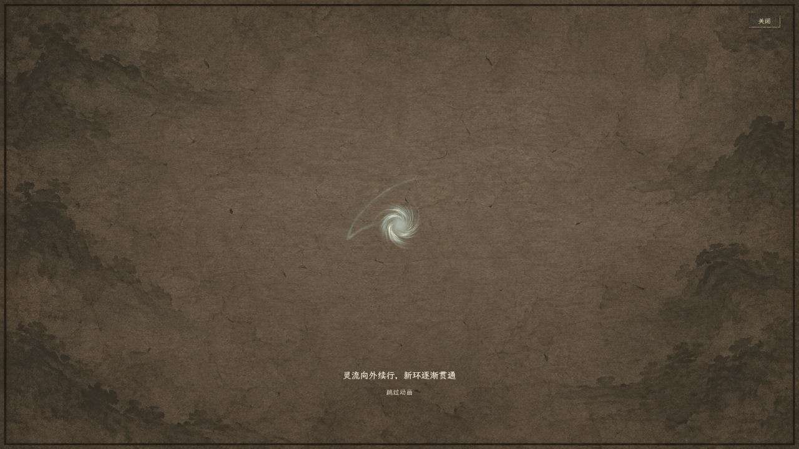
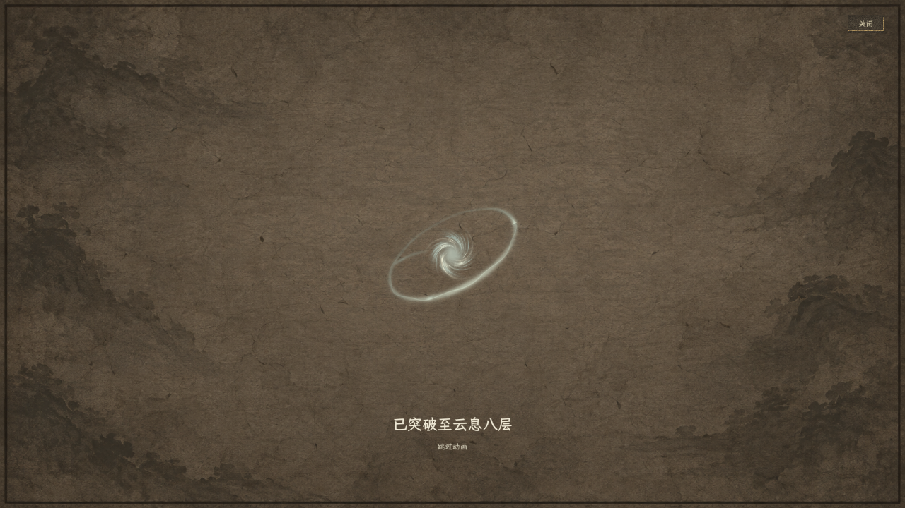
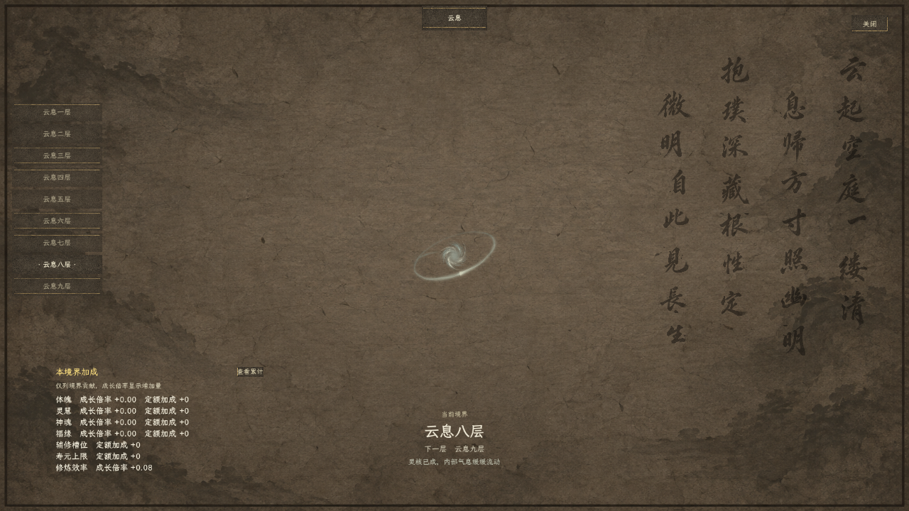

# 突破演出聚焦实机与验收

2026-11-04。用户已确认将本页实机效果接入正式游戏，凝核成功、普通突破和归元九息圆满共用。当前交接、结算等待与回归结果以[统一正式接入规格](../../plans/人物与修炼/突破演出统一正式接入_20261104.md)为准；下列图片保留当次用户确认的实际效果。

本页图片来自正式 `RealmPanel` 组件的实际运行，使用独立临时人物展示七层升八层，不读取或写入玩家旅程。纸面、气息、三环和题字沿用项目现有素材，不另画效果图替代实机。

## 演出顺序

1. 开始时淡出境界列表、大境界页签、属性加成、右侧题字与常规境界说明；从静室弹出时直接进入聚焦画面，不先闪现新境界及收益。
2. 中央主体平滑放大至原来的1.65倍，适度提高气息的明度与不透明度；保留一句阶段提示、跳过和关闭。
3. 变化完成后稳定0.45秒，再淡入新境界结果并停留1秒。随后主体恢复原尺寸，其余信息用0.4秒恢复。

普通积云、六→七凝核、七→十续环和九息圆满共用聚焦流程；前八息仍留在养息页，不因聚焦演出反复弹窗。普通总览、凝核牌局和养息页默认保留原来的气息表现。

演出只展示已经结算的结果，不改变境界、灵力、凝核分数、丹药、属性、历法或存档。跳过立即恢复完整结果；关闭后再打开恢复正常总览，不遗留透明文字、放大状态或延迟弹回。

## 实际画面

突破中：



新境界揭示：



信息恢复：



另保留[突破前画面](01_突破前.png)。截图为1280×720实际窗口，项目逻辑画布保持1920×1080。

## 打开与验证

```powershell
./tools/run_realm_presentation_preview.ps1
```

R重播当前演出；1看六→七凝核，2看七→八续环，3看九息圆满；关闭按钮退出这个独立预览。可加 `-LargeWindow` 使用1920×1080窗口，`-Mode Capture` 留存四张关键截图，`-Mode Verify` 运行演出检查。

- 编译通过，0警告、0错误。
- 三类代表演出共73项检查通过，覆盖隐藏周围信息、主体放大、保留关闭／跳过、自然结束恢复、跳过恢复、关闭重开及演出不改人物与游戏时钟。
- 1280×720实际窗口截图与正常速度交互预览已运行；关键截图目录为 `.godot/test-results/realm_presentation_preview/20261104_143656_399_capture_path/`。
- 修改后重新运行同一正式存档七层至九息圆满的六进程回归，1001项检查通过；目录为 `.godot/test-results/cloud_seven_formal/run_20261104_143656_406/`。
- 最终验收日志无运行错误或退出泄漏告警。预览只创建隔离目录及临时人物，原有玩家存档保持。

上述73项与1001项属于候选阶段记录。用户确认后的正式接入另外通过103项组件检查、三种正式凝核运行及同档1040项回归；正式凝核不再重复播放牌局页旧动画，且等待行动结算结束再呈现，详见现行接入规格。

正式接入的同档回归已分别在无窗口与1920×1080窗口通过，各1040项。凝核演出结束后关闭境界页，可回到[正式凝核结果与完整记录入口](08_凝核结果恢复.png)；此处只是恢复展示，不会再次结算分数或奖励。

实现为 `csharp/panel/RealmPanel.cs`、`csharp/panel/RealmQiVisual.cs` 与 `shaders/realm_qi_cloud.gdshader`；独立预览入口为 `tools/RealmPresentationPreview.tscn`。
