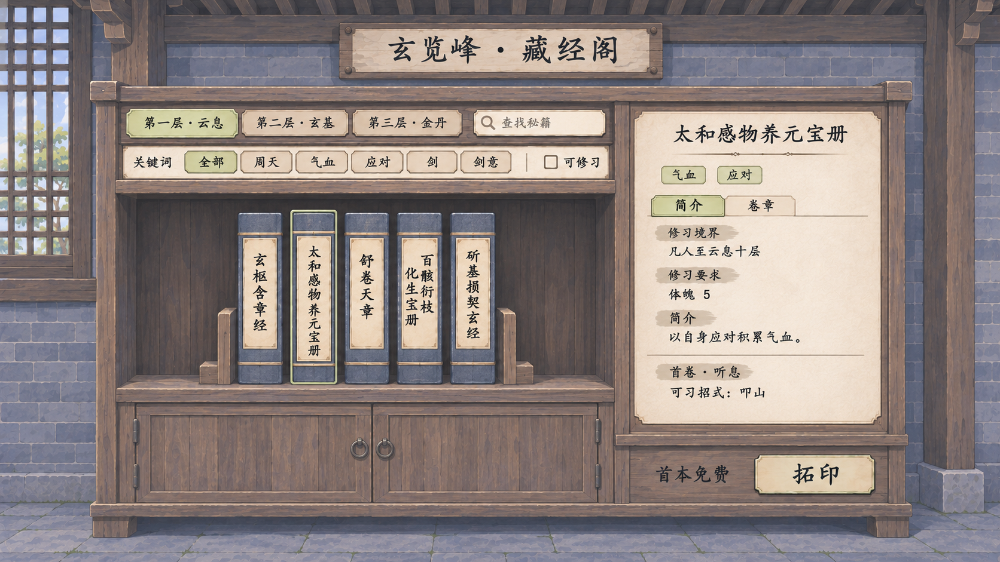
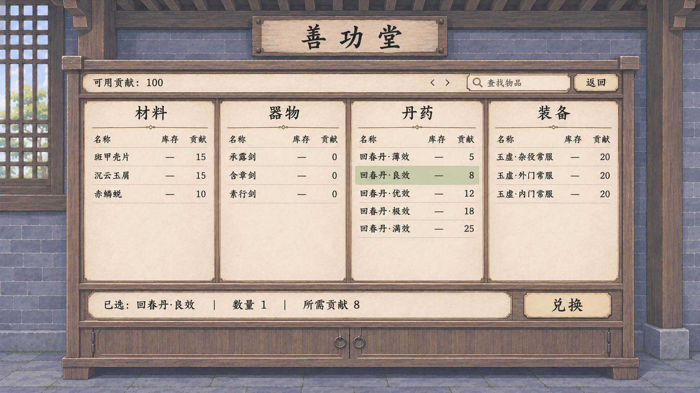

# 藏经阁与善功堂：室内统一理想图

2026-11-06 最新裁定与[可点击 v4 预览](../藏经阁与善功堂布局保留交互_20261106/README.md)：保留原布局，只换材质；真书零散陈列、书脊等占位、字号按长度自适应，关键词变暗不重排，点击抽出。以下图片和集中摆放／同字号说明保留为历史，不再决定当前布局。

2026-11-06。按用户要求，两页共同对齐现有内景的哑光材质、普通室内光照、灰青砖墙与灰褐木材，移除泛光、悬空屋檐和填充书。以下均为理想图，尚未接入正式游戏。

[统一美术规范与字级](../室内功能界面统一规范_20261106.md) · [公共提示词](室内功能界面_共用提示词.txt) · [生成与来源记录](生成记录.json)

## 藏经阁 v3

只陈列现有五本秘籍，书脊按相同规格设计，不加无字书或假条目。采用一组紧凑陈列，书目增多后再增加架层；保留楼层、关键词、检索和单页详情。价格“首本免费”，按钮“拓印”。

[v3 完整提示词](藏经阁_v3_完整提示词.txt) · [功能主案](../../plans/剧情与宗门/玄览峰秘籍拓印与首本免费_20261106.md)

## 善功堂室内 v1

同一套室内木石、纸面与深墨字。材料、器物、丹药、装备四列，移除秘籍；保留原目录与兑换形式。示例贡献价逐项取自现有配置，100 贡献余额来自原实机截图示例，不是玩家当前余额。

[完整提示词](善功堂_v1_完整提示词.txt) · [原实机对照](../行囊交易善功堂实装_20261031/05_原生善功堂四分类.png) · [功能主案](../../plans/界面与美术/交易与善功堂布局修订_20261029.md)

## 来源与检查边界

使用内置 imagegen 工具，未使用 CLI。直接参考当前 `study_room.png` 与 `inn_lobby.png`；先生成藏经阁室内新稿，再将其作为善功堂材料／字级的共同参考。原藏经阁 v2 只提供功能组织，原善功堂截图只提供目录层级，不延续其屋檐等装饰。

已查看两张生成原图：柜体落地，标题固定在室内，未增加泛光特效，藏经阁共五本，善功堂没有秘籍栏。书脊的精确宽高和统一字号是后续原生控件规范；生成排字不作像素级尺寸承诺。未执行构建、交互或小窗口测试，没有改动运行时代码及玩家存档。
