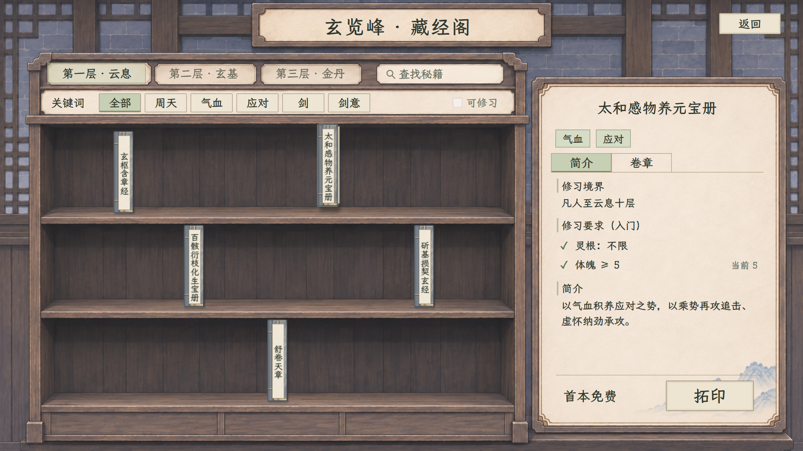
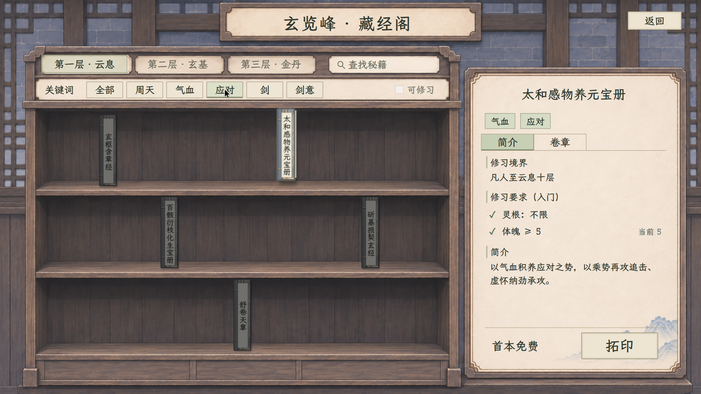

# 藏经阁与善功堂：保留原布局的交互预览

2026-11-07：[Godot 正式书架与拓印领取已接入](../玄览峰拓印接入_20261107/README.md)，实际角色条件、首本免费、1 贡献测试价、领取提交和存档均见新页。本页继续保留浏览器美术样板及生成来源。

2026-11-07 更新：简介删除“首卷／可习招式”；“修习要求（入门）”逐条显示满足 ✓、不满足 ✕、明确阈值与当前值。各卷另列境界、属性、前置卷章等条件。浏览器使用明确标为样例的角色资料（凡人、体魄／灵慧 5、基础造诣 0、未研习卷章），未读取玩家存档，勾叉不是实际玩家状态。

[满足示例](修习要求_满足_20261107.png) · [不满足示例](修习要求_不满足_20261107.png) · [各卷条件](修习要求_卷章_20261107.png) · [本次检查](修习要求验收_20261107.json)

2026-11-06 当前版本 v4。用户明确：保留所给藏经阁的占屏比例、三排书架与右侧详情，善功堂保留原四列目录布局；只调整素材风格。书脊等占位、字级自适应；少量真书零散陈列；关键词只压暗不匹配项；点击选中并从原位抽出。

[打开可点击预览](index.html) · [直接看藏经阁](preview.html) · [直接看善功堂](preview.html?view=shop)

## 藏经阁

[关键词与抽拉短演示](关键词与抽拉演示.mp4) · [1280 窗口](藏经阁_默认_1280.png)

已做成真实可点的浏览器样板：关键词、名称搜索、选书、简介／卷章切换、字体适配和抽拉动画均由实际控件完成。五本书分布在三排书架，切换关键词不隐藏、不重排，也不替玩家换选书；暗项仍能点击。书脊固定 42×170 设计单位，书脊与现有秘籍图标沿用灰蓝布面及缝线，书名在 18 号上限内按字数和题签空间适配，当前五本均单列竖排。选中只做位移与书页侧边、接触影，槽位与宽高不变，旧书自动归位。

目录数据从本次读取的五本现行开放资源提取，包含心法关键词、入门条件、简介与已配置卷章；不改任何秘籍或战斗资源。来源见[目录来源](目录来源.json)。

## 善功堂

沿用原布局、顶栏、四列及底部兑换区，只换纸木等材质。目录移除秘籍，样例价格取现有贡献价配置；100 为原截图示例余额，不是玩家当前余额。支持选中和检索，用于验证文字目录布局。

## 规范、提示词与素材

- [最新共用规范](../室内功能界面统一规范_20261106.md)
- [后续保留布局的共用提示词](室内功能页_保留布局共用提示词.txt)
- [藏经阁框架完整生成提示词](藏经阁_框架_v4_提示词.txt)
- [善功堂框架完整生成提示词](善功堂_框架_v2_提示词.txt)
- [生成记录](生成记录.json) · [交互与尺寸检查](交互验收.json)
- [藏经阁无字框架](藏经阁_空白框架_v4.png) · [善功堂无字框架](善功堂_原布局哑光框架_v2.png)

框架素材通过内置 imagegen 工具制作，未使用 CLI。题签、字体、关键词明暗、抽拉及全部功能文案由 HTML／CSS／JavaScript 控件完成；书脊布面复用项目现有秘籍纹理。正式接入时可以用同样的槽位、字级与反馈规则重建原生控件，不用整图烘焙文字。

## 验收与范围

用 Playwright 在实际 Edge 浏览器检查：书目只有五本；占位相同；关键词后位置与选中不变；匹配明亮／非匹配变暗；暗项可选；新书抽出／旧书归位；1920×1080 和 1280×720 的题签无溢出。截图与视频来自该可交互样板，属于浏览器预览，不是 Godot 实机。

本页不读取角色或存档，可修习资格开关、真实拓印、兑换、行囊与免费领取记录尚未接入，拓印／兑换按钮只呈现位置并禁用提交；其他可点交互如上。没有改动游戏代码、战斗规则、价格、角色或玩家存档。
