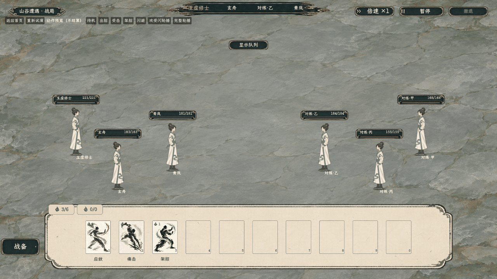
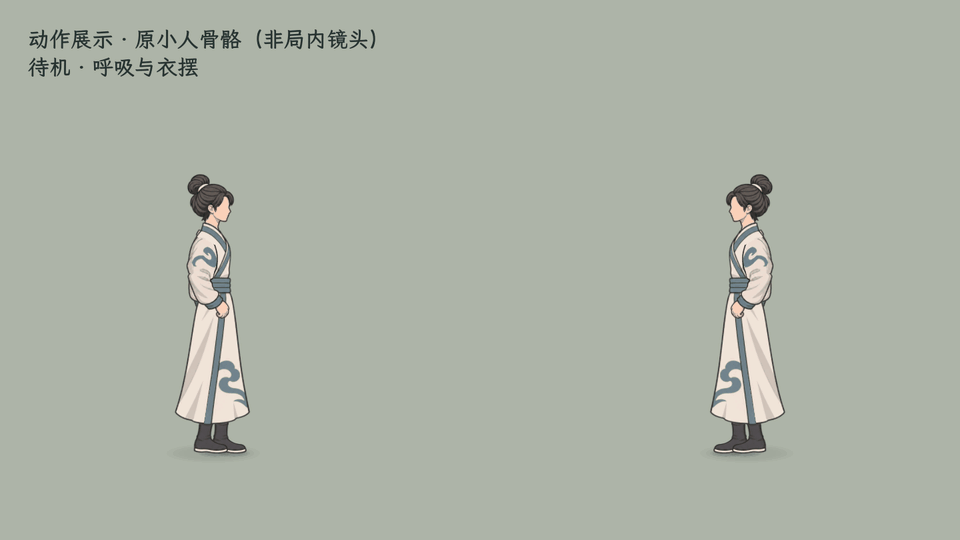
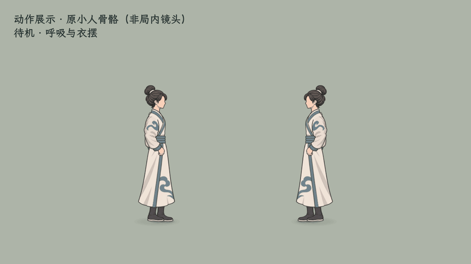
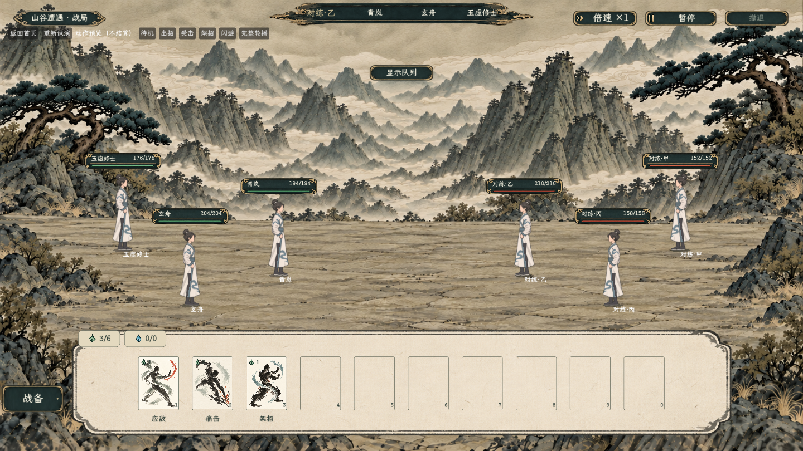
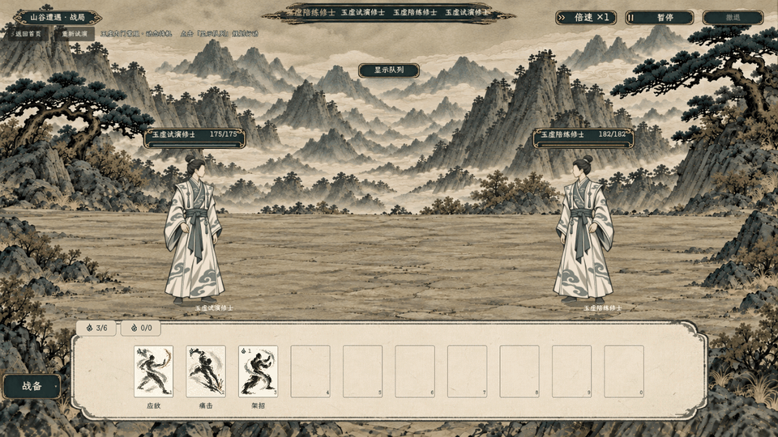
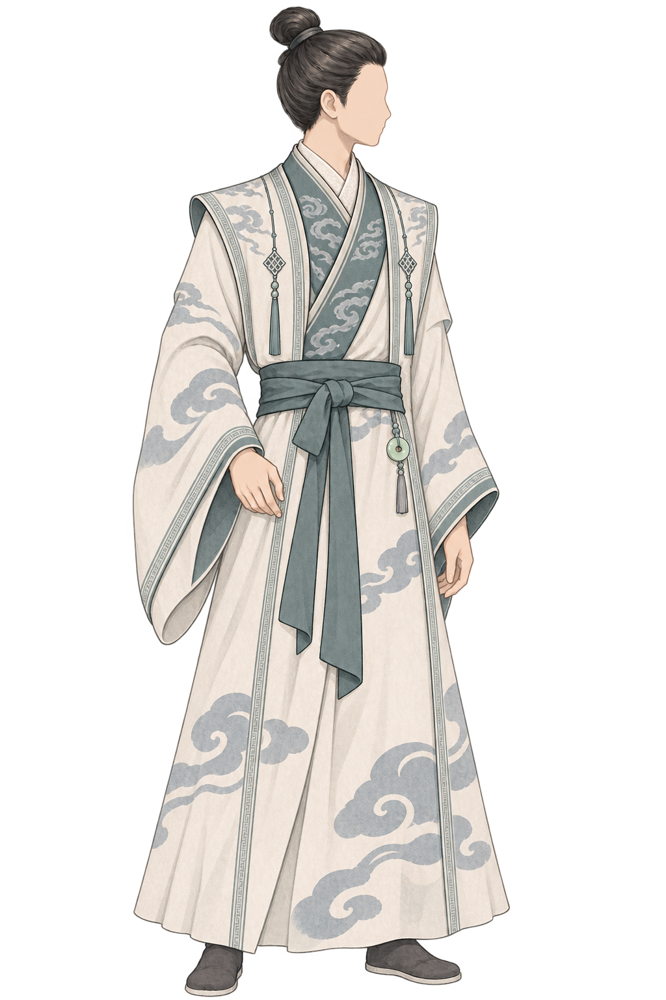

# 行动队列局内形象：玉虚内门常服与守真束髻

最新服装扩展：[玉虚杂役、外门、内门、真传四套](../玉虚四套局内形象_20261103/README.md)已接入。下方仅内门支持范围为早期记录；当前支持男修衣服3／4／5／6及前发5／后发6。

2026-11-03，造型已获用户认可，单套骨骼待机已接入行动队列战斗，供局内验收。正式方案见[行动队列局内形象与换装映射](../../plans/界面与美术/行动队列局内形象与换装映射_20261103.md)。即时动作战斗已按用户要求暂停，本目录服务原行动队列战斗。

## 当前：原小人骨骼完整动作首套

**当前恢复迈步走**：用户最新撤销飞行与纯平移，恢复袍内短步前进、面敌倒步回位。原16单位短步与低抬脚保留；用户允许滑步后，上前／回位改为每段0.35～0.70秒，步态独立保持1.8周期／秒，不再按38单位源坐标限速；人物沿地面移动，腿袍遮挡修复和其余动作保留。下方v3～v5短掠／飞行媒体均为历史，不代表当前入口。

当前v5改为完整轻功：蓄力蹬地→低空前飞／面敌倒飞→落地缓冲。水平行进与骨骼高度共用进度，每段0.65～1秒，15%前为蓄力、15%～82%为飞行、后段落地收势；160像素人物顶点约离地30像素。阴影从飞行骨架分离，留在地面；腿链完整保留并收在袍内。构建及[真实队列飞行验证](../../../output/queue_small_avatar_flight_smoke_20261103.log)通过，覆盖起步不位移、实际离地、暂停同步与落地恢复。下方v3/v4地面短掠为历史方案。

[起跳／顶点／落地分解图](queue_small_v5_action_contact_sheet.png)、[骨骼与层级验证](queue_small_v5_checks.log)。末次验证含脚尖蹬伸、起落实际鞋底接地与双向暂停恢复；近景只是动作检查镜头，不代表局内大小。

最新v4可读性修订：用户反馈远景看不见前后倾，躯干峰值前倾由0.115增至0.30弧度、后倾由0.085增至0.24弧度（约17°／14°）；头部继续反向补偿，骨盆／腿／脚影不整体旋转。接近时长和结算保持。360个双向短掠相位与暂停恢复通过，日志见 `output/queue_glide_lean_v4.log`。v3动图为此次增强前的版本。

本轮追加修订：背景改用原小人的灰绿石坪。已查明嵌套战场层级造成腿穿袍：腿继承父层级，而后袍／里襟／肩盖使用绝对层级；包装层现统一换算为角色内相对层级，原试玩源脚本不改。不同父层级与双向动作的3660相位、36600网格层级断言通过。

最新移动表现采用用户确认的轻功短掠：上前前倾、回位后倾、袖袍跟随收势，腿保持袍内；不再使用逐步慢走作为验收目标。按距离安排0.35～0.85秒接近／回位，以平滑起止的地面轨迹演出。攻击起手后0.30秒接触与队列规则保持。首页试演「攻受闪轮播」选择最近一对，展示完整接近、攻击、后撤回位及受击／闪避。构建及[真实队列轻功验证](../../../output/queue_small_avatar_qinggong_smoke_20261103.log)通过。v1/v2媒体及慢走验证保留为历史，最新轻功录制使用v3文件。

[轻功与遮挡专项验证](queue_small_v3_checks.log)覆盖360个双向短掠相位、无走路循环、起止恢复／暂停，以及原610相位动作回归；已检查近景前后倾与实际战场接近姿态。

实际试演录制162帧／20fps，完整展示上前、出招、后撤回位、受击、闪避和结束待机；本段使用演示接口，不结算伤害。真实战斗规则另由上述队列专项验证覆盖。

石坪素材沿用本机试玩源图加载，导出资源收录尚未处理；本轮为本机试玩交付。

用户最新选择为原即时试玩中的玉虚小比例骨骼人物，接回原行动队列。以下旧版大立绘 v2/v3 记录仅保留历史，不代表当前入口。

首页 → **试演与预览 → 远景队列·玉虚换装试演**，在「动作预览（不结算）」点击「完整轮播」，可依次查看呼吸待机、蓄势出招与收手、受击回稳、架招、闪避。演示动作不结算；实际队列仍由原规则执行攻击和交接。

原小人采用21根骨骼、7个主要加权网格，复用 `tools/action_battle_test/yuxu_approved_skin.gd` 与 `art/yuxu_fullbody_v15`，通过 `tools/queue_small_avatar/queue_small_avatar.gd` 接入。原试玩素材及脚本未改；长袍约束步幅，主要露出靴子，闪避为短撤收身。首版动作力度偏克制，仍待用户评价。

[实际战场十秒动态](queue_small_battle_10s.gif)。

[动作关键姿势对照](queue_small_action_contact_sheet.png)。近景为原生放大渲染的检查画面；实际战场使用远景3v3，远景显示只在隔离试演启用。

当前只支持男修玉虚衣服5／前发5／后发6的准确组合，头发仍烘入头部，**独立换发尚未完成**；其他组合回退原显示，不覆盖人物外观数据。

构建通过；[实际队列验证日志](../../../output/queue_small_avatar_battle_smoke_20261103.log)确认五类动作、远景比例、接触/响应/全局暂停、动作恢复、真实排队攻击与外观快照保持。独立骨骼检查覆盖双向610相位。退出阶段仍有资源清理诊断，未据此宣称所有退出资源问题已解决。

## 历史：大立绘骨骼试作

### 旧版局内入口与实现

最新画风修订：用户要求接近原静态人物的绘制风格，并确认**每套衣服设计一个专属基础姿势，再绑定动态待机**。首套仍用从容垂手姿态；v3改用清晰墨线、简化云纹与大块阴影。源图为 `textures/characters/queue_avatar_design_20261103/yuxu_neimen_shouzhen_v3_ink.png`，旧v2保留用于对照。新图保持同一画布和大体关节位置，按新可见轮廓更新脚点与显示高度，骨骼动态保持。

v3重新编译通过并完成实际战场180帧采集：左右骨骼待机有运动，暂停冻结，双脚靴底区域无像素位移；关键帧肩颈、袖口与腰部连续。见[当前采集日志](../../../output/queue_avatar_capture_v3_20261103.log)。画风与自然度待用户验收。

首页 → **试演与预览 → 行动队列 · 玉虚动态形象**。进入真实队列战斗的双人试演，点击「显示队列」可规划并执行已有行动；可重新试演，或按 Esc 返回首页。此入口不写入世界存档。

共用战斗显示也会识别同一男修衣服、前发、后发组合，其他未制作组合保留原显示。当前并非所有衣服、男女款、发型都已完成。

保留认可图原始比例，使用9根真实二维骨骼和连续加权网格：胸肩呼吸、头颈轻动、两袖错相跟随、袍摆和腰带轻摆，鞋底固定。连续网格避免独立裁片在颈肩、腰部产生空隙。原始素材未改像素；导入启用 mipmaps 与对应缩小过滤，减少实际人物高度约275像素时的细纹闪烁。

这是第一套完整图的连续蒙皮，尚未成为衣服与头发可分别更换的生产分件系统。已有攻击、受击等沿用整体演出和结算时序，人物保持这套衣服；专用抬臂、持剑等肢体动作尚未制作，不把待机绑定描述为完整动作集。

[当前人物原生像素动态裁切](queue_idle_v3_native_crop_6s.gif)。采集自实际队列场景，1440×810原始画面；全场 GIF 缩为960×540，人物裁切185×305保持原生像素。180帧／6秒，非插画合成动画。

本轮验证：编译0警告0错误；真实场景纹理、骨骼权重、左右朝向、待机时钟、应对冻结与恢复、死亡停止、同衣服行动、队列确认执行，以及仅换前发／后发的回退检查均通过。采集确认2个骨架、18根骨骼在运动，树暂停时冻结；左右靴底区域180帧像素未变化。关键帧目视颈肩、腰带、袍身连续。最终自然度仍由用户局内验收。

日志：[队列场景验证](../../../output/queue_avatar_battle_smoke_20261103.log)、[实际采集](../../../output/queue_avatar_capture_20261103.log)。无运行错误；无窗口验证进程结束时仍有资源释放诊断，不将退出过程描述为完全无警告。尚未验收完整衣装覆盖、多人数布局和专用肢体战斗动作。

下方「生成与验证」记录首张静态设计阶段，不代表当前接入状态。

## 来源对应

| 部位 | 真实选项 | 保存值 | 现存源图 |
| --- | --- | --- | --- |
| 衣服 | 男修玉虚·内门常服 | `appearance_clothes_style = 5` | [male/clothing/06.png](../../../mods/appearance/ink_three_variants_20261004/male/clothing/06.png) |
| 前发 | 守真拢发 | `appearance_hair_style = 5` | [male/hair_front/07.png](../../../mods/appearance/ink_three_variants_20261004/male/hair_front/07.png) |
| 后发 | 守真束髻 | `appearance_hair_back_style = 6` | [male/hair_back/07.png](../../../mods/appearance/ink_three_variants_20261004/male/hair_back/07.png) |

外观衣物身份为 `portrait_clothing_yuxu_neimen`，物品路径 `res://resources/entities/items/clothing/玉虚内门常服.tres`。前发目录跳过废弃物理05，因此保存值不能当图片号使用。全目录映射、名称、源图路径与哈希见[44项来源检查](appearance_mapping_audit.json)：14件男女衣服、14件前发、16件后发，衣服物品的保存序号均一致。

本图保留真实内门常服的象牙白、灰蓝云纹、青灰交领与腰带、宽袖和小坠饰，配真实露额拢发与束髻。躯干转向屏幕保留胸前服饰，脸侧向敌方且不画五官，完整站姿用于讨论后续待机、攻击与受击。现有衣服源图只到腰下附近，全身裙摆、鞋及局内姿态是新设计延展，尚待审阅，不能视为既有素材已获认可。

## 生成与验证

使用内置 imagegen，完整[提示词与修改要求](生成提示.md)留档。第一轮角度已符合方向，第二轮保留完整人物构图，依据实际服装源图修正交领云纹和长肩片。第二轮同时要求干净透明边；检查发现外围采样点Alpha均为0，透明像素的RGB仍可能在忽略Alpha的查看器里显出底色，这不等于实际不透明光晕。生成后未编辑像素，原生Alpha完整保留。未使用旧即时战斗侧面分件，未修改原立绘部件。

源数据已核对文件存在、44项SHA-256、14款男女衣服对应物品索引和样例三项编号。生成图的尺寸、Alpha及来源路径见[素材检查](asset_verification.json)。本图为完整静态设计图，尚无拆件、绑定、动作或正式局内渲染；未运行编译或场景冒烟，不将静态预览称为动态成品。最终审美判断待用户看图。

未经用户看过，不继续批量制作其他衣服。后续每件局内衣服/前后发都需映射真实选项；未知装备外露层与缺失动作按方案登记，不能用固定一套人物掩盖缺件。
