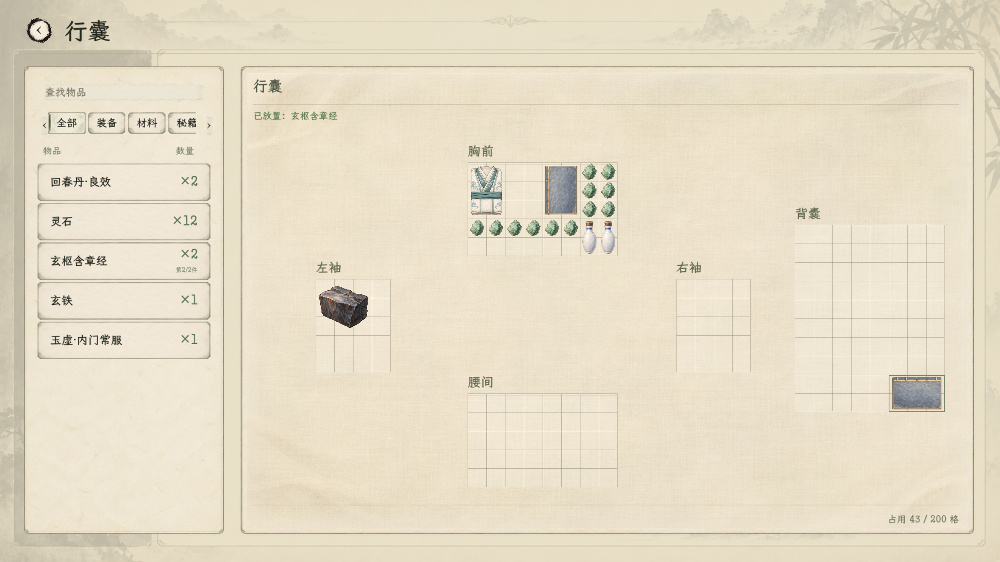
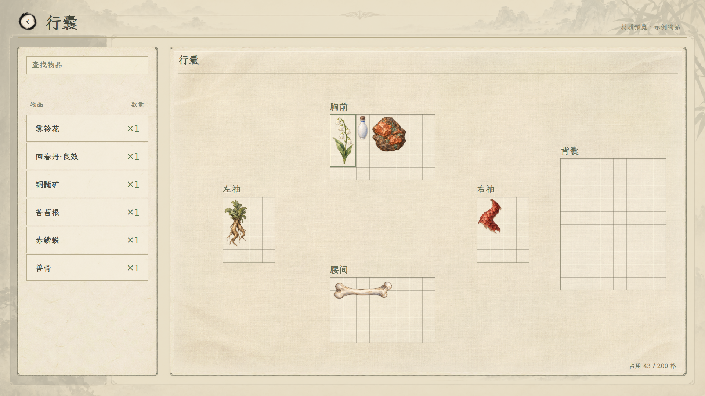
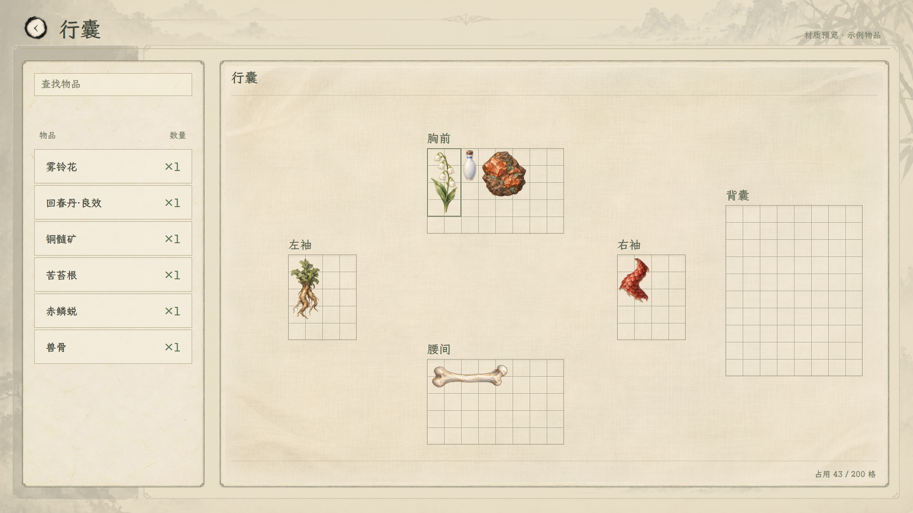
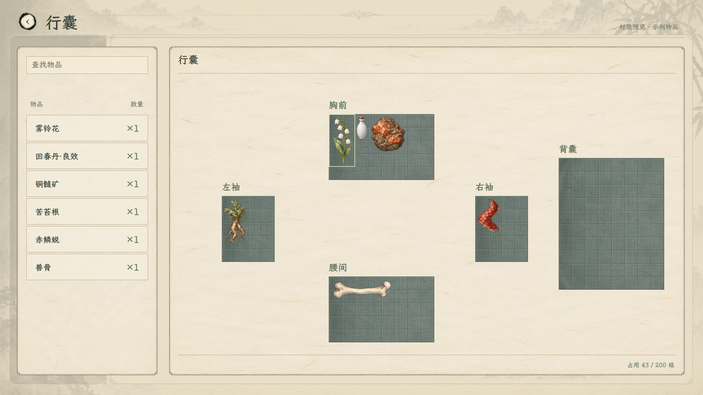

# 行囊200格：原边界内补格

## 当前游戏界面：浅绢淡纹v5已接入

用户认可淡纹版并授权接入正式行囊，200格与五区位置保持。右侧使用同版浅绢底面，格线、文字、物品和选择／拖放状态由原生控件绘制；左侧纸上清单保留真实分类、搜索及跨储物空间定位。储物弹窗下方的行囊同步新样式，内腔材质与储物袋更名不在本轮范围。后续用户要求领取页右侧同步，现已与正常行囊共用布面及格线，两页各自原坐标保持；见[领取页实机与五组349项验证](../领取左侧回收与拖动显隐_20261107/README.md)。

[1280实机](浅绢接入_v5_实机/行囊/03_原生行囊1280.png) · [实际旋转拖放](浅绢接入_v5_实机/行囊/01_原生行囊旋转拖动.png) · [储物弹窗与下方行囊](浅绢接入_v5_实机/储物空间/07_戒指暗罩1920.png) · [接入验证记录](浅绢淡纹v5_接入验证_20261107.json)。

本轮编译0警告0错误，三组现有场景共136项通过：行囊窗口30、储物空间窗口80、真实旅程入口26。覆盖1920／1280、分类定位、拖放旋转、取消及界外松手、新增背囊边缘格、储物往返、弹窗暗幕与返回，以及实际HUD行囊入口、原生交易、善功堂结算和独立持久化快照。首次尝试时底图尚未导入完成，导入后相关检查已重新通过。旅程旧测试中的九分类常量与当前七分类目录不符，已改为校验完整现行目录；未修改善功堂规则。既有“卸力”资源UID警告仍按文本路径回退，未出现本次材质加载错误。

背景底板由已认可v5预览导出，尺寸1416×906，仅包含纸边和布面，不含格线、文字或物品；各区继续由200格真实数据控制，没有写入玩家物品或重排旧摆放。底板见[正式素材](../../../textures/ui/inventory_material_20261107/garment_inventory_panel_v5.png)，来源为原[生成素绢](../../../textures/ui/inventory_material_20261107/garment_lining_warm_v4.png)与本目录v5样式。相关入口：[行囊控件](../../../csharp/panel/StoragePanel.Native.cs)、[布面与格线](../../../csharp/panel/StoragePanel.GarmentLining.cs)、[弹窗下方行囊：现行储物袋实现](../../../csharp/panel/StoragePanel.BagModal.cs)（旧戒指弹窗文件已退役）、[底板导出](../../../tools/export_inventory_garment_panel_v5_20261107.js)、[现有场景回归脚本](../../../tools/run_inventory_lining_v5_smoke_20261107.ps1)。日志位于`output/inventory_lining_v5_20261107/`，使用隔离保存目录。

以下理想图、初轮容量测试及当时编译阻塞均保留为阶段记录；当前接入状态与验证以上方实机为准。

## 接入依据：浅绢淡纹v5理想图

用户认可浅绢方向，并要求格子纹理稍淡、减少黑感。本版小幅减淡格内暗纹、内外格线和折边阴影，保留格界、文字与选中框的清晰度；200格、36格距、五区坐标及原物品图标保持。仅调整预览样式，沿用原素绢素材，正式游戏材质未替换。

[1280窗口](行囊200格_浅绢淡纹理想图_v5_1280.png) · [可缩放预览](行囊200格_浅绢淡纹理想图_v5_20261107.html) · [淡纹样式](素绢融合_淡纹_v5_20261107.css) · [核对记录](浅绢淡纹v5_视觉核对_20261107.json)。1920与1280均已核对，200格与原位置一致，图片加载正常，浏览器0警告0错误。

## 上一版：浅绢v4，方向已认可

用户反馈上一张深灰青分区与纸墨背景不协调，本轮按确认方向保留左侧纸上清单，右侧改一整片浅暖灰素绢衣物内衬。五个收纳区以灰褐细格线、轻薄折边和极淡衣褶融进底面；物品、200格、36格距及各区坐标保持。本图为预览，未替换正式游戏材质。

[1280窗口](行囊200格_浅绢理想图_v4_1280.png) · [可缩放预览](行囊200格_浅绢理想图_v4_20261107.html) · [样式](素绢融合_v4_20261107.css) · [生成素材原图](../../../textures/ui/inventory_material_20261107/garment_lining_warm_v4.png) · [生成提示词与方式](素绢底面_v4_生成提示词.txt) · [本轮核对记录](浅绢v4_视觉核对_20261107.json)。

素绢底面使用内置图片生成工具新生成；中文、格线、边缘和现有图标由界面叠加，五区继续引用原[200格示例数据](200格示例_20261107.json)，保证每格及位置准确。1920×1080与1280×720已逐图核对，分别36／24屏幕像素每格；五区全部可见、合计200格，示例仍占43格，图片加载正常，浏览器0警告0错误。本轮仅更新美术预览，未运行或改动游戏事务。

## 扩容与上一版材质记录

2026-11-07。用户选择 **200格，各区都不超出原边界**。每格保持36设计单位，五区位置不变，胸前、腰间各40格，左右袖各20格，背囊80格；实际总面积恢复至48格距时期的93.75%。普通行囊容量及领取页已接入，新布料底面仍是材质预览。

[1280窗口效果](行囊200格_材质理想图_1280.png) · [可缩放预览](行囊200格_材质预览_20261107.html) · [200格主案](../../plans/物品与装备/行囊恢复原面积与200格扩容_20261107.md) · [已认可的v3材质对照](../收纳格子材质理想图_20261107/README.md)。

## 尺寸与状态

| 区域 | 当前列×行 | 格数 | 原48格距显示范围 | 当前36格距显示范围 |
| --- | --- | --- | --- | --- |
| 胸前 | 8×5 | 40 | 288×192 | 288×180 |
| 左袖 | 4×5 | 20 | 144×192 | 144×180 |
| 右袖 | 4×5 | 20 | 144×192 | 144×180 |
| 腰间 | 8×5 | 40 | 288×192 | 288×180 |
| 背囊 | 8×10 | 80 | 288×384 | 288×360 |
| 合计 | — | **200** | — | **93.75%原面积** |

每边向下取整，保留原中心；物品源图、占地、朝向及实例保持。旧有效摆放无需重排，新格子不附赠物品。实际库存、交易、战利品、善功堂兑换、拓印领取及满包校验均读取新的容量与分区形状。储物袋内腔仍按原有长宽，坊市20×18排版候选另案。

材质预览沿用现有纸墨底与原图标，将已认可的灰青衣料和深浅细格线应用到完整五区。[示例数据](200格示例_20261107.json)从当前五区尺寸生成，六件隔离样例共占43格，不是玩家存档。正式游戏的新材质、储物袋显示名和袋子实物外形尚未替换。

## 实机与验证

实机仍是现有底面，下面的截图用于核对200格、36格距、清册和真实拖放：

- [行囊1920](实机/行囊/02_原生行囊空间与清册.png) · [行囊1280：书册放入背囊新增边缘](实机/行囊/03_原生行囊1280.png)。
- [领取页1920](实机/领取/01_领取收纳_1920.png) · [领取页1280](实机/领取/03_领取收纳_1280.png) · [拖放旋转](实机/领取/04_领取收纳_旋转.png)。
- [储物空间1920](实机/储物空间/02_戒指矩形收纳1920.png) · [储物空间1280](实机/储物空间/03_戒指矩形收纳1280.png)，其内腔没有扩容。

当前11组场景共481项通过：空间模型34、行囊27、储物空间72、领取53、交易25、战利品16、善功堂兑换23、拓印63；另有窗口行囊30、储物空间80、领取58。覆盖200格满包／溢出、真实占格适配、原实例与坐标保留、新增边缘格拖放和旋转、储物空间取回、领取提交／放弃及交易失败回滚。材质页面1920／1280均为5区200格，对应单格36／24屏幕像素，图片加载正常；16张原生窗口截图已保存。

扩容代码曾完整编译通过，0警告0错误。随后工作区另一处战斗盘改动仍在进行，最新整项目编译为1警告3错误：`BattleBoardView`／`BattleBoardHud`引用的`CombatBoardPresentation`尚未齐全；本轮不修改正在进行的战斗工作。旅程入口检查已更新旧字段及开场对白等待，但这项最新修改尚待整项目恢复编译后重跑，不计入上述481项。运行时仍有既有“卸力”资源UID警告，已按文本路径回退，不属于本次扩容错误。

回归脚本：[run_inventory_capacity200_regression_20261107.ps1](../../../tools/run_inventory_capacity200_regression_20261107.ps1)。脚本将测试保存目录隔离在本轮输出目录，不写真实玩家存档；日志位于`output/inventory_capacity200_20261107/`。具体状态见[验证记录](扩容与验证_20261107.json)。
