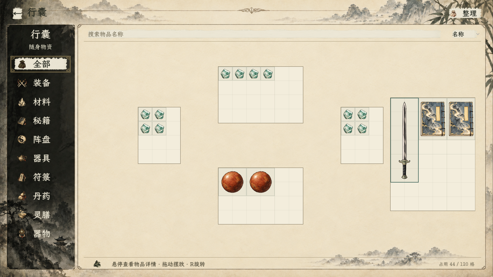
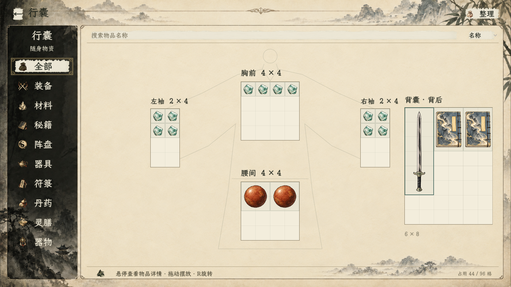
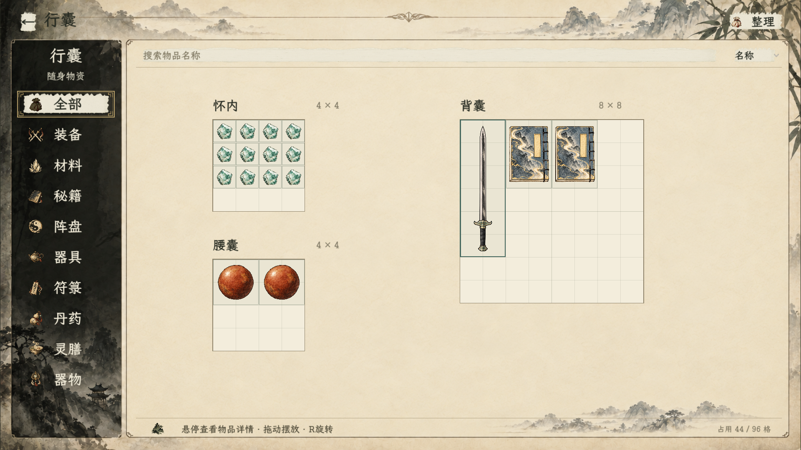
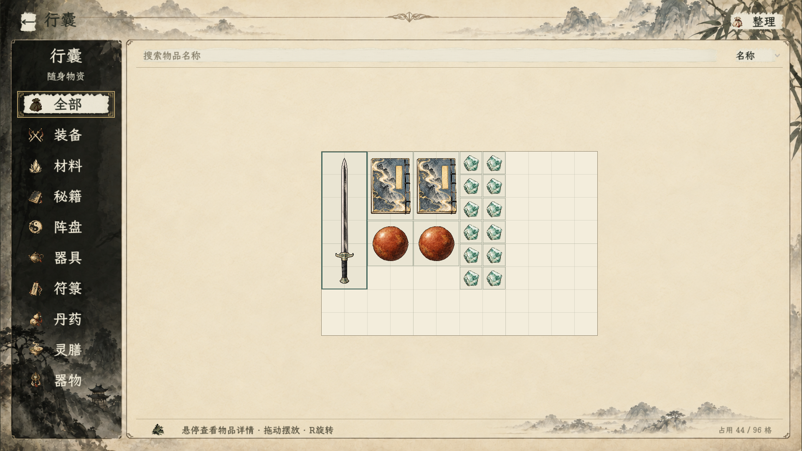
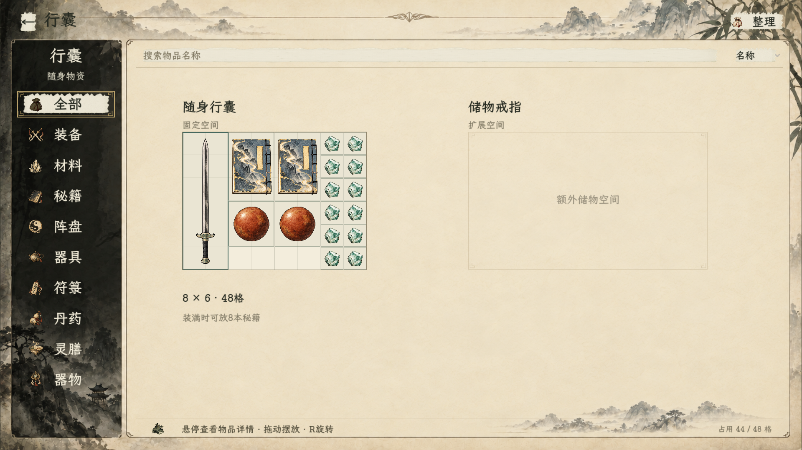
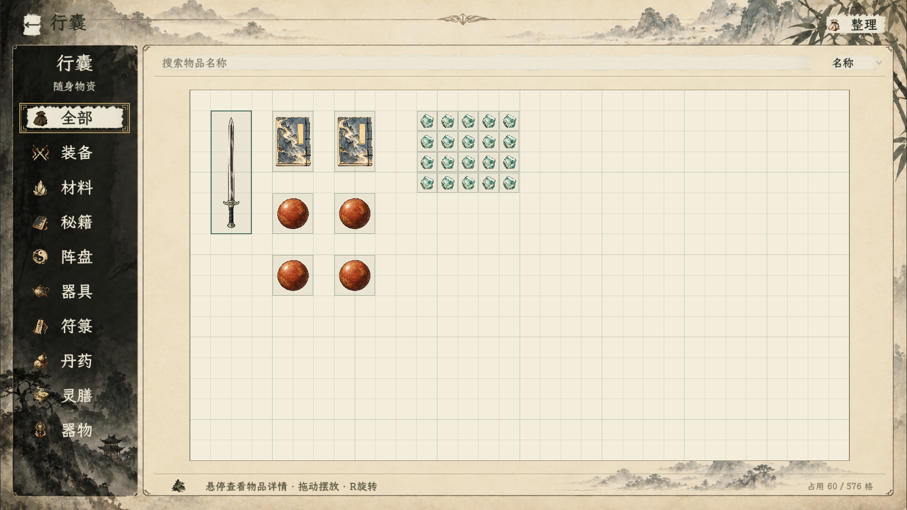
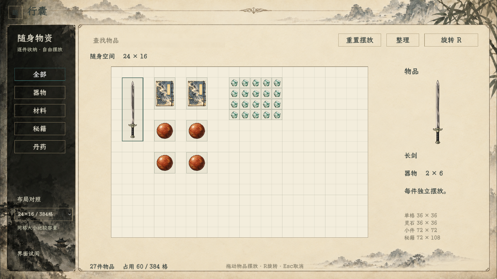

# 行囊细网格界面试阅

2026-10-29最新修订：用户随后要求恢复区域文字，只去掉尺寸描述与人体示意图。当前保留胸前、左袖、右袖、腰间、背囊五区名称和120细格，原外壳、分类、搜索、整理保留。书册共用朴素图，行囊丹药使用共用瓷瓶；全量图标已按[本轮统一规范](../行囊全物品图标与占地_20261029/README.md)重绘、替换并完成原生检查。正式空间库存和存档未迁移。

## 当前：五区名称、无尺寸描述、无人体图

胸前6×4、左右袖各3×4、腰间6×4、背囊6×8，共120格；尺寸只写在策划，不打印在分区标题。每格48设计单位，素材每格128源像素，保留原纸墨外壳。单件必须完整放在同一区域，可旋转和跨区转移；不预留右侧戒指面板。戒指仍按包内物品、单击打开内部子页的方向，未新增容量或嵌套规则。

入口：首页→试演与预览→行囊·细网格布局试阅。最新统一素材[实机截图](行囊_区名与统一图标.png)已更新：19件／65格，五区120格，书册与瓷瓶均使用本轮图。原生校验见[干净布局运行记录](../行囊全物品图标与占地_20261029/12_原生行囊布局_干净截图.log)；下方无标注120格、96格和早期容量图均为阶段历史。

## 历史：无文字标注、无人体图，120格（已被恢复名称取代）

网格按原身体相对位置分布，不再显示“胸前”“左袖”等名称或各区尺寸，头、肩、袖、腰带及衣袍轮廓全部移除。界面保留原分类、顶栏和底部总占用统计。

尺寸仅在策划记录中列出：上中6×4／24格、左右各3×4／12格、下中6×4／24格、偏右6×8／48格，共120格。相比上一版96格增加25%，主要扩展上中和下中，两侧各补一列；单格仍48设计单位，物品图像比例不变。当前总量及分配为待审建议，不设置行囊本体扩容入口。

样本仍17件／44格，区域间可转移，单件不能跨区拼占；戒指继续作为包内物品，主页面不另预留戒指区。没有新增戒指实例或内部库存。

编译与原生检查见[无标注120格记录](无标注120格运行.log)，成功标记 `INVENTORY_CLEAN_REGIONS_OK`。检查五区120格、样本无重叠、分区边界、两侧尺寸、跨区转移、留白判定、旋转与整理守恒。

## 历史：带标注及人体轮廓的96格（已取代）

| 区域 | 建议尺寸 | 相对位置 | 当前样本 |
| --- | --- | --- | --- |
| 胸前 | 4×4，16格 | 上方中央，领口下 | 四枚灵石 |
| 左袖 | 2×4，8格 | 人体示意左侧袖口 | 四枚灵石 |
| 右袖 | 2×4，8格 | 人体示意右侧袖口 | 四枚灵石 |
| 腰间 | 4×4，16格 | 胸前下方、腰带处 | 两颗丹药 |
| 背囊 | 6×8，48格 | 偏右，标明背后 | 长剑和两本秘籍 |

在原1348×704物品区域内加入很淡的头肩、宽袖、衣袍及腰带轮廓作为位置示意，物品格仍是原生控件绘制的正方形网格。轮廓不代表角色立绘或装备位，也不新增人物外观。单格统一48设计单位，总量仍为96格；各区尺寸与容量是待审提案，扩大排版覆盖不增加容量。

无物品类别限制、负重、快取或穿戴解锁规则。物品可跨区转移，但单件不能跨区拼占；两袖宽度自然限制长物件摆入，不额外增加“袖袋禁放长剑”的类别规则。戒指仍放包内，按单击进入内部子页的方向设计，戒指实例、内部库存和正式行囊迁移尚未制作。

编译0警告、0错误。原生标记 `INVENTORY_BODY_POSITION_OK`，见[人体位置运行记录](人体位置运行.log)：五区96格、17件44格、边界与重叠拒绝、两袖尺寸校验、跨区转移、留白判定、坐标映射、旋转及整理守恒通过。已检查实际渲染画面，标题、原分类／顶栏和网格未重叠。

## 历史：怀内、腰囊、背囊三处分区（被人体位置布局取代）

| 区域 | 待审尺寸 | 排版位置 | 样本摆放 |
| --- | --- | --- | --- |
| 怀内 | 4×4，16格 | 左上 | 十二枚灵石，12格 |
| 腰囊 | 4×4，16格 | 左下 | 两颗丹药，8格 |
| 背囊 | 8×8，64格 | 右侧大区 | 长剑与两本秘籍，24格 |

三处总计96格，单格均48设计单位；区域名称、容量及排版是提案，尚未视作用户定案。不强制药物放腰囊或灵石放怀内，不新增负重、战斗快取、穿戴容量等规则。物品可在三处之间拖放，但必须完整落在一个区域内，不能跨区占格；区域之间的纸面留白不是可放物的格子。

戒指仍为包内物品，单击进入内部空间子页，无右侧专属戒指区域。本轮没有制作戒指实例或内部库存，未定本体占地、内部容量与嵌套规则。

编译0警告、0错误；原生检查通过，标记 `INVENTORY_BODY_STORAGE_OK`，见[分区运行记录](分区运行.log)。检查分区总面积96、17件／44格样本、跨区边界拒绝、留白不能落物、三区坐标映射、合法跨区转移、占用拒绝、旋转及整理守恒。整理当前作用于全部样本，可重新分配到各区；正式整理策略另随后续接入确认。

## 历史：12×8整块居中网格（被分区提案取代）

- 固定12×8／96格为新的待审建议，单格48设计单位，显示576×384；在原1348×704物品区内居中，不新增侧栏或容量切换。
- 行囊保持固定空间。储物戒指是包内物品，单击进入内部空间子页；本轮仅确认页面关系，不新增戒指实例、本体尺寸、内部容量、套娃或获取规则。
- 原搜索、排序、十类分类、整理、返回与共用悬停保留。取消右侧戒指占位框及新增的标题、书本容量说明。
- 混装样本仍为17件／44格，剩52格。纯秘籍横放3×2可放四列四行，共16本；这是游戏空间结果，不是现实负重上限。
- 验证包含16本书完整摆入、第17本无法摆入，混装、边界、重叠、旋转及整理守恒。编译0警告0错误，原生标记 `INVENTORY_MEDIUM_BAG_OK`，见[96格运行记录](行囊96格运行.log)。

## 历史：8本秘籍与右侧戒指占位（已撤回）

- 建议固定8×6／48格，单格48设计单位，网格384×288。把“随身装满约8本薄册”作为游戏容量基准；实际携带取决于书本厚薄、衣物和袋子，未把8本宣称为现实上限。
- 8本2×3秘籍可按四列两行装满；混装示例为一把剑、两本秘籍、两颗丹药、十二枚灵石，共17件／44格。剩4格呈窄缝，无法再放2×2物品。
- 内容区左侧放随身行囊，标题及容量说明在网格外；右侧用淡框示意未来储物戒指区域，不绘制可放物的格子、不显示戒指容量，也无交互或假定佩戴状态。
- 原分类栏、顶栏及纸墨风格继续直接复用正式StoragePanel；未增加右侧物品常驻详情。物品信息仍用悬停卡片。
- 8×6、显示尺度与戒指区位置均为本轮建议。行囊本体固定，戒指规则另案；本轮没有增加戒指资源、装备位、容量、嵌套或来源。

编译与原生验证通过，标记 `INVENTORY_SMALL_BAG_OK`，见[小行囊运行记录](小行囊运行.log)。检查包括8本书完整摆入、第9本不能摆入、混装无重叠、边界拒绝、阻挡旋转与合法旋转、整理后数量及面积守恒。

## 历史：原布局、32×18固定细网格（已撤回）

- 直接复用原搜索、排序、十类分类、顶部返回／整理、纸墨外壳与底部信息栏。未另绘外壳，不保留上一轮右侧常驻详情或容量切换。
- 原物品区坐标284／156、尺寸1348×704设计单位保持。当前网格32×18、共576格，单格38×38，网格1216×684居中，左右留66、上下留10设计单位。
- 32×18与38为本轮排版建议，非用户已经确认的容量数值；一旦定案，行囊本体不随角色成长或界面操作扩容。储物戒指的容量、入口及规则后续另定，本轮不新增。
- 物品大小继续采用灵石1×1、小件2×2、秘籍2×3、长剑样本2×6。不同尺寸和旋转等比显示；保留样本拖放、碰撞校验和整理。
- 详情通过原共用悬停卡片展示，不占用固定右栏。筛选与检索淡化非匹配样本而保留占地。排序控件保留原位置，样板按物理坐标展示，不模拟正式库存排序事务。
- 样本仍为27件、60格，无新增人物物品。入口仍为首页 → 试演与预览 → 行囊 · 细网格布局试阅。

编译0警告、0错误；原生场景边界、碰撞、旋转和整理检查通过，标记 `INVENTORY_ORIGINAL_LAYOUT_OK`，见[原布局运行记录](原布局运行.log)。已查看1920×1080实际渲染截图，确认搜索／分类与原布局相同、取消常驻详情和容量切换、网格在原区域内完整显示。正式库存迁移与完整鼠标人工操作仍待后续实施。

## 历史：上一轮三档布局（停止推进）

以下关于右侧常驻说明、三档容量切换与36单位单格的描述均为被本轮最新裁定取代的历史制作记录。四份生成物品图仍沿用。

## 布局与尺度

沿用已认可的宣纸山水外壳、项目楷体及墨绿反馈。左侧是分类，中央是连续细网格，搜索和整理在顶部，物品名称与说明放在右侧，底部显示件数与占用格数。物品没有各自的名称条，不重复占据小格空间。

以项目原行囊1672×941设计画布为基准，单格36×36设计单位；1920×1080窗口等比适配后约41.3像素。基础线淡，每四格略加深以便定位，整件物品仅以薄边和极淡底色标识占地，不增加格间间隙。缩放整个界面时网格和物品同步变化。

| 对照 | 行列与总格数 | 网格设计尺寸 | 定位 |
| --- | --- | --- | --- |
| 紧凑 | 20×14，280格 | 720×504 | 同尺度，携带空间更少 |
| 默认样板 | 24×16，384格 | 864×576 | 本轮建议先审阅此版，未锁定正式容量 |
| 宽裕 | 28×18，504格 | 1008×648 | 同尺度，空间更多，仍可完整显示 |

三者保持相同格子大小，不通过把物品缩小来伪装扩容。均不需要滚动网格。

## 样本与交互

样本含一把2×6长剑、两本2×3秘籍、四颗2×2丹药和二十枚1×1灵石，共27件、60格。仅用于比较界面尺度，不赠送给正式人物。前三者是样板外观，不改变物品属性或丹种。

- 可切换三种布局，拖放、R旋转、Esc取消拖动；放到重叠或边界外时退回原位置。
- 旋转同时改变占地和图像方向，等比显示，不拉伸。
- 分类和搜索只淡化非匹配项，物品位置与占地保留。
- “整理”对整个样本行囊排布；失败时恢复原布局。
- 右侧查看选中物品，顶部返回首页。

游戏入口：首页 → 试演与预览 → 行囊 · 细网格布局试阅。独立场景为 `tools/InventorySpatialLayoutPreview.tscn`，实现为 `csharp/debug/InventorySpatialLayoutPreview.cs`。

## 素材

本轮使用内置 image_gen，以既有灵石、秘籍和修长剑图作为参考重构，丹药为单颗新绘；没有调用豆包或DeepSeek。提示词见[生成提示词](生成提示词.md)。样本素材位于 `textures/items/inventory_space_20261028/`，以新文件保留，不覆盖正式资源。

| 文件 | 实际像素 | 占地 | 说明 |
| --- | --- | --- | --- |
| spirit_stone_1x1_v1.png | 1254×1254 | 1×1 | 一块青绿灵石，替换原簇状构图 |
| pill_2x2_v1.png | 1254×1254 | 2×2 | 单颗暖褐色药丸 |
| manual_2x3_v1.png | 1024×1536 | 2×3 | 竖直书册，保留墨蓝封面、山水与右侧装订 |
| sword_2x6_v1.png | 724×2172 | 2×6 | 竖直完整长剑，保留原护手和刃面 |

四份均有RGBA通道；实际外侧抽样alpha为0。秘籍图在工具预览中曾呈棕色底，检查发现边缘RGB带棕色但alpha为0；原生截图的书册外侧透明，实际显示无棕色方底。额外背景清理生成稿未替换本轮样本。正式批量制作前仍需逐份检查边缘，不凭工具预览认定透明合格。

生成分辨率仅是源图大小；行囊按占地和统一格子尺度显示，右侧详情等比适配。战斗持剑原素材与握点保持原接口。

## 验证与审阅

`dotnet build --no-restore --verbosity quiet` 编译通过，0警告、0错误。原生场景检查了四份透明素材加载、27件/60格统计、负坐标与越界拒绝、重叠拒绝、原位合法、旋转被阻挡和合法旋转的尺寸变化、整理后数量守恒与无重叠，渲染并保存三种布局截图。成功标记为 `INVENTORY_LAYOUT_PREVIEW_OK`；见[运行记录](运行.log)。不等同正式库存与存档迁移的回归测试，完整鼠标人工操作待审。

[三种布局对照](布局对照.html)

正式接入前仍需最终确定容量、装备后占地及旧存档大量堆叠物品的无损迁移策略，按[占地草案](../../plans/物品与装备/行囊空间占地改版草案_20261028.md)继续。
