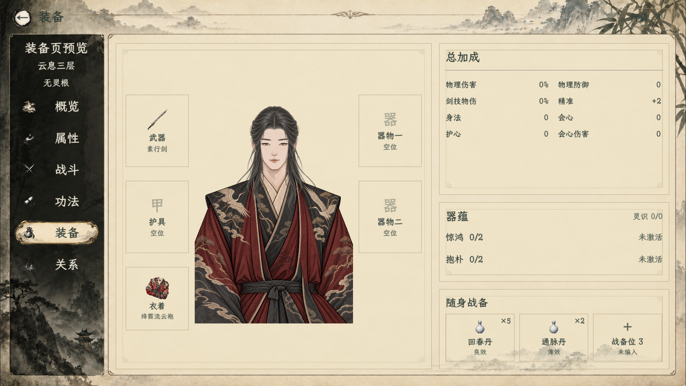
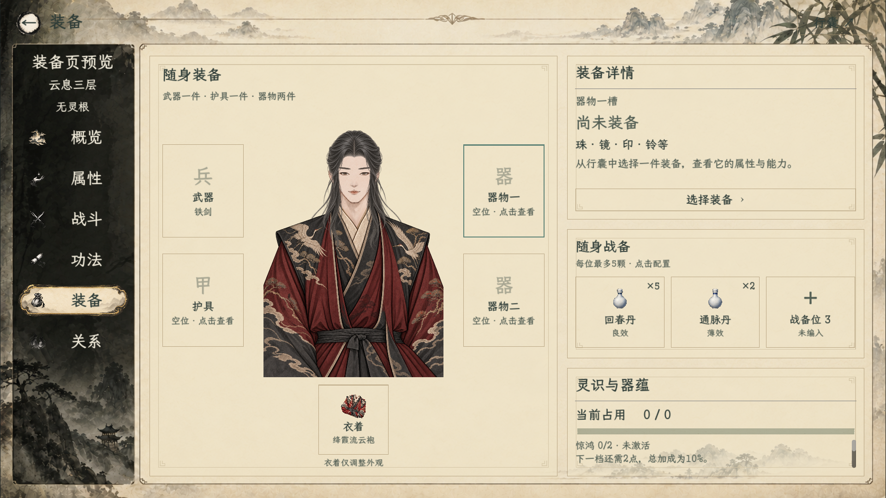
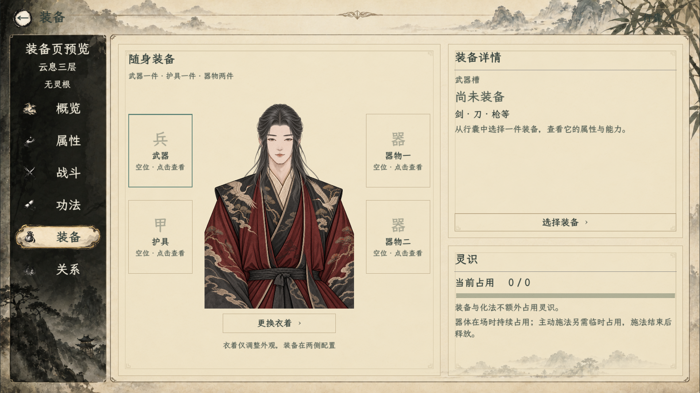
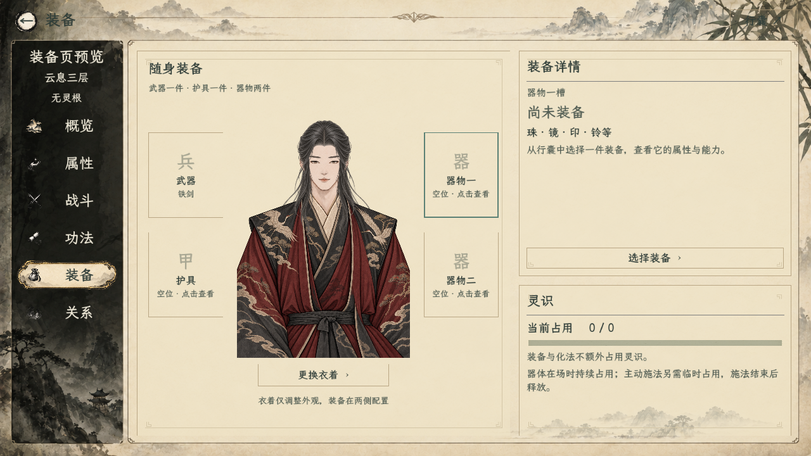

# 装备页四槽改版

## 2026-10-26：汇总布局（当前）

最新修订：用户明确每次测试新建存档，无需旧存档兼容入口；已移除“旧版装备”按钮及其头冠／足履／旧法宝管理选择页。当前装备页只保留武器、护具、器物一、器物二、衣着及战备。下方关于保留旧管理入口的描述为历史记录，不再适用。本次未删除磁盘上的存档文件，也未扩展清理当前器物系统。

用户要求删去顶部说明，右侧只保留总加成、器蕴等汇总，不展示单件器物详情；衣着不再独占立绘下方整行，主页面尽量不用滑条。本次以此修订覆盖下方首次战备布局。

- 左侧去掉“随身装备”“武器一件·护具一件·器物两件”和衣着解释，立绘延伸至下方；衣着格移到护具下方，与左列装备对齐，尺寸154×154，不另占底部横行。空槽仅显示“空位”。
- 右侧依次为总加成 `(788,0,562,370)`、器蕴 `(788,388,562,194)`、随身战备 `(788,600,562,195)`。总加成双列铺开；器蕴直接显示惊鸿／抱朴累计与激活收益，灵识占用简写在标题旁。三战备格继续显示品质与数量。
- 主页面不使用ScrollContainer，不设置内部滑条。删去固定说明和操作提示；详细物品属性、器蕴档位及灵识规则由统一悬停展示。四个装备格点击直接打开原选择／更换入口，不再选中后在右侧重复展示单件详情；旧引用仍有条件管理入口。
- 总加成只汇总当前已接入的实际角色收益：宗门制式武器固定收益、已装备生成剑的基础物防／物伤／剑关键词物伤，以及实际激活器蕴。固定值与百分比区分显示，同源不重复计数；器体和单次技能能力不并入角色常驻属性。旧测试装备有展示字段但未接入角色重算的部分不伪装成已生效收益。本轮不修改装备数值或启用旧属性后端。
- 编译0警告0错误，页面专项35项通过：原衣着与战备配置闭环保留，新增无内部滚动／无重复说明、直接更换、实际制式武器汇总、生成剑与器蕴聚合及反复刷新不叠加检查。1920×1080及1280×720截图均已检查。

[小窗口](汇总布局_20261026/05_右侧战备小窗口.png) · [器蕴激活验证](汇总布局_20261026/06_器蕴激活汇总.png)

## 2026-10-26：首次右侧战备与衣着格（历史）

用户确认把战备放到装备页右侧，并把立绘下方的更换衣着入口改成正式格子。沿用原纸墨背景、细线边框、选中描边及字体。

- 右侧从上到下为装备详情、随身战备、灵识与器蕴。设计坐标分别为 `(788,0,562,310)`、`(788,328,562,244)`、`(788,590,562,205)`，详情和器蕴继续支持滚动，原有装备管理入口保留。
- 随身战备横排三个共用格，常显实际物品图标、名称、丹效档位、数量。点击空格从本人行囊选择；点击已编入物品提供更换、按可用余量增减、移除操作。悬停显示效果，单击只出配置选项。每位最多5颗，同种同档跨格预留总量不能超过本人实际持有；配置不消费、不增毒。
- 配置写入角色现有 `battle_supplies`，与战前页和局内使用共用，正常保存读取。战斗替身的该区域只查看，不能修改本场备药。不自动补满消耗后的数量。
- 立绘下方改为132×132的衣着格，展示当前衣服图标与名称，点击沿用现有换装界面，取消保持原衣着；不新增护具装备位或改变装备属性。立绘高度从536调整为510，为衣着格留出完整区域。
- 首批丹药、容量和扣除规则见[丹药主案12.2～12.4](../../plans/百工技艺/炼丹/云息丹药扩充与旧丹完善提案_20261024.md)。消耗型符箓只保留共用位置的规则，其具体效果仍未开放；应对与打断暂缓。

验收：编译0警告0错误；`EquipmentPagePreview` 专项27项通过，覆盖四装备槽保留、实际衣着图标及换装入口／取消、三战备格、实际点击编入／增减／移除、重复预留限制、库存不变、战前快照、资源保存及战斗编辑锁定。检查1920×1080与1280×720实机截图，本次运行未报引擎错误；完整世界战斗往返不在此次页面专项范围。

[小窗口实机](战备与衣着_20261026/05_右侧战备小窗口.png)

以下保留2026-10-23首次四槽改版记录，其中“撤下战备占位”指当时未接入的旧占位，当前由上述真实共用战备格替代。

2026-10-23，正式角色页 `InfoPanel` 中的装备分页已更新。沿用现有纸墨背景、边框、字体及人物立绘，不生成替换美术。

## 已完成

- 左侧人物及武器、护具、器物一、器物二共四个槽，选中槽以青色描边区分。不存在的物品不伪造图标，使用淡墨字标；有图标的装备读取实际资源。
- 右上随选择展示真实装备名称和基础加成、选择/更换按钮，详情滚动显示；空槽有类别说明。没有适用候选时提示，不清除其他装备。
- 右下展示角色实际灵识占用，说明装备/化法、在场持续与主动施法临时占用的规则；不重复列出四槽。
- 衣着入口保留在立绘下方；撤下旧常规穿戴/法宝双栏及未配置的丹药、符箓占位。
- 旧存档若已装备头冠、足履或旧法宝，显示“查看旧版装备”管理入口。仅重排界面，不清空、迁移或补发物品。

## 接入边界

本次是实际游戏界面改造，现有装备选择仍走 `weapon/clothes/ornament_1/ornament_2`。新炼器快照继续沿已验收的行囊展示路径，不混入旧法宝选择器；新快照装备收益、器蕴汇总、单槽变换和D/T执行并未因页面改造而实现。旧头冠/足履/法宝迁移到新模型需后续明确方案。

## 验收

- `dotnet build --no-restore -v quiet`：0警告，0错误。
- 隔离入口：`res://tools/EquipmentPagePreview.tscn`；创建独立人物，不读写正式存档。
- [运行日志](运行.log)：11条通过，含四槽、移除旧分栏、真实武器属性、槽位切换、无候选不修改武器、旧引用保留和三次截图。
- 检查1920×1080与1280×720实机图，修复物品名称因横向布局未伸展而竖排的问题；最终日志无引擎错误。
- 预览中铁剑为旧资源测试物品，其数值不作为新炼器平衡或公式结果。

