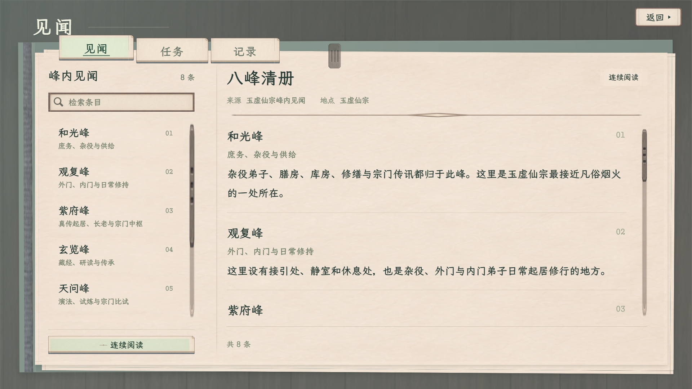

# 见闻／任务／记录 · 案卷清册样稿

2026-11-08，当前修订2，用户同意本版本先保留，未接入游戏；随后继续炼丹独立样稿，仍逐面板验收。采用灰蓝案卷夹、分类纸签、左侧清册和单张阅读页，与百工展开书册及角色厚框区别构图，材质、字级和状态保持同族。

[打开可操作样稿](index.html) · [当前主案](../../plans/界面与美术/见闻任务纸墨木石样稿_20261108.md) · [素材来源](素材来源.json) · [示例数据](示例数据.json) · [浏览器验证](验收记录.json)

本地预览：[8876查看入口](http://127.0.0.1:8876/docs/美术规范/见闻任务纸墨木石样稿_20261108/index.html)。现有服务可直接复用，本目录没有启动或关闭其他面板的服务。

## 完整画面

以下三图只显示游戏画面，隐藏顶部查看工具；右上角统一为“返回 ▸”，三角为独立几何图形，底图沿用同族素材。日历与标题不附昼夜或时辰。

[任务完整画面](任务_完整样稿_1920.png) · [记录空状态完整画面](记录_完整样稿_1920.png)

| 页面 | 1920×1080 | 1280×720 |
| --- | --- | --- |
| 见闻连续阅读 | [完整图](见闻_1920.png) | [完整图](见闻_1280.png) |
| 任务与追踪演示 | [完整图](任务_追踪_1920.png) | [完整图](任务_追踪_1280.png) |
| 记录空状态 | [完整图](记录_空状态_1920.png) | [完整图](记录_空状态_1280.png) |

[见闻单条阅读](见闻_单条_1920.png) · [长正文滚至末尾](见闻_正文末尾_1280.png)

## 可查看的交互

- 见闻、任务、记录分类切换；分类签支持左右方向键、Home和End。
- 目录按标题、正文与地点检索；目录与正文独立滚动。
- 八峰短正文可逐条查看或连续阅读，滚动条、滚轮、键盘均可到最后一段。
- 任务进行中／已完成筛选，追踪／取消追踪及唯一标记。本页演示不会接取、完成或发放任何任务。
- 顶部查看工具可切换空状态、长正文和重置。Esc收起后可继续查看。

## 数据与接入边界

八峰正文逐字摘自现行YuxuPeakInterior；连续阅读只是将八段原文依序排版，不生成新传闻。省略未知的已发现状态与日期。任务采用现行源码中的三份固定文本，演示条件统一为“已入宗的凡人、尚未领取首本”，不是实际角色信息。已完成与记录没有实际夹具，保持空白，不伪造奖励、进度、时间或领取事实。

所有操作仅保留在页面内存；无localStorage、sessionStorage或IndexedDB写入，不读取玩家存档，不连接游戏状态。刷新后恢复初始样稿。正式Journal的旧长正文滚动问题不在本轮修改范围。

## 素材与验证

复用角色／静室修订5六类控件中的短页签、常规／主要按钮和输入槽，以及现有控件图集与藏经阁纸木纹理。只读引用，通过区域伸缩和层叠组成案卷夹；没有改写共享素材或脚本，也没有新增PNG绘制脚本。完整文件和SHA-256见素材来源。

1920×1080与1280×720共60项浏览器检查通过，控制台无页面异常；覆盖原有阅读、追踪交互及右上返回位置、实心小三角与键盘执行。8张窗口截图已更新，另提供3张隐藏查看工具的完整画面；4份正文来源与全部材质哈希复核一致。实际结果见[当前验收](验收记录.json)，原[首版52项](验收记录_首版52项.json)单独留档，不等同于正式游戏验收。
