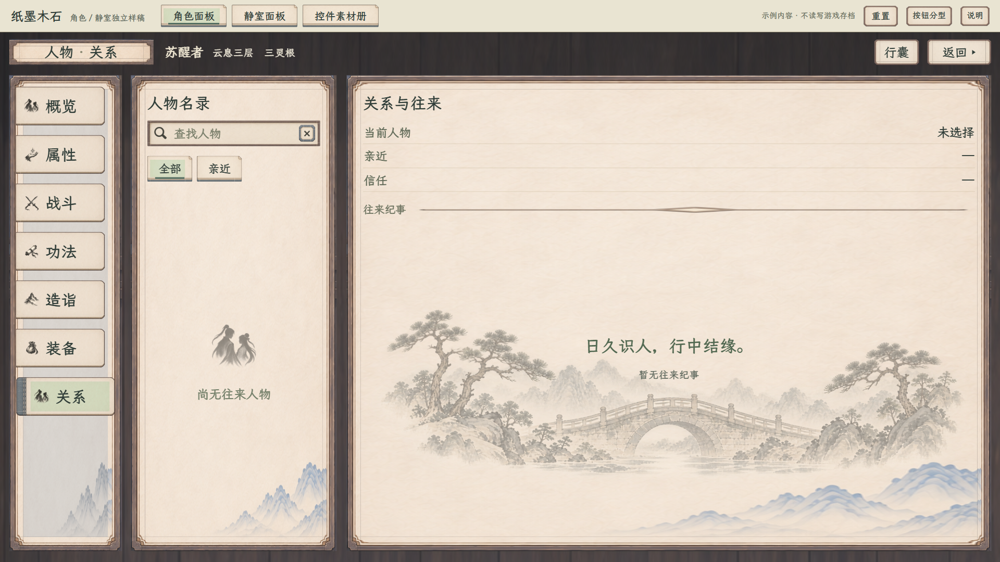
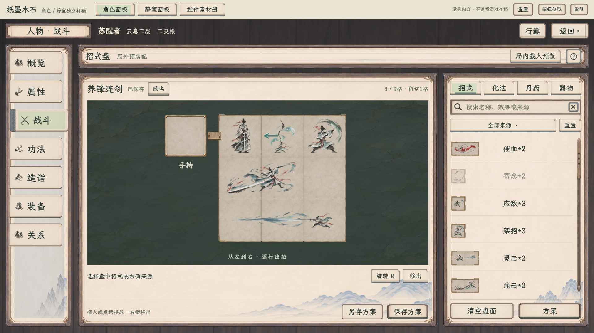
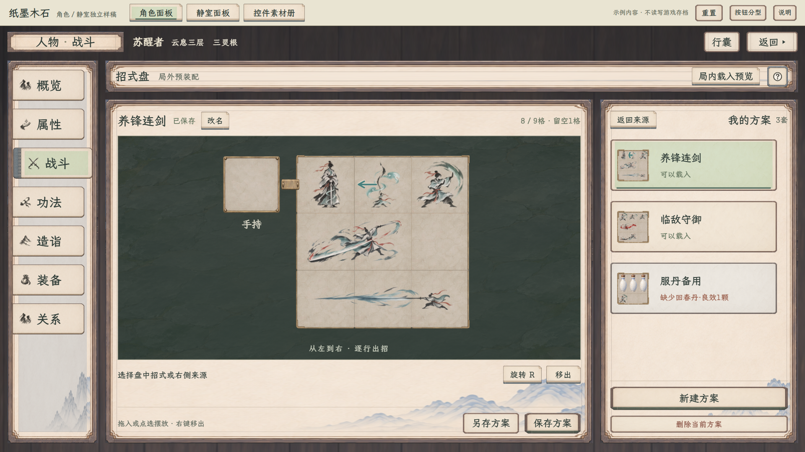
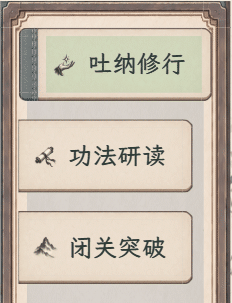
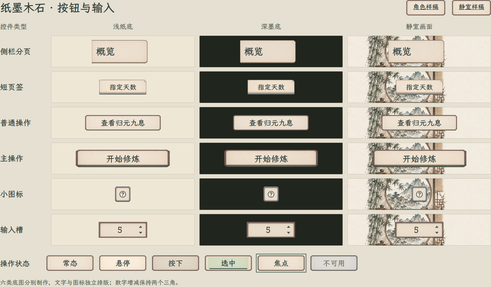
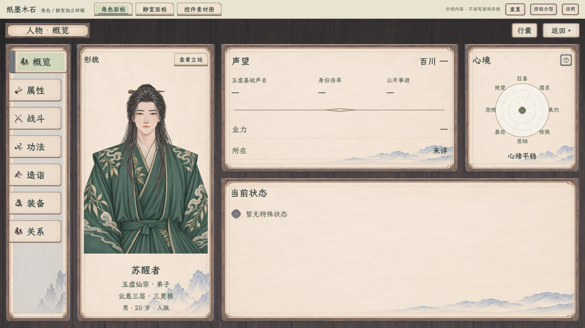
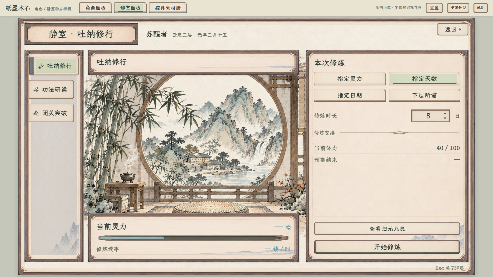

# 角色与静室 · 纸墨木石独立样稿

最新选中效果按用户要求去掉额外细线，改为柔和整纸浅灰绿、略深墨色文字与原纸框明暗。见[无细线对比与两档画面](../整纸选中全页复核_20261109/无细线修订/README.md)；下方早期图仅为对应阶段记录。

2026-11-09选中纸面修正：去除文字后方的中央矩形染色，统一为整张纸签轻染色，角色／静室侧栏与战斗分类共用；滑出与装订边保持。两档窗口及分页切换、悬停、按住已直接核对，未改原PNG。[1280战斗页](战斗_整纸选中_1280.png) · [1920战斗页](战斗_整纸选中_1920.png) · [侧栏近图](侧栏选中_去中央块.png) · [静室近图](静室选中_去中央块.png)。本次是网页残留样式修正，不重计下方历史验收项数。

2026-11-08 · **角色七页已改为无框木底、紧凑页眉，造诣独立为侧栏分页，待查看。** 静室三页沿原样稿；本任务只改独立样稿，善功堂和藏经阁保持，数字增减仍为裸三角，其余控件保留素材。

[当前样稿](index.html) · [角色](index.html#character/overview) · [静室](index.html#quiet/practice) · [控件素材册](index.html#materials/controls) · [按钮分型与底色检查](按钮分型.html) · [范围与规则边界](../../plans/界面与美术/角色与静室纸墨木石样稿_20261108.md) · [本轮验收](验收记录.json)

本地预览地址：http://127.0.0.1:8876/docs/美术规范/角色与静室纸墨木石样稿_20261108/index.html

## 最新：无框木底与独立造诣

角色侧栏现为“概览、属性、战斗、功法、造诣、装备、关系”；[造诣](index.html#character/proficiency)放在功法下面，与战斗平级，战斗正文不再放图谱入口。原木纹铺满整个查看区域，最外层框边及装饰角撤下；侧栏和正文随窗口横向展开，原来两侧的空白也用于主体，不拉宽字形和按钮。顶部题签、人物信息、行囊与返回统一为46高的一行。题签字级26、姓名23，正文高度由777增为845，约增加8.8%。

内部资料、侧栏、按钮继续使用原材质，七页切换保留配招草稿与浏览状态。静室保持原场景和外框。本轮两档156项布局与交互检查通过，另有两档简略公式收起检查；详见[当前验收](战斗新版_验收.json)。此前140／154项记录为旧版子页／页眉范围，不能覆盖当前分页裁定。

## 战斗页预装配与命名方案

[直接打开新版配招](index.html#character/battle) · [本次范围](../../plans/界面与美术/角色战斗页新版招式盘样稿_20261108.md) · [156项专项验收](战斗新版_验收.json)

用户最新追加已落实：造诣移至功法下方的独立侧栏标签，通过侧栏切换保留配招草稿；角色各页的行囊按钮位于固定右上返回的左侧，同高对齐。此条覆盖上轮从战斗按钮进入图谱子页的流程。

- 旧十槽兽战展示换为真实3×3招式盘，完整图标跨格；R转向、拖拽换位、方向键移动、Delete及右键移出。
- 化法只作用于箭头实际指向的紧邻合格招式，无效指向明确提示；二十招、二十化法文案来自现行卡图，费用和份数不另改。
- 右侧默认选招，点击“方案”进入同栏列表。支持不限固定套数、新建、命名、覆盖保存、另存与删除；合法方案一键完整载入，缺项保持当前盘。
- 丹药按一块一颗预留。示例普通行囊有良效回春丹／凝罡丹各2颗；“服丹备用”需3颗回春丹，用于查看缺1颗的提示。世界专用药不进入战斗来源。
- “局内载入预览”只操作独立副本，不回写局外草稿或已保存方案；未绑定的资源显示“— / —”。外围唯一手持位预留，新器物能力未在本次补定。
- 方案只保留在本次查看中，切分页保持；刷新或顶部重置恢复示例。不读写正式旅程、浏览器存储或战斗账本。

| 新版状态 | 1920×1080 | 1280×720 |
| --- | --- | --- |
| 默认配招 | [完整图](战斗新版_配招_1920.png) | [完整图](战斗新版_配招_1280.png) |
| 独立造诣 | [完整图](角色_造诣_1920.png) | [完整图](角色_造诣_1280.png) |
| 方案子页 | [完整图](战斗新版_方案_1920.png) | [完整图](战斗新版_方案_1280.png) |
| 局内载入副本 | [完整图](战斗新版_局内载入_1920.png) | [完整图](战斗新版_局内载入_1280.png) |
| 详细悬停 | [完整图](战斗新版_详细悬停_1920.png) | [完整图](战斗新版_详细悬停_1280.png) |
| 简略悬停 | [完整图](战斗新版_简略悬停_1920.png) | [完整图](战斗新版_简略悬停_1280.png) |

两档156项布局／交互／回归通过，另检查两档简略公式收起。涵盖无框木纹全覆盖、紧凑页眉同高、正文空间、独立造诣顺序及选中、鼠标真实拖放、碰撞／越界保持、份数／库存、输入校验与转义、覆盖与草稿隔离、局内副本、完整长悬停、角色七页／静室三页及减少动态效果；无脚本错误或素材404。[导出的43项当前定义](battle-data.json)包括[二十招与二十化法](../../卡牌词典/招式盘/README.md)、周天指示和两种丹药；药品效果读取当前药品目录，库存是明确的排版夹具。

盘面复用[39逐格素材](../局内战斗布阵与开战理想图_20261107/39_首批素材与验证.md)，暗石底复用现有战场石材，按钮继续使用本样稿的六类底图。无需新生成位图。下方205项和侧栏动图是修订5历史记录，不能当作本次新盘验收。

最新导航调整：静室三页右上角统一为“返回 ▸”，小实心三角位于文字右侧，与休息共用样式；年月日不附时辰。保留原离开确认、角色行囊与侧栏动效。见[当前静室完整图](静室_首页.png)和[统一返回专项验收](统一返回验收.json)；下方205项是修订5历史回归与侧栏动效记录。

## 修订5：保留的侧栏调整

- 侧栏选中后纸签和文字一起右移，露出左侧装订边；取消选中时收回隐藏。切换分页保持连续动画，角色／静室同步，键盘与快速往返也保持正确状态；减少动态效果模式直接切到终态。
- 本轮只改变侧栏动效，复用原PNG；六类底图和其他页面内容保持。

[角色侧栏动图](角色_侧栏动效.gif) · [动效参数](侧栏动效参数.json) · [42项专项验收](侧栏动效验收.json)

### 沿用的六类素材

- 六类底图分别生成：侧栏装订页签、短纸签、普通操作、主操作、灰青石小图标底座、内凹输入槽，按用途与大小适配。
- 替换修订3统一按钮取样及裁角方案。使用生成图的真实Alpha，清除低透明度背景噪点；浅纸、深墨和静室三种底色及三倍边缘图均已查看。
- 字和图标继续独立，数字增减只用两个三角；本轮仅换控件材质，上一轮资料去重、声望恢复、心境缩小、局外Buff留白和静室删减保持。

[放大查看六类边缘](按钮边缘_三倍.png) · [底图与完整提示词](assets/按钮分型_v4/README.md)

## 当前首页

## 当前图集

| 角色 | 大窗口 | 小窗口 |
| --- | --- | --- |
| 概览 | [1920](角色_概览_1920.png) | [1280](角色_概览_1280.png) |
| 属性 | [1920](角色_属性_1920.png) | [1280](角色_属性_1280.png) |
| 战斗（新版） | [1920](战斗新版_配招_1920.png) | [1280](战斗新版_配招_1280.png) |
| 功法 | [1920](角色_功法_1920.png) | [1280](角色_功法_1280.png) |
| 造诣 | [1920](角色_造诣_1920.png) | [1280](角色_造诣_1280.png) |
| 装备 | [1920](角色_装备_1920.png) | [1280](角色_装备_1280.png) |
| 关系 | [1920](角色_关系_1920.png) | [1280](角色_关系_1280.png) |

| 静室 | 大窗口 | 小窗口 |
| --- | --- | --- |
| 吐纳修行 | [1920](静室_吐纳修行_1920.png) | [1280](静室_吐纳修行_1280.png) |
| 功法研读 | [1920](静室_功法研读_1920.png) | [1280](静室_功法研读_1280.png) |
| 闭关突破 | [1920](静室_闭关突破_1920.png) | [1280](静室_闭关突破_1280.png) |

[局外Buff示例1920](局外Buff_1920.png) · [局外Buff示例1280](局外Buff_1280.png) · [淡青缕数](灵力缕数_1280.png) · [日期输入](日期输入_1280.png) · [确认弹窗](确认弹窗_1280.png) · [深墨悬停](深墨悬停_1280.png) · [素材册1920](控件素材册_1920.png) · [素材册1280](控件素材册_1280.png)

“重伤”图只引用现有定义：正式战斗生命上限暂降15%，云息累计休息120小时恢复。它是临时排版夹具，默认仍为空状态，未向实际人物添加状态，不增加新状态或叠加规则。

## 素材与边界

六类按钮与输入底图使用[新分型素材](assets/按钮分型_v4/README.md)，已用于角色六页、静室三页、预览工具栏、素材册及各浮层。图标、文字、交互和业务含义独立；普通控件不会因尺寸改变而一律复用同一个取样。数字增减为用户要求的裸三角例外。

[分型索引](assets/按钮分型_v4/按钮分型索引.json) · [完整生成提示词](assets/按钮分型_v4/完整提示词.txt) · [透明通道分析](assets/按钮分型_v4/透明通道分析.json) · [素材来源与哈希](素材来源.json)

其余框体、纸页、题签、勾选／单选、进度、滚动、节点、槽位、深墨提示、弹窗与通知继续引用原有素材。[原20区索引](控件素材索引.json)及[旧补充图集](assets/控件补充图集_v1.png)保持。新图由内置图像生成工具分别制作，原PNG按字节保留，不以脚本重绘；显示时连续清除低Alpha背景噪点，不使用矩形底色遮挡或旧的轮廓裁角。

[示例数据](示例数据.json)仅用于排版，未绑定字段留“—”。所有业务按钮只展示样式，不学习、装配、修炼、扣费、推进时间或写存档／浏览器存储。原立绘、静室唯一背景、正式卡牌、装备和状态数据保持。

两档窗口本轮163项回归与42项动效专项，共205项通过，见[当前验收](验收记录.json)。[修订4的163项](验收记录_修订4_163项.json)、[修订3的140项](验收记录_修订3_140项.json)、[修订2的103项](验收记录_修订2_103项.json)与[首版112项](验收记录_首版112项.json)属历史范围，延后页面的旧截图不再列入当前图集。浏览器检查不代表正式Godot已接入。
