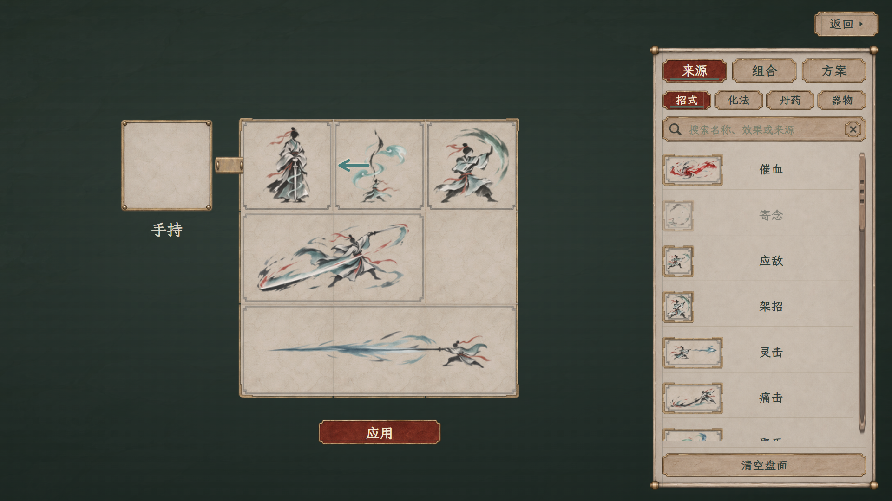

# 战斗页：当前应用与全屏配招

> 方案最新修订见[逐项应用与命名保存](../人物与局内配招统一_20261109/方案列表修订/README.md)：右侧只留方案列表，每项“应用、改名”；盘下“保存为方案”命名确认，旧底部新建／覆盖／另存／删除按钮撤去。保存不自动应用，列表“应用”直接更新当前开局副本。仍为人物样稿内存。

> 最新布局见[清册与紧凑盘修订](../人物与局内配招统一_20261109/紧凑与清册修订/README.md)：首页仅已学与持有清单，五类按钮采用“配招”同款边框；当前应用移入配招，盘缩小、局内资源栏放盘下。配招保留原页暗幕，局内只载入；以下121项及画面为历史记录。

2026-11-08版 · 独立布局样稿，待用户查看。人物面板由另一个对话维护，本轮只修改战斗组件与战斗专用查看入口。

[打开可操作样稿](battle-workspace.html) · [现行流程与规则边界](../../plans/界面与美术/战斗配招全屏应用与组合方案_20261108.md) · [本轮验收](战斗配招新版验收.json)

## 本次布局

- 战斗首页只显示当前应用的整盘、名称和“配招”，撤去组合／方案展示区及管理入口。
- 配招覆盖整个窗口，采用局内的浮置盘面、紧凑纸卷来源栏及右上“返回 ▸”；撤掉主盘大纸框、标题、副标题及常驻旋转／移出／多选／保存组合操作排。
- 右栏切换来源、组合、方案。来源按实际占形显示，组合保存局部搭配、方案保存整盘；所有详细管理都在全屏页内。
- 盘下仅保留“应用”及必要的操作反馈。应用才更新默认开局副本；返回或点裸露背景保留草稿，不应用。
- 每一份盘内对象都有一圈材质边框，多格对象整体围框；选中再叠加强调。盘格、图标与素材来自既有素材，不重绘源PNG。

## 操作

1. 来源可以拖入，也可先点选再点落点。拖动中R或右键转向，盘内显示完整落点预览，盘外显示跟随图案；松手才写入草稿。
2. 盘内对象拖出卸下，放不下时回原位；Esc取消拖动。原位只隐藏正在拖的那一份，来源拖出取消新增，不在下一次点空格时误摆。
3. Shift或Ctrl点选多份，再到“组合”页保存；可命名、同名覆盖、改名、删除。拖入组合保留相对坐标和朝向，盘内多选也可整体移动。空隙不作为组合占格。
4. “方案”页可载入、新建、改名、覆盖、另存和删除整盘。缺来源、超份数、重叠、越界或缺药时整盘保持；方案载入回来源页，应用仍需另点。
5. 点击“应用”返回首页，默认开局改为这份草稿的独立副本。返回不应用，删除组合或方案也不影响已经应用的配置。

## 两种窗口

| 页面 | 1920×1080 | 1280×720 |
| --- | --- | --- |
| 当前应用 | [查看](战斗布局定稿_当前应用_1920.png) | [查看](战斗布局定稿_当前应用_1280.png) |
| 配招／来源 | [查看](战斗布局定稿_来源_1920.png) | [查看](战斗布局定稿_来源_1280.png) |
| 组合管理 | [查看](战斗布局定稿_组合_1920.png) | [查看](战斗布局定稿_组合_1280.png) |
| 方案管理 | [查看](战斗布局定稿_方案_1920.png) | [查看](战斗布局定稿_方案_1280.png) |

## 验证与边界

[验收记录](战斗配招新版验收.json)分为两组，合计121项通过，0项失败：

- 115项交互检查覆盖两档窗口、首页精简、全屏尺寸、材质框、右键转向、抓取预览、取消／越界／拖出、待摆清理、多选目标同步、组合保存与覆盖、方案新建／改名／覆盖／删除、应用副本及模板隔离；未发现脚本错误、素材请求失败或浏览器存储写入。
- 6项截图及宿主兼容检查覆盖两档右栏固定控件边界、原角色样稿仍可挂载战斗组件、配招全屏及返回；没有对人物外层或其他分页重新验收。
- 两个战斗脚本通过语法检查，八张干净截图已经实际查看；旧156项及中间版本验收均不计入本轮121项。

当前仍是网页交互样稿。方案与组合只在本次查看中保存，刷新恢复示例。`RoleBattle.getOpeningConfiguration()`返回已应用的独立副本，正式战斗开始入口、角色存档、真实库存与消耗尚未接入；本轮不把此接口验证当成原生实装完成。

本轮代码范围为`battle-preview.js`、`battle-preview.css`、新增的`battle-workspace.html`和`battle-workspace.js`。人物公共外层、原生战斗、卡牌数值和源素材不在本轮改动范围。
