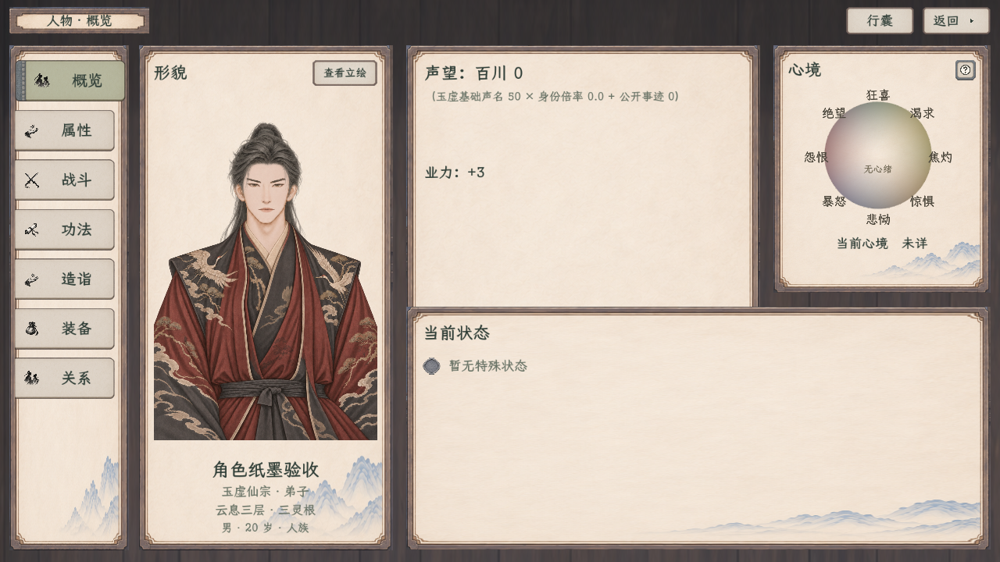

# 角色七页纸墨木石接入

2026-11-08。按用户最新范围“先实装人物七页和按钮，战斗配招等另一对话验收”，本页记录角色公共外观、七页与按钮接入。现已正式接入，统一构建0警告0错误；1280／1920两档原生各216项、共432项通过，34张完整图已生成，七页及重点浮层已逐项目视核对。权威范围见[七页原生接入](../../plans/界面与美术/角色纸墨木石七页原生接入_20261108.md)。

正式入口继续使用 `InfoPanel.tscn`，概览、属性、战斗、功法、造诣、装备、关系均绑定当前人物。造诣从战斗子页移到功法下独立侧栏入口，图谱、脉面、缩放、真实资格与参悟回调保留。原生控件采用已确认的纸面、木石框和分型按钮，生产资源均从 `textures/` 读取，原网页样稿保持。

最外层取消框边与装饰角，原图集的深木区域直接铺满窗口。角色画布按窗口高度等比适配，逻辑宽度使用实际横向空间；正文左232、右16、上76、下20设计单位。页眉题签、姓名、境界、灵根、行囊与返回统一为顶部12、46高、22字级的一行，文字垂直居中。

概览基本资料集中在真实立绘下方，页眉不重复姓名、境界及灵根。声望和业力保留原数据来源；按用户2026-11-09最新反馈去掉“所在”整行。右侧心境收紧，下方局外状态保留948×383设计区域，继续读取正式状态记录、恢复信息与来源。当前运行尚无可绑定的八维持久心绪时如实显示“未详”，不把网页夹具的平稳落点写入人物。

属性页保持原值及悬停提供者，灵力数值与“缕”为淡青色。基础属性改为单行名值，保留社交、战斗、修行及造诣检索。战斗页保留当前正式技能目录、兽战装卸与化法；已取消的攻伐／术诀／守御分类不再作为玩家筛选。此次不接新预装配、全屏配招或局部组合，不改变当前人类招式盘或混合兽战流程。功法页保留真实待研读／已学秘籍、主辅修、卷章、修持、化法、习得和原研读入口。

装备页保留现行武器、护具、两个饰物字段、独立衣着、器蕴及战备入口。网页四块布局涉及尚未迁移的双护具接口，本次不把新视觉分类强行绑定旧槽，也不删除已有操作或改装备收益。关系页继续读取已记录人物、真实关系与往来，不生成初始关系条目。共用InfoPanel的NPC只读信息、探查快照和交谈／交易入口保持。

侧栏选中时纸签、文字和图标右移18设计单位，220毫秒缓出；装订边140毫秒显隐。切换不销毁侧栏，快速往返从当前进度继续。右上保留行囊入口，并列显示“返回”与小实心右三角；返回沿原收起与解绑行为。

普通选择、操作和书目显式使用 `PaperButtonFeedback` 的Regular原纸面，选中对整纸轻染、文字维持深墨；按住下沉1设计单位，释放恢复。导航、图标与输入仍按用途使用各自形制，不再根据按钮宽度切换旧折角Tab。角色衣着弹层由角色入口显式启用同族皮肤，其他衣着入口保持原默认。

## 验证入口

- 专属场景：[CharacterPaperUiSmoke.tscn](../../../tools/CharacterPaperUiSmoke.tscn)。
- 专属检查：[CharacterPaperUiSmoke.cs](../../../csharp/debug/CharacterPaperUiSmoke.cs)。
- 1280×720默认，1920×1080使用 `--wide` 或 `--paper-width=1920`。
- 必须将APPDATA隔离在项目 `tmp/`、`output/` 或 `.godot/test-results/` 下；场景在创建人物页前检查用户目录，拒绝玩家实际目录。
- 使用内存人物、当前待研读秘籍、现有装备与现行重伤定义检查真实显示；真实参悟和装备操作只写本场景内存人物，不读取旅程，不保存人物，不开战、不制卡、不推进时间。
- 通过原生鼠标覆盖七页切换、导航终态、正文扩展、五态纸面、瞬时按住、秘籍筛选与选择、图谱全部现有根节点参悟、原兽战装卸、装备选择／卸下、衣着取消、NPC交谈／交易与探查快照、行囊及返回。
- 运行后分别输出 `验证记录_1280.json`、`验证记录_1920.json` 及七页、按钮、衣着、NPC和局外状态完整图。最终结果见[合并验收](验收记录.json)、[1280逐项](验证记录_1280.json)、[1920逐项](验证记录_1920.json)及[编译](编译.log)；两次均退出0，使用固定GPU SubViewport。

## 素材来源

共用[生产素材清单](../../../textures/ui/crafting_paper_20261108/sources.json)中的原批准PNG。内部面板只在内存按样稿原九区取样，未生成替代PNG；无框深木底直接读取原框图集的既定区域。导航原PNG逐字节复制，新增类型与装订边不改变已接炼丹五类控件或输入框行为。

字体为项目原 `LXGWZhenKaiSlabGB-Regular.ttf`；导航、属性图标及真实人物渲染、关系桥图均复用正式资源。善功堂、藏经阁、百工、见闻、静室、休息和炼器文件未由本分线改写。

## 原生完整图

2026-11-09追加：分割线改普通细直线，问号在图标按钮水平／垂直居中；NPC属性快照补齐浅纸底。先前图谱夹具与滚动外点击问题已修正，最终432项全部通过；不以此前失败记录冒充完成。

| 页面 | 1920×1080 | 1280×720 |
| --- | --- | --- |
| 概览 | [完整图](角色_概览_1920.png) | [完整图](角色_概览_1280.png) |
| 属性 | [完整图](角色_属性_1920.png) | [完整图](角色_属性_1280.png) |
| 战斗 | [完整图](角色_战斗_1920.png) | [完整图](角色_战斗_1280.png) |
| 功法 | [完整图](角色_功法_1920.png) | [完整图](角色_功法_1280.png) |
| 造诣 | [完整图](角色_造诣_1920.png) | [完整图](角色_造诣_1280.png) |
| 装备 | [完整图](角色_装备_1920.png) | [完整图](角色_装备_1280.png) |
| 关系 | [完整图](角色_关系_1920.png) | [完整图](角色_关系_1280.png) |
| 衣着_原生弹层 | [完整图](角色_衣着_原生弹层_1920.png) | [完整图](角色_衣着_原生弹层_1280.png) |
| NPC_属性快照 | [完整图](角色_NPC_属性快照_1920.png) | [完整图](角色_NPC_属性快照_1280.png) |
