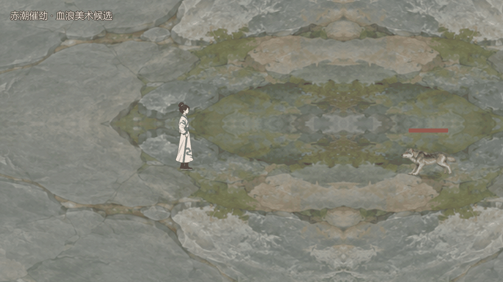
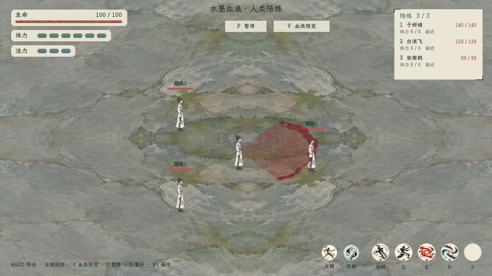

# 赤潮催劲：扇形血浪与水墨拖尾

2026-11-05材质补充：[战斗特效水墨统一](../战斗特效水墨统一_20261105/README.md)继续柔化血浪浓边和墨色分布，几何、人物圆心与手高约定保持。正式新版秘籍血浪已另按[即时实装主案](../../plans/战斗与构筑/百骸云息篇即时实装与自选对练_20261104.md)接入判伤；本页V键入口仍用于独立视觉预览。

2026-11-04后续实装：[新版秘籍自选对练](../../plans/战斗与构筑/百骸云息篇即时实装与自选对练_20261104.md)已接入0.78秒扩散判伤和击退。本页及V键入口仍记录独立美术样片，下面“未接入”描述仅指该纯视觉入口。

2026-11-04，独立美术候选。依据用户本轮明确要求：血浪为扇形向外扩散，经过处保留拖尾，并带水墨质感。此前生成的侧向卷水浪不符合扇面要求，已弃用，未加入项目资源。

## 当前表现

- 本轮最新裁定：**中心保持人物中心，只取实际手部高度，不采用手骨的横向位置。** 放浪时保存人物圆心和手高，整片血浪、淡墨余迹及散墨共同上移；此前贴地血浪的表现由本条覆盖。
- 从出手圆心向前展开120°扇面，弧形浪头由近及远扩张。预览半径沿新版图谱220单位，支持360°任意出手方向，不改变技能的120°扇面。
- 按当前侧向略俯视镜头呈现：先确定水平方向，再统一压缩纵深，整个平面抬至出手时的手部高度。鼠标瞄准也从抬高后的圆心计算。当前样片沿用0.46纵深投影及14单位浪头起伏；这两项是美术参数，手高读取实际人物骨骼而非固定新数值。
- 浪头较浓，后方保留已扫过的淡血墨扇面。各半径的余迹按经过时间分别淡散，浪头离开后仍能看到路径，之后完全消失。
- 暗朱、酒红墨色，以不均匀墨带、破边、飞白和细孔表现浓淡及晕染。全程透明混合，不使用发光叠加或实心血墙。
- 形状由原生扇形几何控制，水墨材质由确定性多尺度噪声生成。本候选未采用图像生成的序列图，不依赖外部位图。

## 边界与现行来源

[新版秘籍入口](../../秘籍词典/drawio/新版秘籍/README.md)及其中《百骸衍枝化生宝册·云息篇》图谱仍为当前待审稿。赤潮催劲的费用、气血条件、6秒强化、末段触发、伤害与化法规则均未修改。

图谱明确血浪飞行细节待定，因此本轮只做独立视觉候选，不接入战斗命中、伤害或资源结算。预览中的扩张、拖尾及消散时长为可调美术参数，不作为正式弹速或判伤时机。未增加属性、资源、关键词、射程、位移、返费、抽牌、额外行动或资源生成。

这类离身血浪的余迹固定在释放时的人物圆心和手高；人物后续移动、转向或手势变化不带走已扫过的路径。显示层级按释放时人物的地面前后顺序处理，不再把整片血浪压在所有人物脚下。

## 可复用水墨粒子

用户本轮追加要求：以后招式、拖尾应复用基础水墨表现。共用层只负责视觉，提供三种预设：

| 预设 | 表现 | 复用方向 |
| --- | --- | --- |
| ground | 贴地、低速、浅墨晕染 | 冲刺残墨、落地墨点；当前手高血浪不调用 |
| fleck | 有短促初速、略微抬起的碎墨 | 浪头飞白、掌风边缘、剑气破墨 |
| mist | 缓慢漂移、扩大并淡出的软雾 | 血浪悬空余迹、血气消退、气劲尾端、运功气息 |

粒子以固定种子和独立视觉时钟驱动，不消耗战斗随机数；颜色、大小、寿命、漂移及投影可调。已经发出的粒子保存在世界位置，节点移动或转向不会带走旧拖尾。采用有上限的数据池，结束及取消时可统一清理。此基础不负责判伤、范围、位移或任何状态。

## 文件与运行

- [独立表现节点](../../../tools/action_battle_test/blood_wave_vfx.gd)
- [水墨材质](../../../shaders/blood_wave_ink.gdshader)
- [通用水墨粒子层](../../../tools/action_battle_test/ink_particle_layer.gd)
- [实际角色、石地与镜头预览](../../../tools/blood_wave_ingame_preview.gd)
- [一键运行当前NPC演练](../../../tools/run_blood_wave_preview.cmd)
- [八方向投影核验](../../../tools/blood_wave_direction_capture.gd)
- [俯视／浅斜视几何对照](../../../tools/blood_wave_preview.gd)
- [实拍帧编码工具](../../../tools/encode_blood_wave_preview.py)

## 游戏入口与人类NPC

首页 **试演与预览 → 战斗与特效 → 血浪 · 水墨特效演练（人类NPC）**。新场景复用现有一对三演练及三名独立凡人NPC，保留其追击、拳掌、痛击、架招、错步及独立资源／冷却；不生成世界人物、奖励或存档变更。

- P开始、暂停或继续；WASD移动，鼠标指向任意方向。
- V或上方“血浪预览”按钮放出纯视觉血浪，现有左键连招等战斗照常。
- T同组重开；F1查看操作，F2判定对照，Esc关面板或返回首页。
- 暂停冻结血浪及粒子时钟；重开、胜负与退出清理全部余迹。已释放路径固定在世界位置。

血浪尚未接入伤害、气血消耗或赤潮催劲强化；V是特效预览操作，不新增0费攻击或技能资源。原玩家六招、NPC四招与当前规则保持。

首页原19项平铺改为四个折叠分组：默认展开战斗与特效，另有“人物与衣装”“修行与工坊”“世界与界面”。撤下被当前侧向演练覆盖的“动作战斗试玩（独立样例）”“动作战斗试玩（新分件实验）”两个重复入口，底层场景与回归工具保留。新增血浪入口后现有18项预览，其余有用功能均归组保留。

[新演练场景](../../../tscn/scene/BloodWaveNpcTrialScene.tscn) · [演练扩展](../../../tools/action_battle_test/blood_wave_npc_trial.gd) · [操作界面](../../../tools/action_battle_test/blood_wave_npc_hud.gd)

用于录制的独立脚本`blood_wave_ingame_preview.gd`另外支持鼠标左键指定方向、空格重播、左右方向键及Esc退出；这些录制控制不用于上述NPC场景。命令行`--direction-deg=45`可固定斜向采集，`--capture-dir=绝对目录 --frames=96 --fps=30`采集一段完整样片。

## 验证与预览

[八方向连续核验](eight_directions/blood_wave_ink.gif) · [八方向静帧](eight_directions.png)

[整理后的首页入口](menu_grouped.png) · [演练操作页](npc_help.png)

当前截图及上方连续预览已更新为手高版本。[左向实机画面](hand_height_left.png)与右向共用人物圆心，手部横向偏移不参与圆心计算。八向对照图仅核验水平扇面及投影形状。

1. **效果、数值、费用与目标**：不编辑技能数据、伤害、资源、冷却或目标；沿用当前待审图谱的120°／220表现边界。NPC使用原四招和人物生成规则，玩家保留六招。
2. **规则边界**：未增加属性、资源、关键词、射程、位移或控制。360°表示任意出手朝向；各朝向仍是120°扇面。纵深压缩与浪头高度仅为美术参数。
3. **零费与资源限制**：视觉预览不形成技能、不触发命中、返费、抽牌、额外行动或资源生成；原战斗限制保持。
4. **数据与展示**：正式技能数据及词典图稿保持；新场景按钮和帮助明确“血浪特效预览”。早期卷水浪图未加入工程。
5. **验证**：八方向×6个时刻读取195552个实际网格顶点，168项范围／角度／生命周期检查通过。78帧实际窗口逐像素检查34项通过：最大反投影半径214.9114、最大半角59.9696°；浪头散去后八向均有余迹，首末帧整图完全一致。共用粒子36项通过：三预设共24颗，在父节点平移、旋转、非均匀缩放后图像逐像素不变；清理后与空白帧一致。96帧同场景采集另有90项战斗状态与结束清理检查通过。

NPC新入口41项通过，涵盖首页进入、三名NPC及四份人物状态、真实AI推进、V预览无数值变化、暂停冻结、移动后原位留痕、T同组重开、结束清理及Esc返回；原人类NPC入口9项回归通过。菜单C#构建0警告、0错误，新的场景与HUD实际渲染正常。

手高修订专项78项通过：八方向×3个时刻，97776个实际顶点与464个粒子均只按高度上移，横向保持，最大网格／粒子平移误差小于0.00004单位。真实NPC场景确认人物圆心保持、手高实时读取、旧波圆心／高度及粒子在移动转身后不变，新波读取新姿态，暂停与清理正常。新版入口41项回归和78帧／90项状态隔离采集再次通过；本轮不涉及新的伤害、费用、目标、状态或技能数值。

[手高专项日志](../../../output/blood_wave_hand_height_20261104.log) · [新版NPC入口回归](../../../output/blood_wave_npc_hand_plane_regression_20261104.log) · [手高版连续采集](../../../output/blood_wave_hand_plane_motion_20261104.log)

日志：[八向几何及采集](../../../output/blood_wave_eight_directions_20261104.log)、[实际像素](../../../output/blood_wave_pixels_20261104.log)、[粒子池及世界锚点渲染](../../../output/ink_particle_smoke_20261104.log)、[同场景战斗状态隔离](../../../output/blood_wave_ink_ingame_final_20261104.log)、[新NPC入口41项](../../../output/blood_wave_npc_trial_20261104.log)、[原人类NPC入口9项](../../../output/blood_wave_human_menu_regression_20261104.log)。早期独立采集启动包含工程原有外观MOD备份缺件警告，本轮未发现血浪脚本或材质错误。
