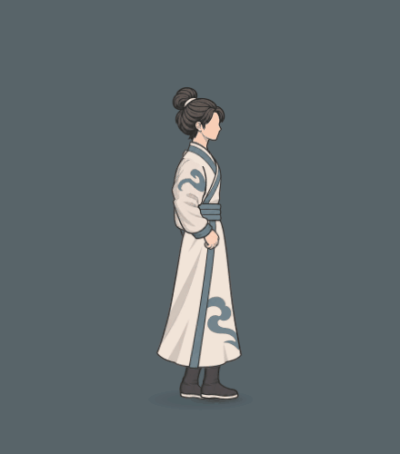

# 跑动衣摆后飘与停步回落

本页为上轮交替摆臂版本。用户本轮已确认连同手臂参考本机《鬼谷八荒》持架跑姿，当前入口与动态见[鬼谷持架跑姿与衣摆](../鬼谷持架跑姿与衣摆_20261104/README.md)；下方原生资料保留为真实旧版对照。

本轮只修衣摆：持续跑动时向真实移动方向后方展开，松键后保留余势，再自然回垂。已经确认的倾身、交替摆臂和扩大腿幅保持。

- [新版近景：跑动3秒＋松键回落2秒](新版衣摆_跑动3秒与松键回落2秒_近景.gif)
- [实际局内：完整跑停5秒](新版衣摆_跑动3秒与松键回落2秒_实际局内.gif)
- [原v3与新衣摆：同输入5秒对照](原v3与新衣摆_同输入跑停5秒.gif)

三段GIF均为75帧／5秒。近景440×500，局内880×600；128色、无抖动编码，原PNG直接来自游戏渲染。主片完整保留松键后的两秒，没有用纯跑动循环代替回落。[四相位](起步_持续后飘_松键余势_回垂四相位.png)依次为起步、持续后飘、松键0.1秒余势及停步约2秒；另有[实际尺寸未缩放裁切](实际尺寸未缩放_跑停四相位.png)。

左侧对照使用本轮修改前的真正v3跑动源码，未替换成更早的固定持手方案。同输入192帧中，双臂、腿、骨盆、躯干及头颈的骨点与骨角差均为0；原静止近景逐像素一致。后片的后飘轮廓已明显展开，松键后约0.1–0.3秒仍有余势，约0.6–1秒回垂，2秒基本稳定；腰部连接及自然露腿保留。

独立短录沿用首页试玩基准114，体力始终6、气血100。敌人初始在身后650，AI和共同镜头按原规则推进；没有改游戏移速、战斗或镜头规则。主段后另记录短后退、转向与停步，可查看[转向中](new_0164.png)和[转向后回落](new_0191.png)。[专项检查](衣摆后飘与停步物理检查.json)通过前后移动、停步衰减、地面余量、暂停、转向世界连续性及重置检查。

根代理已目视最终跑停关键帧，并在同一最终源码上通过主试玩入口45帧及大世界共享接口12项。只读研究另见[鬼谷衣摆结构复核](鬼谷衣摆结构复核.md)与[鬼谷整体步态骨骼复核](鬼谷整体步态骨骼复核.md)，本轮没有据此重做已经确认的跑姿。

源、轨迹与身体不变验证见[记录](衣摆跑停与身体不改动记录.json)及[逐帧原始数据](frames.jsonl)。捕捉来源：`tools/action_battle_test/output/running_cloth_return_final/`。旧v3可加载基准位于 `tools/action_battle_test/reference_walk_run_v3_cloth_baseline_20261104.gd`，SHA256为 `1DABA5359212C43277861C2C8E5ECCCE2A068E3AE5A8949D9C2D716EBB0D735A`；新版衣摆SHA256为 `8F231A7F034902910E5B7520B7BA761C1FD9F9306672C3C25BC457E3EBBAF859`。
