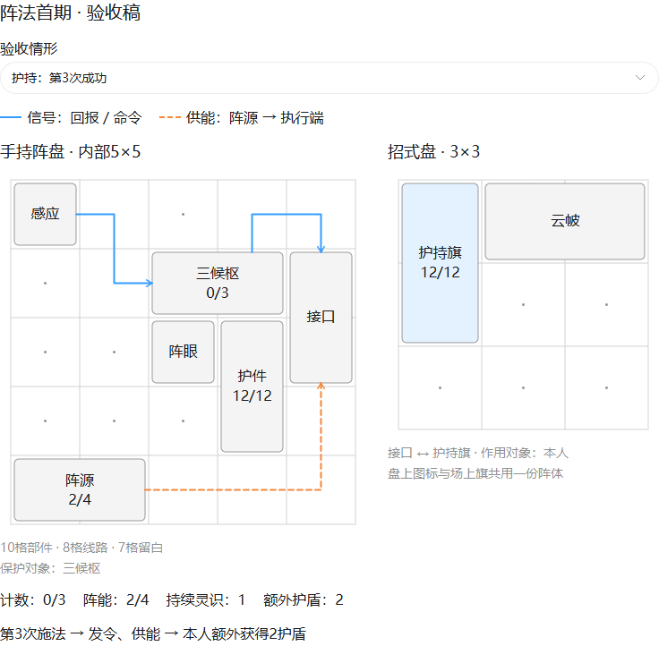
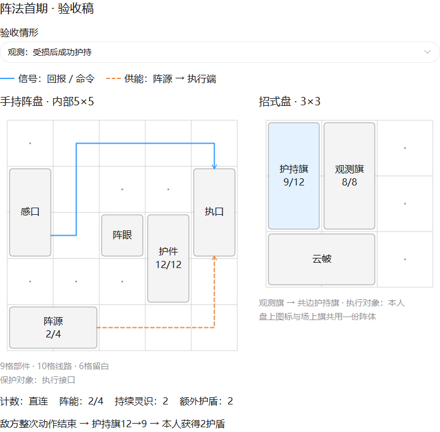
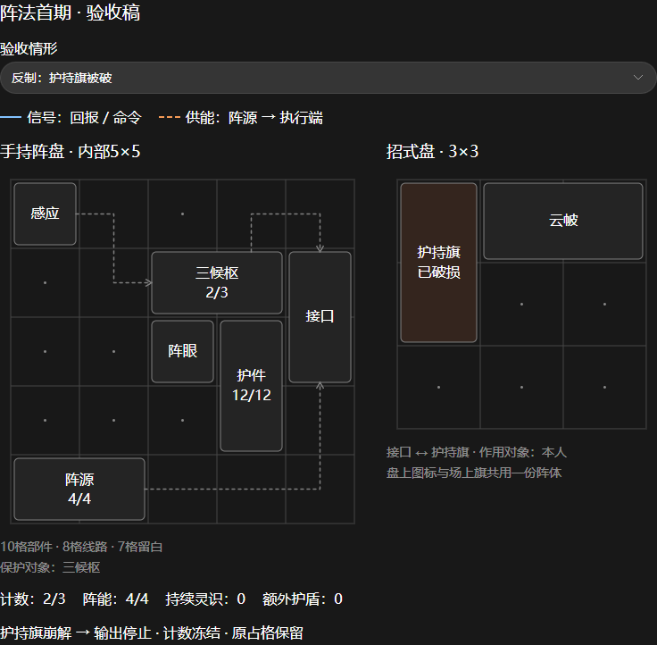
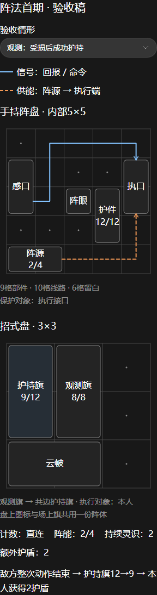

# 阵法首期策划验收图

> 历史图示：后续用户明确基础阵盘可无旗，[当前结构改革](../../plans/百工技艺/阵法/阵法改革_独立阵盘与分阵旗定位_20261108.md)推荐高阶旗作分阵中枢。以下图片只说明旧1.0旗端装法，不作为改革版布局或正式出图依据。

> 2026-11-08；对应[阵法系统完整策划提案1.0](../../plans/百工技艺/阵法/阵法系统完整策划提案_20261108.md)。仅用于评审占格、线路与状态，方框是策划示意，不是正式图标或实机截图。所有新规格待整体验收。

## 本人施法三候护持

左边为手持阵盘内部，右边为招式盘。蓝色实线传信号，橙色虚线供阵能；两个网络各占独立空格。接口是实际1×2部件，连接右侧那一面真实护持旗。

第三次合格施法后，三候枢归零，阵源4→2，本人额外获得2护盾。云帔自身效果另算。

## 器物观测直连护持

右侧观测旗观察共边的护持旗；敌方整次动作结束后，护持旗阵体12→9的实际承伤回报盘内，再命令护持旗给本人2护盾。没有候枢，所以不是三候图；人物护盾不修复或保护旗。

## 破旗后保留占格

护持旗崩解，停止输出并释放其持续占用；两格仍保留破损实物。本图计数冻结在2／3，不靠撤下、重摆或换方案刷新。

## 窄屏排列

窄屏将阵盘与招式盘上下排列，部件仍按实际多格合并，不缩成无法阅读的小字。

## 预览检查范围

12种状态分别在768／320像素宽、明／暗主题检查，共48组；未发现横向溢出、图中文字相互重叠或裁出图边，状态和对象数符合示意数据，无浏览器脚本异常。已目视检查宽屏护持和窄屏观测图。

这些检查只验证策划示意，不是游戏战斗、真实材料成器或平衡测试。检查摘要见[预览记录](预览检查.json)，几何与事件模型见[静态验收记录](../../plans/百工技艺/阵法/阵法系统完整策划验收_20261108.md)。
