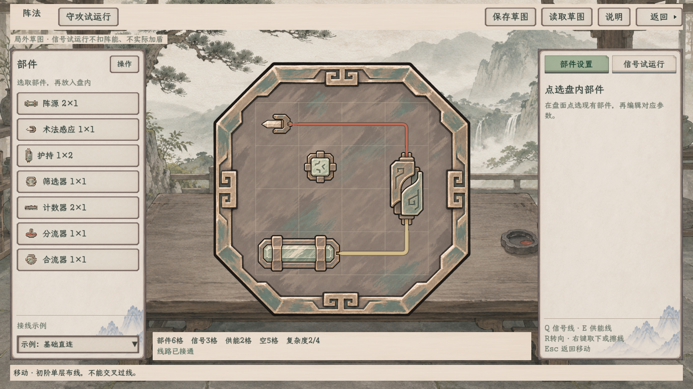

# 阵法纸墨木石操作界面

> **最新交互**：[格线与快捷键修订](格线与快捷键修订/README.md)。编辑盘已改为常显细格线，盘下工具条撤去；Q切“信号线”、E切“供能线”，名称保持。下方24张表格保留首轮功能证据，当前画面以本次修订为准。

2026-11-09。[当前方案与接入边界](../../plans/界面与美术/阵法纸墨木石操作界面_20261109.md)。按用户新要求撤去全部盘面常驻名称／状态纸签，基础4×4与守攻试演均采用干净铜纹盘；悬停或右侧纸页显示名称、口位、参数和当前值。

入口：**百工 → 阵法 → 绘制阵图**。也可使用[独立查看启动器](../../../tools/run_formation_paper_workspace.cmd)。此启动器使用独立资料目录，不打开人物旅程。

## 画面与操作

同族案面背景、薄纸侧栏、深墨字、整纸中灰绿选中，顶栏22字号／46高度，右上返回带独立实心三角。中间不加厚纸框，保留最大的操作空间；灰褐铜底、灰青玉料、朱砂细线与赭金粗线沿已选B墨绘风格。

左侧选部件，中央摆放与拖动，R或操作菜单转向；Q切“信号线”、E切“供能线”后按住左键画线，Esc回移动，右键取下／擦除。参数、计数和结果收在右侧；编辑格线常显，元件文字签仍隐藏，拖动时悬停立即收起。

| 画面 | 1920×1080 | 1280×720 |
| --- | --- | --- |
| 百工入口 | [查看](1920/01_百工入口.png) | [查看](1280/01_百工入口.png) |
| 完整工作台 | [查看](1920/02_阵法全屏工作台.png) | [查看](1280/02_阵法全屏工作台.png) |
| 真实铺线与辅助格位 | [查看](1920/03_真实铺线与格位.png) | [查看](1280/03_真实铺线与格位.png) |
| 单层交叉拒绝 | [查看](1920/04_单层交叉拒绝.png) | [查看](1280/04_单层交叉拒绝.png) |
| 部件参数纸栏 | [查看](1920/05_计数器参数纸栏.png) | [查看](1280/05_计数器参数纸栏.png) |
| 实际信号试运行 | [查看](1920/06_信号实际试运行.png) | [查看](1280/06_信号实际试运行.png) |
| 共用部件悬停 | [查看](1920/07_部件悬停.png) | [查看](1280/07_部件悬停.png) |
| 常态无格线／无纸签 | [查看](1920/08_默认无格线无纸签.png) | [查看](1280/08_默认无格线无纸签.png) |
| 守攻低生命开罩 | [查看](1920/09_守攻低生命开罩.png) | [查看](1280/09_守攻低生命开罩.png) |
| 守攻恢复后施法攻击 | [查看](1920/10_守攻高生命施法.png) | [查看](1280/10_守攻高生命施法.png) |
| 返回原工作台 | [查看](1920/11_返回阵盘工作台.png) | [查看](1280/11_返回阵盘工作台.png) |
| 返回百工 | [查看](1920/12_返回百工.png) | [查看](1280/12_返回百工.png) |

所有图片均由Godot真实视口输出，未用网页或另画概念图替代。前轮带文字签的素材图仍保留在旧目录，本页才是最新操作界面来源。

## 保持的功能边界

- 基础4×4、复杂度上限4、阵眼固定、单层禁跨线及实际端口判定保持；初始七类可摆部件没有因换肤扩充。
- 草图原参数、计数器两模式、示例、保存／读取与基础信号试运行继续原接口；不消耗材料、不授予实物或图谱，不因试线实际加盾。
- 守攻页沿真实隔离运行器，保留实际开罩付款、转攻伤害、公共护盾来源及同次事件去重；试演参数不写入正式人物。
- 没有给新比较器、开关及火击猜测正式占格、造诣或配方；复杂图仍只作素材试排。
- 仅阵法操作内页接入；未批量迁移百工资料册、炼器或其他系统。

## 素材复用

- [同族空案面](../../../textures/ui/talisman_crafting_20261108/desk_v1.png)
- [百工纸面与按钮](../../../textures/ui/crafting_paper_20261108/sources.json)
- [基础四件与图片接口](../铜纹阵盘基础元件_20261108/README.md)
- [逻辑部件与图片接口](../铜纹阵盘逻辑元件_20261108/README.md)
- [守攻五件与空盘生成记录](../守攻阵铜纹素材_20261109/README.md)

本次未新生成、裁改或重画已选PNG。按钮整纸状态使用当前共用纸墨控件，线路与真实槽口在原生画布中独立适配。

## 首轮原生验证（历史基线）

最新整工程编译0警告、0错误。1920×1080与1280×720各295项，共590项新原生交互检查通过；每档12张真实视口图，共24张。不复用旧核心或其他页面的断言计数。

- [1920完整记录](1920/原生验收.json) · [1280完整记录](1280/原生验收.json)
- [视觉复核总表](视觉复核.json)：24张逐图查看通过，两档完整记录均已更新视觉验收结果。
- [专项启动器](../../../tools/run_formation_paper_ui_smoke.ps1)使用独立APPDATA、未入世界的试验人物与独立草图路径，不读取正式旅程；两档最后stderr均为空。
- 覆盖真实百工入口、三栏与顶栏边界、部件摆放及拖动、R转向、合法铺擦线、跨线拒绝、参数键入、计数与同次重发、保存读取及坏档保护、共用悬停穿透与拖动抑制、守攻实际扣能与伤敌、两层返回及试验人物释放。
- 顶栏、右侧及底部记录均检查实际全局边界，不能仅凭全屏宿主尺寸认定内容没有越界。

首轮仅预览图发现守攻标题提示自动换行撑高的问题，现场及预览记录另存“初次守攻布局问题”目录；已修正单行标题并增强边界检查，以上两档完整记录为修正后的最终结果。此前预览检查不计入590项。
