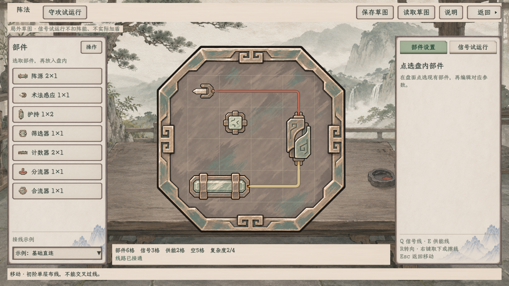

# 格线与快捷键修订

2026-11-09。按用户新要求，基础编辑盘常显细格线，并撤掉盘下整排工具按钮，把空间还给盘面。保持原名称“信号线”“供能线”。

| 操作 | 方式 |
| --- | --- |
| 铺信号线 | Q切换，再按住左键拖动 |
| 铺供能线 | E切换，再按住左键拖动 |
| 回到移动 | Esc，再拖动盘内已有部件 |
| 放置部件 | 左侧选取部件后点盘内放下 |
| 转向 | R，或左侧“操作”菜单的“转向” |
| 取下／擦除 | 右键；也可从操作菜单选择“擦除” |
| 清线路 | 左侧“操作”菜单，部件保留 |

输入文字或数值、查看说明、守攻试演、菜单展开和拖动期间，Q／E不会切换背后工具。常显格线与动态落点反馈分别处理；没有重新显示元件名称／状态签，也没有棋盘填色或改写铜纹素材。

| 画面 | 1920×1080 | 1280×720 |
| --- | --- | --- |
| 常显格线与盘面 | [查看](1920/01_常显格线与扩大的盘面.png) | [查看](1280/01_常显格线与扩大的盘面.png) |
| Q切换信号线 | [查看](1920/02_Q信号线.png) | [查看](1280/02_Q信号线.png) |
| E切换供能线 | [查看](1920/03_E供能线.png) | [查看](1280/03_E供能线.png) |
| 左侧紧凑操作菜单 | [查看](1920/04_收起的六项工具菜单.png) | [查看](1280/04_收起的六项工具菜单.png) |

入口沿用**百工 → 阵法 → 绘制阵图**，也可[独立打开](../../../../tools/run_formation_paper_workspace.cmd)。[界面主案](../../../plans/界面与美术/阵法纸墨木石操作界面_20261109.md)记录本次覆盖前轮隐藏格线／工具条的裁定。

本次只调整编辑显示和操作入口。4×4、复杂度、占格、元件口位、单层禁跨线、源能力与草图／试运行规则保持。独立小专项记录在本目录；[前轮590项／24图](../README.md)保留历史，不重新计为本次新增检查。

## 本次验证

最新整工程构建0警告、0错误。1920×1080与1280×720各36项新原生检查通过，共72项／8张真实视口图；当前专项没有重复运行前轮590项。

- [1920记录](1920/原生专项.json) · [1280记录](1280/原生专项.json) · [专项启动器](../../../../tools/run_formation_paper_revision_smoke.ps1)
- [逐图视觉复核](视觉复核.json)：8张全部通过，两档退出正常，错误日志为空。
- 原生按键检验Q／E真实铺线及原名称、Esc／选取部件退出铺线、R转向、右键取下／擦除。
- 左侧菜单六项均通过实际鼠标命中；输入框、数值框、菜单、说明和守攻页不串Q／E／R到背后画布。
- 移除工具条后，1920档实际Canvas高度从717.322增至777.003像素，增加59.681像素，即52设计单位；1280档按同一设计画布等比扩展。
- 使用独立APPDATA和草图路径，不读人物旅程、不发放器物或图谱；自开Godot均已退出。

首次菜单输入验证曾使用Popup子视口键盘注入；后核对本地引擎及项目配置，改用真实根视口鼠标命中与嵌入式Popup，保持项目InputMap不变。前两次测试适配现场独立留档，以上两档为最终成功记录；业务UI没有因此改变规则。

旧全链helper仅同步菜单入口、常显格位断言和真实鼠标路由，未来输出移至“全链兼容”子目录；本次没有运行，也不将其计入72项。
