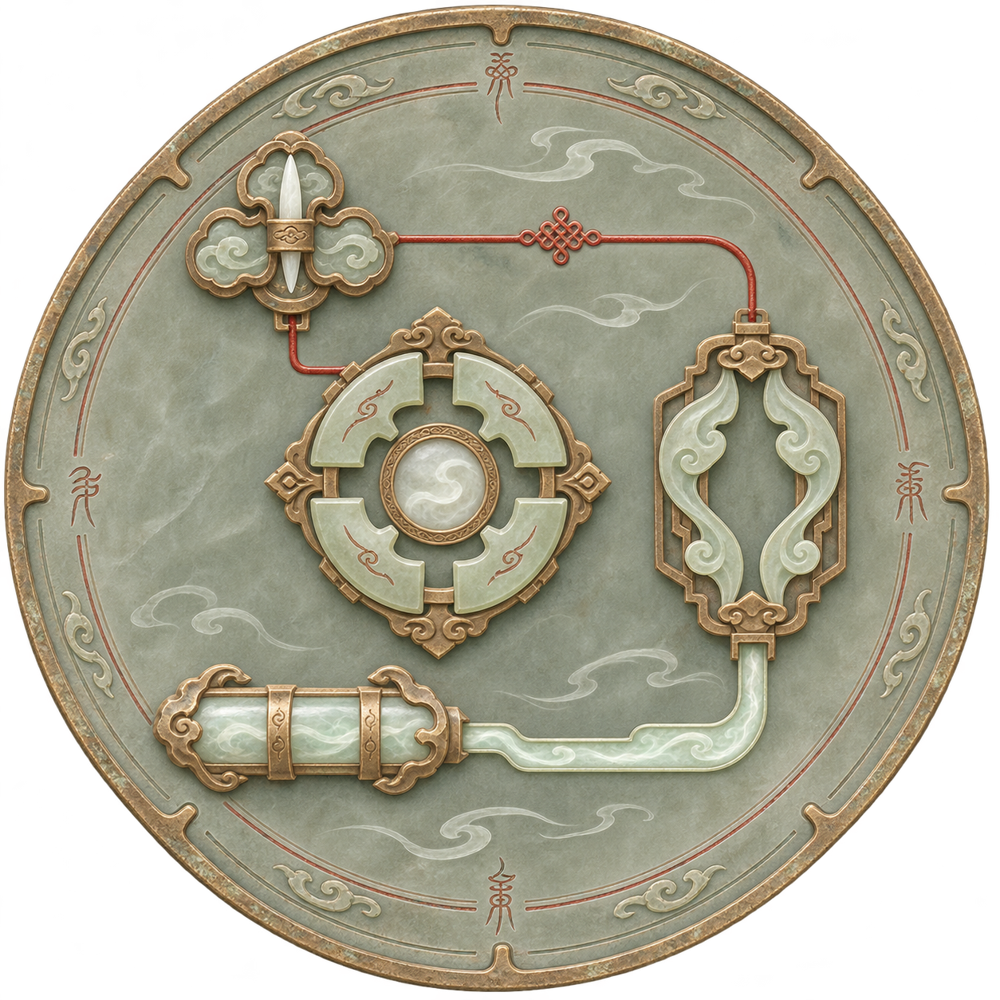

# 阵盘俯视电路理想图

2026-11-08。以下两版均未获选用，保留为历史探索。用户继续指出未达到阵盘与修仙的感觉，并强调首要符合本项目画风；当前待评入口为[项目画风对照三候选](../阵盘项目画风对照_20261108/README.md)。本页不作为认可母版或当前推荐。

第二版采用温润青灰玉盘、古铜、阵环与篆纹，独立阵枢以玉片、铜榫及灵髓构成；护持为双云弧阵机，不画盾。两组连接呈朱砂脉纹与青白灵络，空闲画面隐藏辅助格位。去除现代芯片壳、成排引脚及工业孔位，不将“元件感”理解为照搬现代电脑硬件。

本图为内置生成的整体风格示意，不是实机截图；部件比例、触点数量与详细走线未按可搭建4×4逐项验证，不可直接据此修改逻辑、费用或端口规则。第二版提示与来源见[生成记录02](生成记录_02.json)。此前原生画面不代表本图已经实现。

第一版仅供追溯：[偏现代电路板的旧理想图](01_俯视芯片阵枢理想图.png)、[旧生成记录](生成记录.json)。不再将其芯片式外观作为当前推荐。
