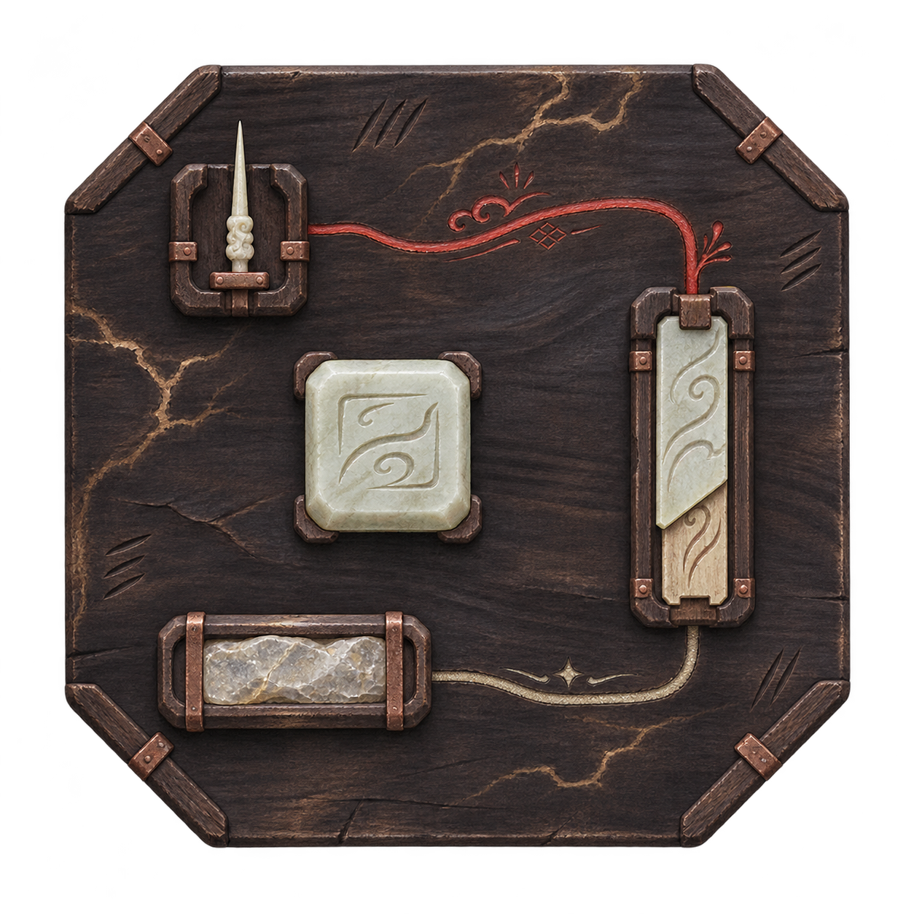
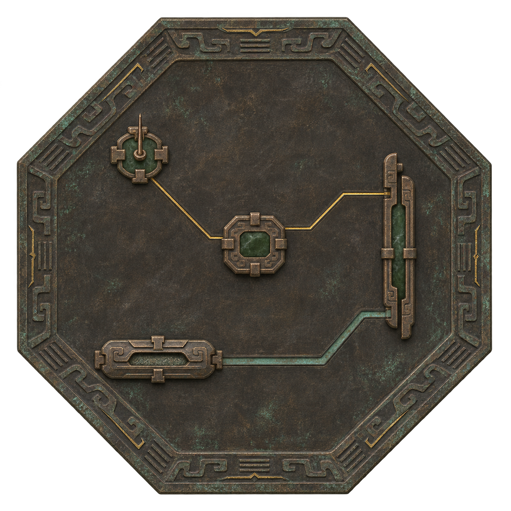
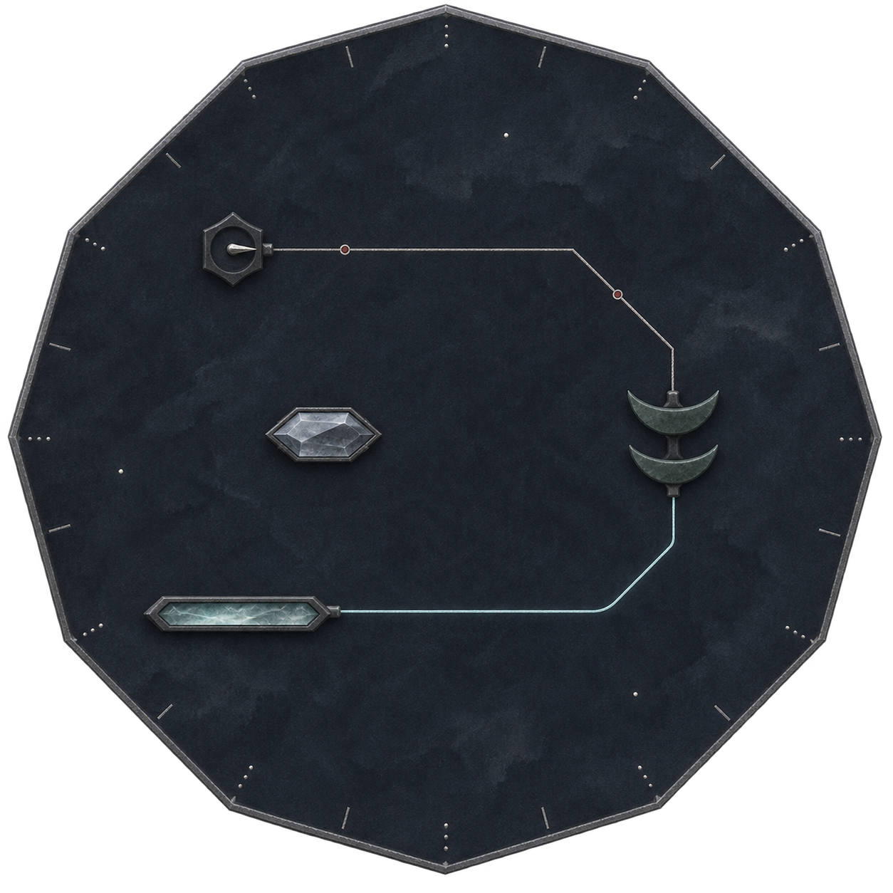
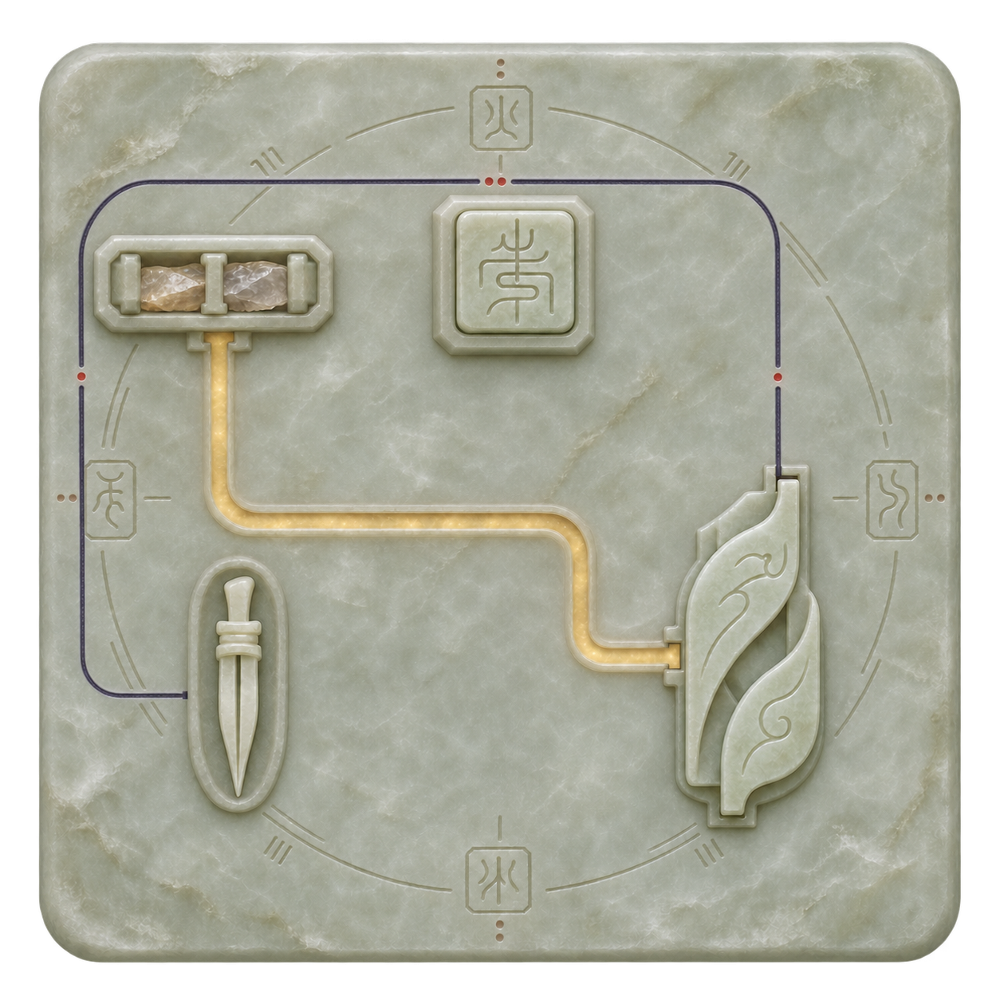

# 阵盘四路风格探索

2026-11-08。以下四组保留为材质与盘形探索。用户随后强调首要符合本项目画风，当前入口已转至[项目画风对照三候选](../阵盘项目画风对照_20261108/README.md)，以现行剑器图标和善功堂直接作参考。本页不作为当前推荐或认可母版。

本轮沿用基础阵眼、阵源、感应枢、内置护持阵器四种部件作视觉对照。基础规则仍见[4×4单层接线实施](../../plans/百工技艺/阵法/基础阵盘四格单层接线实施_20261108.md)。图片只供选风格，部件比例、端口朝向和完整4×4布线未逐格验算，不作为新增规则或实机完成证据。

| 方案 | 盘体与气质 | 元件语言 | 两类线路 |
| --- | --- | --- | --- |
| A 朱砂木符 | 切角乌木方盘，朴素手作 | 骨玉针座、方玉印、灵石槽、叠片符夹 | 朱砂笔脉／金灰灵砂嵌脉 |
| B 错金古铜 | 八棱古铜盘，古器与禁制感 | 铜楔、榫接、薄片阵机，少量墨玉嵌芯 | 细错金刻纹／冷青浅槽 |
| C 玄石星图 | 近十二边玄石盘，清冷星象感 | 晶眼、髓槽、短星针、双弧玉片 | 银砂点线／青白灵脉 |
| D 素玉篆刻 | 圆角素玉方版，宗门制式与篆刻感 | 方印、玉髓槽、分叉玉针、叠叶阵机 | 墨青刻脉／淡蜜色髓光 |

**A · 朱砂木符**

**B · 错金古铜**

**C · 玄石星图**

**D · 素玉篆刻**

## 取经来源与设计推演

- 小说中的工艺线索：[《阵法通仙》第7章](https://wap.jjwxc.net/book2/2376103/7)写到灵木、刻笔和刻画阵纹，支持“先有阵材，再在材料上施作”的视觉思路；[《阵问长生》第117章·灵墨](https://cn.ttkan.co/novel/pagea/zhenwenzhangsheng-guanxu_117.html)可供参考画阵用墨的工艺语汇。乌木方盘、具体元件剪影及配色为本项目推演。
- 器面纹样线索：[《凡人修仙传》第275章](https://www.yunshuzhai.com/book/5104/275.html)中的改进阵具与符纹描写，用于寻找“器面刻纹承载阵法”的感觉；不移植小说的阵旗数量、品阶或运行规则。
- 古器构图线索：[八卦镜，国立故宫博物院，台北](https://digitalarchive.npm.gov.tw/Collection/Detail/7152?dep=U)的中心构件、外围纹带层次，以及[故宫博物院铜镀金星象插屏](https://www.dpm.org.cn/collection/clock/233128.html)的星图点线组织。B、C为原创推演，不作历史器物复原。
- 图标可读性参考：[TapTap法宝展示](https://www.taptap.cn/moment/730407618954134954)中器物轮廓与材质的区分思路。四图未拼贴或复刻其具体图标。

初步美术判断：B最容易读成具有禁制用途的阵器，A最适合表现入门阵师的手作感；C偏清冷，D偏整洁制式。四者均未获用户选定，不自动安排为不同品阶或品质。

## 文件与状态

使用内置图像生成工具。完整提示、原始图片路径、来源和检查记录分别见 [A](prompts_A.json)、[B](prompts_B.json)、[C](prompts_C.json)、[D](prompts_D.json)。选定图均保留透明背景；本轮不接入正式编辑器或替换活动素材。

此前[两版理想图](../阵盘俯视电路理想图_20261108/README.md)保留为未选用的历史探索，均不作为当前认可母版。
