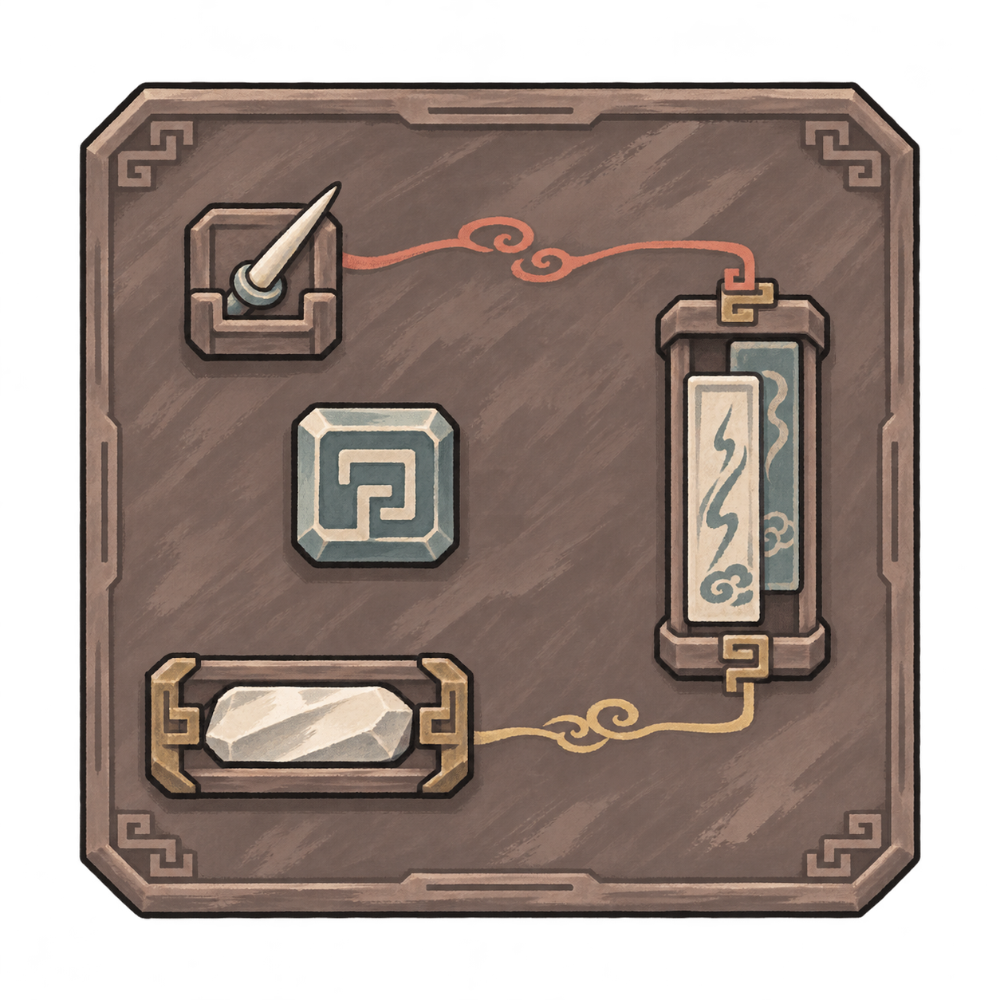
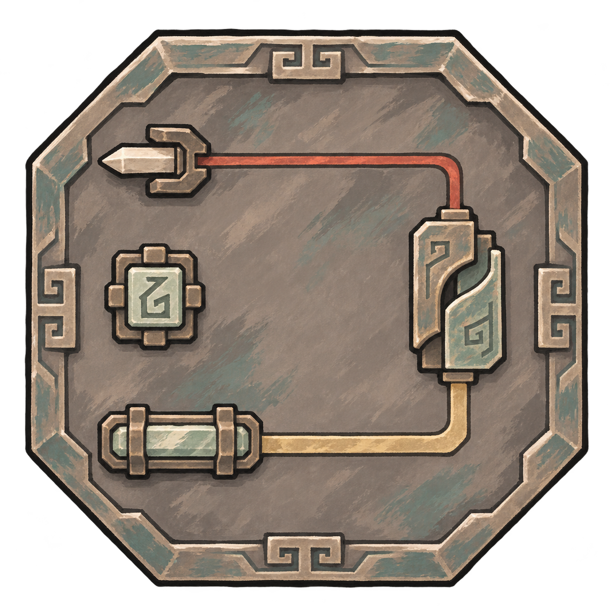
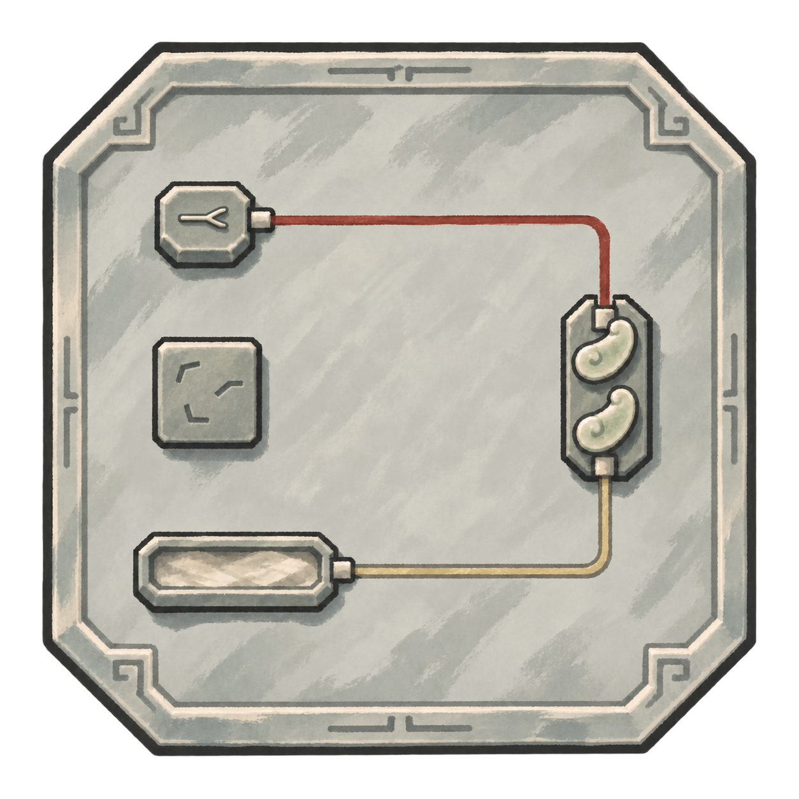

# 阵盘项目画风对照

2026-11-08。用户已选定本页 **B·墨绘铜纹** 为阵盘风格基准，并强调保证一致、做好连接美术。当前继续[四件基础元件与接线设计](../铜纹阵盘基础元件_20261108/README.md)。A与C保留为对照，整盘风格确认不等于具体元件比例、端口与实机接入已全部验收。

## 首要依据

- [现行剑器图标](../../../textures/ui/forged_swords_icons_20261025_v1/broad_sword.png)：墨线轮廓、概括色面、墨灰暗部、象牙白亮缘，青铜与青绿低饱和；[已接入的器物图标说明](../器物斜放图标_20261025/README.md)。
- [善功堂原生画面](../玄览峰拓印接入_20261107/08_善功堂_1920.png)：灰褐木作、灰青材料与暖纸面的协调关系；借画法与色调，不挪用其屋檐构图。
- [全局纸墨木石规范](../../plans/界面与美术/全局界面统一风格规范_20261108.md)：统一材质与状态语言，按实际用途设计器具形状；物品沿用已认可手绘风格。

生成时将上述两张实际图片直接交给内置图像工具作画风参考。小说资料继续供阵材、篆纹及器物造型取经，详见[资料与早期材质探索](../阵盘四路风格探索_20261108/README.md#取经来源与设计推演)。优先顺序为项目现有画法、阵盘识别度、元件与线路可读性。

## 三种候选

| 方案 | 主要区别 | 共同画法 |
| --- | --- | --- |
| A 墨绘木符 | 灰褐灵木、骨玉符夹，偏手作与朴素 | 墨线勾边、概括明暗、少量枯笔、低饱和材料 |
| B 墨绘铜纹 | 古铜盘面、克制纹带，偏阵器与禁制 | 与现行剑器的青铜、墨灰和象牙白协调 |
| C 墨绘青石 | 浅灰青石、玉片构件，偏清静与素净 | 与项目石材、灰青木石界面协调 |

当前已选B：古铜、青灰与象牙白能接上现行剑器，盘沿刻纹也有阵器识别度。A与C仅保留历史对照，不自动设为不同品质或品阶。

**A · 墨绘木符**

**B · 墨绘铜纹**

**C · 墨绘青石**

C当前使用修订2：感应件改为平伏针枢，阵眼改为分离短折刻纹；[首稿](C_墨绘青石.png)保留历史。

## 保留的功能边界

严格正俯视；4×4格位仅用于底层构筑，空闲理想图不画棋盘。四种基础部件用不同实体剪影表达，护持采用叠片或弧片构件；两类线路用材质、颜色与粗细区分并绕行。盘体不能靠密集装饰遮住可操作区域。

正式几何和端口仍以[4×4单层接线主案](../../plans/百工技艺/阵法/基础阵盘四格单层接线实施_20261108.md)为准。理想图的具体部件比例、刻纹和路线未逐格验算，不自动改动端口、复杂度、功能或品质分层。

完整提示、引用图片、原始输出和检查见 [A生成记录](prompts_A.json)、[B生成记录](prompts_B.json)、[C修订记录](prompts_C_v2.json)及[C首稿记录](prompts_C.json)。B整盘画风已选定，后续独立元件与接线按对应新页逐项查看。
