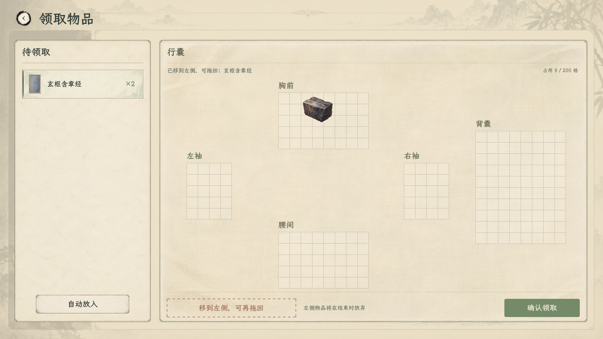

# 领取左栏可拖回与拖动显隐

2026-11-07，领取页右侧已与正常行囊统一为用户认可的浅绢淡纹v5，共用同一布面、格线与薄折边。200格、36格距与领取页各区位置保持。左侧继续只显示同一“待领取”列表；同类普通物品合并数量，误移可拖回，拖动时原格隐藏原物品。

[领取小窗口](浅绢统一_实机/领取/03_领取收纳_1280.png) · [领取旋转预览](浅绢统一_实机/领取/04_领取收纳_拖动预览.png) · [同款正常行囊](浅绢统一_实机/行囊/02_原生行囊空间与清册.png) · [普通行囊源格已隐藏](浅绢统一_实机/行囊/01_原生行囊旋转拖动.png) · [储物空间](浅绢统一_实机/储物空间/02_戒指矩形收纳1920.png) · [当前规则](../../plans/物品与装备/行囊索引与空间联动方案_20261029.md) · [浅绢统一验证](领取浅绢统一_验证_20261107.json)。

布面复用正常行囊的1416×906素材，在领取页原1370×906面板内铺满；格线独立按36设计单位绘制，不随背景缩放。五区尺寸仍为胸前8×5、双袖各4×5、腰间8×5、背囊8×10。领取页布局与正常行囊分别保留原坐标，没有为了共用材质挪动分区。背景不接收鼠标输入；物品图标、命中、旋转、拖放和结算沿用原实现。

左栏只有“待领取”标题；普通物品按同类汇总，同名奖励与移出的原有物品显示为一行及合计数量，器物及储物容器保留独立身份。来源只在内部保留，拖回时优先取回原有物品，保持原身份、朝向与器物快照；本次新领物品移回左栏则恢复待领取数量。刚移出的条目会自动滚动到可见区域。自动放入与结算继续沿原规则，不将原有物品重复计为新奖励。

这些操作只改变当前领取预览。结束时左侧仍有物品，会先确认：未领取奖励将放弃，未放回的原有物品将丢弃；选择继续整理可恢复摆放。使用中物品、有内容的储物容器和突破预留药仍受原规则保护。真实库存发生变化时，整次提交拒绝并重读，清除旧的左栏与奖励预览，避免复制或覆盖真实数据。

领取页、普通行囊及储物空间中，真正抓起后隐藏源物品；普通行囊同时隐藏源位置选择／定位框。落点校验排除自身，取消、无效松手、失焦和尺寸变化恢复原显示，不提前修改真实库存。左侧列表按数量汇总，保留其列表表示。

编译0警告0错误。本轮浅绢统一共五组349项通过：领取无窗口83、领取窗口89、普通行囊窗口34、储物空间窗口80、玄览峰拓印63。实际鼠标往返、同名普通物品只显示一行及合计数量、原格隐藏／取消恢复、身份与来源回调守恒、结束确认、器物快照、库存变化重读及真实炼丹／拓印领取均通过；大窗及1280窗口截图已核对。测试使用隔离保存目录，不写玩家真实存档；既有“卸力”资源UID警告仍按文本路径回退，无新增运行错误。此前[统一列表235项](统一待领取_验证_20261107.json)及[拖动回收347项](领取左栏与拖动_验证_20261107.json)保留为阶段记录。

实现位置：[共用布面与格线](../../../csharp/panel/InventoryGarmentStyle.cs)、[领取页显示](../../../csharp/panel/ItemClaimPanel.View.cs)、[领取状态与提交](../../../csharp/panel/ItemClaimPanel.cs)、[左侧列表](../../../csharp/panel/ItemClaimPanel.LeftList.cs)、[领取拖动](../../../csharp/panel/ItemClaimPanel.Drag.cs)、[行囊拖动](../../../csharp/panel/StoragePanel.NativeDrag.cs)。本轮回归：[浅绢统一脚本](../../../tools/run_item_claim_lining_v5_smoke_20261107.ps1)；日志位于`output/item_claim_lining_v5_20261107/`。
