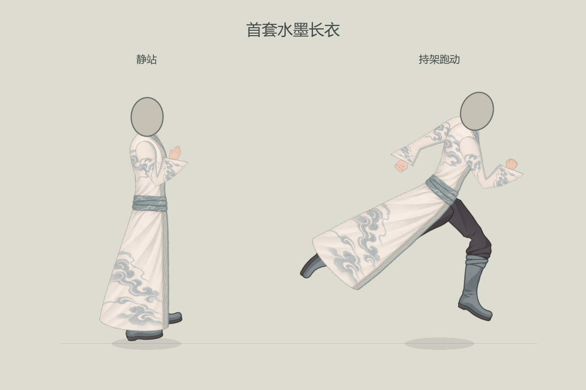

# 首套高清水墨长衣

> 当前路线已更新：用户随后明确选回完整旧版 `yuxu_fullbody_v15` 整体、朴素旧头及原衣布，采用一件连续闭袍与内部前后控制区惯性。下文密集纹样、重绘头部及旧试衣参数均保留为历史候选，不能作为当前选定造型或最终验收。现行来源、边界与实装记录见[旧版常服整体衣摆与大步跑动](../旧版常服整体衣摆与大步跑动_20261105/README.md)。

2026-11-05，玉虚·内门常服独立试衣候选。当前采用固定束发、固定肢长、肘部局部收褶、独立脚掌转动及分区衣摆跟随。画面用于用户继续评价，默认局内人物尚未替换。

## 当前造型与手型

### v34 当前：固定束发的整体试穿与衣摆分区跟随

用户要求先固定一款发型看整体。本轮选用项目既有 `art/original_wanderer/head.png` 的墨色束髻／青灰与米白发带、侧视无五官头部，复制为本套 `assets/head_bound_ribbon.png`（265×369，SHA256 `a41ac187f2349399440da3f69e8be6078d3d654890a6b67b1b1ad1ede70ea563`）；未生成新头图。颈根按图内(167,214)注册，以发顶至颈根210源像素对齐既有人台头高，不把拖带算进头部比例。抵消导入头骨的初始轴向偏转，后续只跟随动作增量。已检查静站、跑动及左右朝向，灰色椭圆仅作隐藏的装配参照。

衣摆继续保持侧视连续闭袍。对照男101两条下摆分支与末端跟随，本套在腰口固定、三段延迟基础上增加逐深度旋转、前后衣缘不同拖曳、末端错相波动；逐点旋转先保持腰部半径，再添加有限跟随偏移。前缘较贴近腿，后缘拖曳稍大，起跑后展、停步回垂，不用整片同向平移表示飘动。母图、UV和原拓扑保持；这是本项目表现层，未冒称原作DynamicBone完整求解。

衣摆19项、682帧检查通过：腰漂移0，三角面积比最低约0.704，安全限幅倍率始终1，无新增翻面。见[衣摆最终检查](衣摆最终检查_20261105.json)。全套含头发原生采集为 `output/ink_outfit_v34_hem_edges_final/`；当前完整跑动、停步、左右朝向和出手图片已同步。独立试衣窗口默认可从跑动开始，用户继续评价整体观感。

### v33：固定肢长、局部褶皱与独立脚掌

用户最新要求：大臂、小臂及相对长度固定，手、袖口和其余衣料尽量保持母图形状；弯臂的挤压改由肘部褶皱表现，腿和脚也不能随转动拉长。此前“整袖无褶皱”的限制由此更新为“仅肘部允许少量局部收褶”。所有母图PNG、本轮六种手势方向及手指保持，不重新生成。

双侧统一使用近侧Idle的实际骨段尺标，先完成静态装配，再只接受动作角度。下表为应用项目固定 `source_scale` 前的源像素值，不是最终截图像素，也不是从低清原图目测的人体标准。

| 肢体 | 上段 | 下段 | 上段／下段 |
| --- | --- | --- | --- |
| 双臂 | 大臂12.818806 | 小臂12.026830 | 约1.06585 |
| 双腿 | 大腿27.778198 | 小腿28.632887 | 约0.97015 |

袖身拆为保持尺寸的两个转动区，肘处重复接合排而不连接会翻折的三角形，以同材质局部接合面覆盖外侧间隙，内侧用两条概括阴影表现收褶。大臂、小臂、袖口与手的网格边长不随动作变化；手腕不再把整段小臂逐渐拧向另一个方向。两侧长度和尺寸相同，动作端点只提供方向，不再逐帧把高清图铺满变化的骨长。

裤腿使用同一50×80完整画布、同一套髋／膝／踝锚点；大腿、小腿／靴筒、脚掌各自保持形状。脚掌参考原作`tui3`独立控制，在固定踝点转动；素材切分线与踝pivot分别处理，不能把脚背或鞋尖截成两半。膝／踝只有局部同材质接合。原先腰平面误裁抬起膝盖的问题已修正：裤根裁切只作用臀根UV范围0.23—0.32，膝／脚不参与腰部裁切；膝内侧残余透明细缝仅在局部带内闭合。

原作复核依据见[鬼谷原始关节权重与曲线复核](鬼谷原始关节权重与曲线复核_20261105.json)。男101采用连续蒙皮，多数主体顶点单骨100%，混合集中肘／腕、膝／踝。近袖19个大臂、6个小臂、3个手顶点为单骨，其余4个肘点和3个腕点混合；裤靴16个大腿、9个小腿、5个脚点单骨，3个膝点及4个踝点混合。原作存在局部位移曲线，求值骨长变化主要不是XY投影误差。本套依用户要求保留固定比例，借鉴局部过渡、独立远端与衣下遮挡；不将自有硬分区接合说成原作完全相同的实现，也不声称复现其完整状态机或地面校正。

装配49项检查通过。双侧、两个朝向、6段原动作全144帧共1728姿态：袖身10824192次连接边长比较、腿脚主体及膝部262656次边长比较通过，最大误差均小于0.00002项目单位；可见网格翻面及非有限顶点均为0。踝部仅在局部切边间生成接合面，允许该小面形变，主体脚掌保持刚性；6912个接合三角无翻面／退化，20736次切边与桥接覆盖检查无缺口。详见[固定袖段检查](固定袖段检查_20261105.json)、[固定腿脚检查](固定腿脚检查_20261105.json)、[原动作骨长变化的只读测量](原动作肢长测量_20261105.json)。这些检查证明装配尺寸与几何稳定，最终视觉以原生跑动及用户评价为准。

独立试衣支持 `--preview-run` 直接从跑动开始，1静站、2跑动、3后退、4出手、5错步、F换朝向、空格暂停；仍未替换正式默认人物。下方v30及更早的“当前／最新”、旧锚位和旧检查只描述当时状态，与本节不一致时以本节及当前验收JSON为准。

### 以下为历史试装记录

### v30 历史：只修屈肘变形，不改手指

用户明确指出应修装配扭曲、肘下缘不要尖，不再调整手指。本轮所有PNG保持，手势采样、掌腕尺度及刚性手部变换保持。袖身原中心线在肘处直接折转，即便截面方向插值，仍会形成轮廓尖点；现将肘前后各半段较短骨长范围接为切向连续二次曲线，截面跟随曲线切线，曲线外保留直段，腕前平滑接回手腕方向。肩位置、骨长目标和袖宽补偿沿用。

原生伸／屈两侧对照为 `output/ink_outfit_v30_round_elbow/`，全身各动作及手型采集为 `output/ink_outfit_v30_round_elbow_full/`，备用手近景为 `output/ink_outfit_v30_round_elbow_hands/`。49项装配检查通过；本文伸屈对照、全身跑动／剑指出手、备用手近景同步。此次为自有袖网格的弯曲路径修正，不是重绘手指或原作物理模拟。

### v29 剑指局部修正（当前）

用户指出v28剑指仍有问题。本轮先按可见问题修正两根伸指长短差过大、收指轮廓不清：剑指改为26b0e37a，食中指贴合、长度接近，补简化指甲确认右手手背。掌腕尺标0.76及其余五手、衣布和几何参数沿用v28。收指的最终观感仍需用户评价，不将装配通过等同于解剖验收。

通过内置image_gen局部编辑，提示词为素材目录 `v29_sword_correction_prompt.json`；v28旧剑指备份至 `archive_before_v28_hands/sleeve_near_sword_v28.png`。引擎原生采集 `output/ink_outfit_v29_optional/` 与 `output/ink_outfit_v29_sword/` 完成，未报加载错误。本文备用手近景及剑指出手全身图已同步。已启动可交互独立试衣窗口：R重载、2跑动、7剑指、4出手；正式游戏默认入口仍未替换。

### v28 当前：现用游戏画法与六种新手型

用户认可已有大臂／躯干比例，并要求衣服质感向当前游戏版本看齐。本轮以实际默认 `art/yuxu_fullbody_v15/body.png`、`arm_relaxed_v19.png` 为画法参考：米白底、青灰纹样、少量概括阴影；去掉v26的密集干刷与纸纹。衣身和六种袖手图全部通过内置image_gen重绘，保留本套流云／回纹设计、侧视闭袍及v27肩肘几何参数。衣摆、裤腿和靴子实现沿用。

近侧右手为手背舒展、松握拳、剑指、隐藏拇指握柄；远侧左手为掌心舒展、松握拳。两侧始终共用近袖衣布，变体仅采样手部，避免切换手势时衣布变化。生成稿手偏大，六种均按0.76共同尺标装配，取消此前旧图的1.34横向加宽及剑指横移；不把伸指和握拳的外框高度强行统一。新图采样腕中心(610,890)，890—925行平滑接腕，袖口裁切线(458,925)至(710,865)，坐标基于1254画布；骨架肩肘腕轴仍沿用v27。上述是当前图的视觉装配值，不宣称六张生成图的解剖尺寸完全相同。

当前母图尺寸：衣身971×1620；六张袖手各1254×1254；未修改裤靴992×1586。完整提示词及生成来源保存在素材目录 `v28_game_style_hand_prompts.json`，旧图备份于 `archive_before_v28_hands/`。这是内置image_gen模式，未使用CLI或外部API。

49项装配检查通过。最终原生采集为 `output/ink_outfit_v28_game_style_final/`、`ink_outfit_v28_normal_final/`、`ink_outfit_v28_optional_final/`；本文完整跑姿、剑指出手、四种普通手和两种备用手近景已更新。检查了袖口切换、左右方向及完整装配，观感仍待用户评价。默认游戏人物未替换，独立试穿已加载新稿。

### 以下v27及更早内容为历史调试记录

历史段落中的“当前”“最新”、旧图测量值与旧提示词指向仅描述当时状态；与上方v28不一致处，以v28为准。

当前v27覆盖袖形参数：用户再次要求手更厚、大臂只略粗于肘、小臂喇叭克制。重新对照已采集视频1:10附近与男性101素材关系，并量取当前共享主袖Alpha>128横截面：肩272行193px、肘577行139px、袖下820行214px。装配采用肩0.98→肘1.26的平缓补偿，静态截面约189:175，避免原图收细再叠加几何收细；前臂中下段逐步收至0.84，临腕恢复1以接刚性手。屈肘区依据转角最多补22%横向厚度，直臂不补。手宽系数从1.14升至1.34、长度从0.94改为0.92，几种手势沿用共同掌宽校准。肩根内收和淡化覆盖沿用；未重画PNG。

最终原生采集 `output/ink_outfit_v27_arm_balance_final/` 已完成，本文完整试衣两图更新；最终装配49项通过。另有加转角补偿前的四组伸／屈袖隔离图 `output/ink_outfit_v27_sleeve_poses/`，只用于发现屈肘视觉收窄，不能当作最终补偿后的图片。当前参数为本项目视觉调试，不宣称源视频精确比例；最终粗细观感待用户评价。

当前v26：用户要求参考浏览器视频后半段整体比例、衣料质感，并明确肘部不要过细。已在原浏览器观察[归墟行视频](https://www.bilibili.com/video/BV1gvxQ6hEbq)约1:01、1:10、1:18、1:30、1:40五处局内画面，截图在 `output/playwright/paused_reference_20261105/`（文件名60/68/88/98是寻址位置，实际播放捕获有约1—2秒偏差）。这些截图只支持轮廓、色块和相对比例观察，低分辨率与特效不支持精确解剖测量；不同于此前男性101源纹理研究。

本轮重绘body和共享sleeve_near：原尺寸971×1620／1254²保留，米白青灰与原云纹位置保持，改用不均匀笔触、较明确灰蓝明暗块和较深腰束，减少均匀光滑渐变。内置image_gen，提示词见素材目录 `video_brush_v26_prompts.json`，原图保存在 `archive_before_brush_v26/`。新袖外侧检查区Alpha最大9/255，仍有低透明残留；不宣称完全无杂边。普通／备用手仍局部采样，不整体替换各手变体的旧衣布。

手的宽度在v25统一尺标上增加14%、纵向收至94%，改善细长感；非严格解剖比例。上臂横向系数由肩0.76过渡至肘1.03，再到袖口1.0；新袖素材同时补足肘部，平缓过渡，仍无刻意肘结和袖褶。灰色无五官人台头宽高收至80%，底部接颈位置保持，用于排除人台头偏大对服装比例的干扰，不包含正式发型设计。

v26原生九组手型动作、换向和连续跑停采集已完成，目录 `output/ink_outfit_v26_video_brush/`；装配49项重新通过。本文完整试衣两张PNG已更新，其他v15—v25近景／GIF均为历史表现，不代表当前画风或手部比例。最终质感与肘部宽度仍待用户评价。

最新尺标覆盖（v25）：用户指出v24统一后的手偏小。本轮重新查看本机男性101原袖／骨点图与60×60原纹理，按Alpha>128、肤色阈值逐行检查：近手下端39—42行可见宽7—8px，远手43—46行约4—5px；含姿势、轮廓和低清边缘影响，不能当作精确解剖掌宽。此前自有舒展手88px按60/1254换算仅4.21逻辑像素。本轮共同尺标在v24上提高30%，约5.47逻辑像素，属于参考范围内的项目选择，不宣称原作唯一比例。各手局部系数现为近舒展1.30、远舒展1.196、握拳／握柄1.17、剑指1.027，沿用腕轴与剑指源中心校准；近舒展也进入同一采样流程。上轮收袖、肩根与裤根保持。v25完整动作原生采集正常，49项装配检查通过，本文完整试衣两图已更新；此前备用手近景仍为v24尺标，不能代表当前尺寸。

当前装配修订（手势尺标／肩根／裤根）：PNG仍为19b03989剑指，新增运行时局部采样校准。900—930行皮肤测量中，近侧舒展掌宽约86—89px，剑指约106—117px，因此以普通掌宽为基准：剑指0.79、握拳和握柄0.90、远侧舒展0.92；剑指源掌心横移-14px对齐腕轴，870—900行平滑过渡，指尖伸直长度不与握拳外框强行对齐。该测量基于皮肤色及Alpha阈值，是装配参考，不宣称所有手势精确等宽。

大臂横向肩段收至70%、肘段85%，小臂向袖口恢复100%，两侧共用同样比例。肩轴向躯干轴内收18%，被躯干覆盖的肩帽170—280行渐隐，消除原轮廓线形成的接缝。裤根在腰下0—10骨架单位内限制外扩并柔化顶缘，10单位以外恢复原裤腿，不缩放膝踝和靴子。当前覆盖此前“无局部UV校准／固定袖宽／仅腰上裁切”的描述；原始素材及参考骨帧保持。

原生整套采集在 `output/ink_outfit_v24_proportions_final/`，九组手势动作、左右跑姿及连续跑停完成；本文完整试衣两图与备用手近景已更新。服装49项、衣摆19项重新通过；旧864相位袖片几何记录未本轮重跑，不能作为本轮收袖验证。仍是独立试穿候选，视觉待评价。

最新覆盖：用户随后指定20b8644c附件作为无名指／小指长度比例参考。当前剑指为19b03989，沿用右手手背方向，按该附件收拢双指的相对长短调整；48b20787已归档。内置image_gen提示词存于 `right_sword_reference_ratio_20261105.json`，Godot原生双手近景与 `备用右手原生采集记录.json` 已同步，采集退出码0。比例为图像参照调整，未宣称精确测量一致，待用户评价。

2026-11-05最新手指比例修订：用户指出001215收拢手指过粗、手掌外扩；当前近侧剑指改用48b20787，收细小指与无名指外轮廓，保留已确认的右手手背方向。上一轮“小指长度综合”图片及JSON仅为历史记录，不再代表当前贴图。最新提示词为素材目录 `right_sword_slim_fingers_20261105.json`（内置image_gen），原生双手近景及 `备用右手原生采集记录.json` 已更新。两次采集退出码0；单手放大图指尖靠近画框，评价以完整双手近景为准。此次只改备用剑指贴图，观感仍待用户评价，未重跑此前代码检查。

身体严格侧视，衣服保持米白、青灰流云与浅回纹，轮廓、纹样清楚；不采用写实肌理和密集纸纹。长袍连续闭合，不开衩、不分叉；后缘平顺，不留凸尖、锯齿花边或黑色肩圈。无五官灰色头只是试衣人台，本套不重画发型。

袖身按用户最后的形状要求：大臂从肩向肘逐渐收细，肘处最细，小臂从肘处开始向袖口展开为喇叭形。去除袖褶、肘结和中段鼓包，只留平顺整体明暗、云纹与边饰。下侧多留余布，腕靠袖口上侧。两侧衣布始终读取同一主图，横向与手部使用同一物理尺标；只替换裸手区域，不把变体里轻微重画的衣布整张切入。

普通待机用舒展手、跑动用松握拳。普通近手展示手背、远手展示掌心；不能整张镜像袖子来改手。用户已明确确认第二张b1ed的右手手背方向正确，仅指出小指太短；第一张3278附件的小指长度合适，需要消除扭曲并适配到第二张方向。当前001215沿已确认方向只补小指长度：悬垂图拇指右侧仅露边，两并指左长右短、保留简化甲形，左侧两根收指可分，小指加长后自然弯入掌内。中间b218曾多出第三瓣，已删去多余分隔线，当前可数五指。袖片与腕中心维持。确认的是方向；综合后的长度观感仍待用户评价。见[小指长度综合原生近景](右手剑指_小指长度综合_原生近景_20261105.png)及[当前素材与采集记录](右手剑指_小指长度综合_20261105.json)。

仅近侧右手另留两个备用版本：剑指与握剑柄。握柄按用户最新要求不露大拇指，只用四指包拢轮廓模拟抓握，不把剑柄画进手图。远手不做剑指。两种备用手型仅可显式预览，未绑定未知技能或武器；普通待机与跑动保持各自手型。

## 服装来源与原创范围

真正服装身份为玉虚·内门常服，保存编号5、`male_clothes_05`。半身前视立绘 `mods/appearance/ink_three_variants_20261004/male/clothing/06.png`、同款后领及未分层完整稿 `mods/appearance/clothing_polish_20261103/final/male/clothing/06.png` 是米白青灰、肩袖流云、浅回纹、领口与腰束的参考。未绘制的侧后及下摆沿同一纹样语汇补全。长期 `yuxu_fullbody_v15` 仅作局内概括程度、小手与旧观感参照。

本机鬼谷男性101提供肩肘腕运动、连续蒙皮及遮挡关系研究，不复用其低清画面作为正式新图。原作开身长衣与本套闭袍不同，可按用户授权改善关节覆盖、腿根、靴形与新衣摆承载。原文件和研究数据保持。

## 实际素材与制作坐标

| 部件 | 实际PNG尺寸 | 当前用途 |
| --- | --- | --- |
| body.png | 971×1620 | 侧衣身、腰束、连续闭袍 |
| sleeve_near.png | 1254×1254 | 两侧共享衣布，近手舒展 |
| sleeve_far.png | 1254×1254 | 远手舒展，只取裸手 |
| sleeve_near_fist.png／sleeve_far_fist.png | 各1254×1254 | 普通跑动握拳，只取裸手 |
| sleeve_near_sword.png | 1254×1254 | 近侧右手剑指备用 |
| sleeve_near_grip.png | 1254×1254 | 近侧右手无外露拇指握柄备用 |
| leg.png | 992×1586 | 两腿共用，收束裤根、圆脚背与厚鞋底 |

八张PNG均保存于项目 `tools/action_battle_test/art/ink_outfit_01_20261104/assets/`。内置image_gen生成；袖片与普通手提示词保存于同目录 `clean_trumpet_v15_prompts.json`、`clean_trumpet_v15_hand_correction_prompts.json`，握柄见 `near_sword_grip_final_revision_prompts.json`。剑指最新以 `right_sword_pinky_length_final_20261105.json` 为准，方向按用户确认锁定；此前掌面稿、小指短稿及多瓣中间稿均在archive目录，不再加载。

袖片实际肩轴S(615,272)、最细肘E(595,577)、腕皮肤出口W(610,870)，均为1254完整画布坐标。S是本项目选定的装配轴；肘和腕依据实际图重新量测，不沿用旧远袖落在布料里的腕点。袖口约从(468,908)到(688,847)。当前图实际腕距约1∶1.81、口宽约掌宽2.5—2.7倍，与“约1∶2、两掌宽”的意图接近但不宣称精确达标。详细数据见[共享主图实测](共享袖主图实际锚位与色彩复核_20261105.json)。

母图净米白区域与衣身相比ΔE76约2.46，仍略暗暖；相比旧袖约5.23已改善。低透明边沿残点存在，白点最大Alpha约11/255，未发现高不透明独立白块。颜色、边缘观感以实际渲染图为准。

衣身与腿仍按完整原Sprite画布线性取样；新袖使用两侧共同的60×60逻辑图及实际绘制关节，不能继续把旧近远两套Sprite布局当作生产锚。[原完整画布研究](完整画布模板与像素锚点.json)保留为研究基准，不使用此前未验收的非线性高清注册。

## 拼接与动态

新袖采用[自有连续袖片承载](独立袖carrier装配说明_20261105.md)：两段骨轴提供位置，横截面方向平滑过渡，截面宽度保持；手区独立刚性变换，不随弯肘拉长或揉挤。源关节只作运动目标，原35／39点紧袖隐藏保留为研究基准。当前肘角偏利落，是无褶皱的图形化表现，不宣称真实布料折叠。

闭袍保留源40点，并加一个局部仿射承载点和三个三角面，消除后缘裁角；源文件不变。衣摆另加中、下、末段三组轻量延迟偏移，随实际速度和加减速拖后、微摆、停步回落；腰与躯干不加偏移。不是原游戏DynamicBone求解，也不追求复杂真实布料。

裤根与上大腿局部收束，帽部最大宽12.450小于当前侧腰14.892；髋膝踝、腿长与靴区未整体缩放。腰带中心以上的隐藏上插段随真实腰平面藏入衣内，没有深色遮片。见[腿部比例量测](裤根与侧腰素材比例复核_20261105.json)及[闭袍承载域](闭袍承载域核对.json)。

## 当前原生画面与检查

[原生跑停动态](首套水墨长衣_跑停.gif) · [局内尺寸静帧](局内尺寸观察/首套水墨长衣_静站与持架跑动.png) · [局内尺寸跑停](局内尺寸观察/首套水墨长衣_跑停.gif)

新袖的伸直、屈肘与两侧等尺寸，另见[隔离弯伸对照](两侧同尺寸袖片_伸直与屈肘.png)。备用手型见[近侧右手剑指与握柄](近侧右手_剑指与握柄_原生近景.png)。这些由同一套素材和骨架在Godot原生渲染，未补画游戏截图；GIF只封装帧与调色板。

源码、手型及暂停等49项基准检查通过；衣摆19项、682帧检查通过，腰额外漂移0、最大附加位移约6.99源姿态像素。新袖六动作各144相位共864姿态，以及伸直／90°／130°弯臂检查均无不透明翻转，刚性手最大数值误差约7.63×10⁻⁶。[袖片几何与锚位检查](袖carrier几何与锚位自检_20261105.json)与原生目视分开记录；不以检查数代替美术评价。

旧v9四手承载域、旧46项记录、旧肩根72帧和历史色差报告只用于追溯。当前72肩相位另存于本目录的 `肩根全周期_v15/`。v15整套普通手媒体与49／19项代码检查继续保留，不能作为当前手型掌背或左右正确的证据。最新八图清单、代码哈希及单手／双手近景见[小指长度综合记录](右手剑指_小指长度综合_20261105.json)。旧[手背五指记录](右手剑指_手背五指_20261105.json)、[最终检查与散列](v15最终检查与散列.json)、[原生媒体封装复核](v15原生媒体封装复核.json)、[备用手独立复核](近侧剑指与握柄手独立复核_20261105.json)和[上一轮左右纠正记录](右手剑指左右纠正_20261105.json)保留历史范围。

## 独立入口

2026-11-05完整试衣追加手型切换：6普通手（待机舒展、跑动松拳）、7近侧右手剑指、8近侧右手握柄，可与动作、换向和暂停一起预览。重载保持所选手型；切回普通手清除覆盖。仅试衣界面使用，不绑定正式技能。原生采集覆盖三手型×静站／跑动／出手九种组合，并保留原换向、跑停采集，正常退出。截图见[剑指出手](完整试衣_剑指出手.png)、[普通跑动](完整试衣_普通跑动.png)。目视检查这两张未见手腕脱接；不代表所有动态帧的美术验收。原始采集目录为 `tools/action_battle_test/output/ink_outfit_v23_full_hand_preview/`。

`tools/action_battle_test/ink_outfit_fitting_room.tscn` 支持静站、跑动、后退、出手、错步、换向、暂停和缩放。干净并排展示为 `ink_outfit_showcase.tscn`，小尺寸为 `ink_outfit_game_scale.tscn`。本轮是一套服装独立试穿，未改默认人物、技能、属性、移速或存档。
