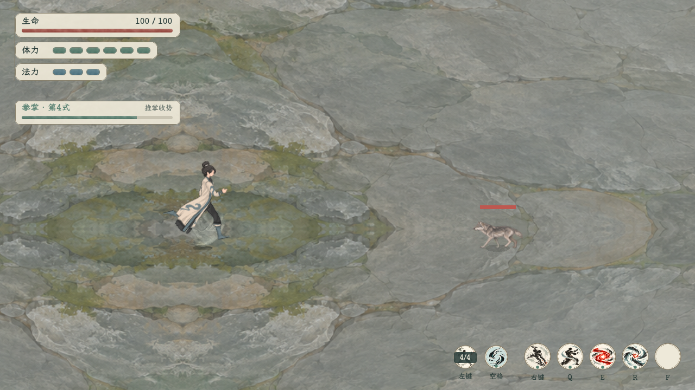
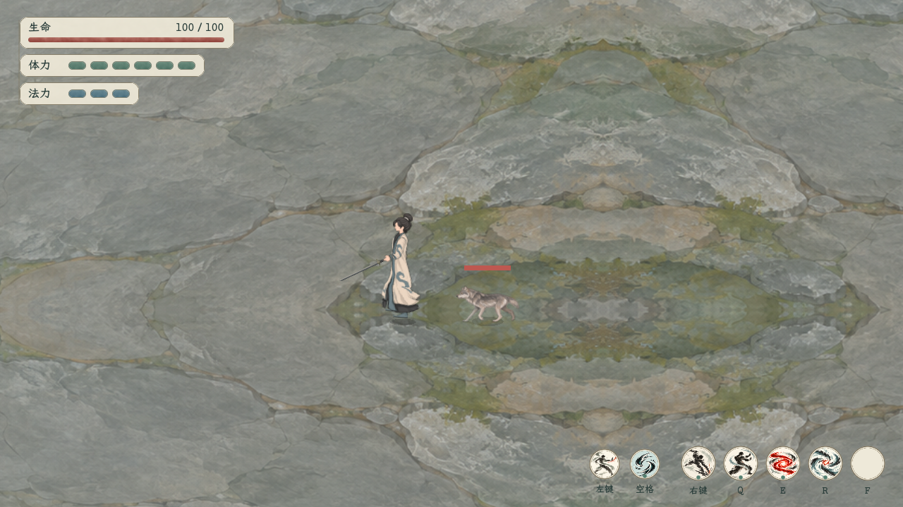
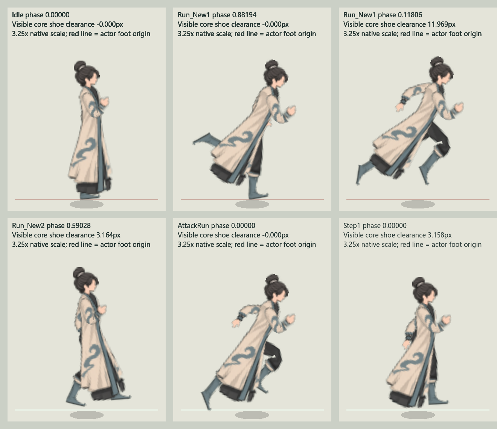
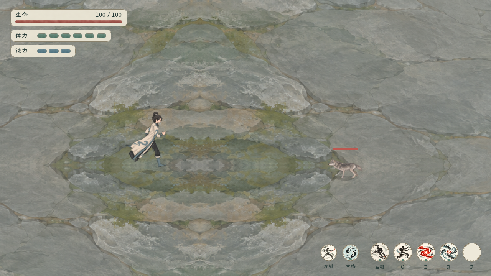

# 鬼谷原规格首套人物与自有束发

2026-11-05，当前人物路线。用户最新要求素材尺寸、骨架和物理按本机《鬼谷八荒》原规格制作本项目人物，并随后明确“发型按照我们自己的”。本轮采用男性101原规格的白青水墨衣装、无五官脸及本项目已选定的朴素束发髻。此前[旧v15完整整臂、80%手部与放飞衣摆](../旧版常服整体衣摆与大步跑动_20261105/README.md)保留阶段成果，已不作为当前默认人物标准。

共享人物入口沿用本套3D原规格管线。最新按用户再次反馈修订浮空感：缩短原Run长时间离地、压低腾空，并由真实鞋底驱动接触影；235跑速、四向试挥、行进出手和左向衣摆修复继续保留。原规格检查只验证原片段求值与几何，移动出手和落脚另有实际运行时专项，不将此前通过数当作所有组合状态无问题的证据。

## 当前修订：落脚承重与鞋底接触影

用户指出提高跑速后仍显浮空。本轮确认两个独立原因：原Run1在此前固定Clip偏移下，144相位只有4相位脚底距地≤0.15源像素，最高离地约11.969；而实际试玩未提供 `has_contact_shadow`，仍画中心位于脚锚下方4像素的大椭圆。静站鞋底已在地平面，影子仍与其分离；跑动时足点还会远离固定椭圆。

当前保留原Run姿势、局部骨长／缩放、235移动量和距离驱动腿时钟，仅共同平移整个人物的显示Y：设原可见鞋底离地为h、该Clip原最大离地为M，阈值取 `M×8/11.969227382`，最终离地取 `min(2,M×0.25)×clamp((h−阈值)/(M−阈值),0,1)²`。Run1对应8像素以下收为支撑、高点保留最多2像素的短腾空；阈值处导数为0，避免硬截断跳变。Run2按自身原幅度缩放。此显示适配仅在真实移动的Run基底上生效；纯源求值和原规格oracle不改，错步保留独立Step1，不强行改为贴地跑。

停步从已校正的整人偏移收回站姿，暂停／同clock重复请求保持；原物理继续接收真实显示根的运动，不另添假重力或更改SDK参数。新的原生接触影挂在runtime脚锚下，不挂在随身体升降的rig_root：淡地影中心保持地面，两处短影分别读取可见鞋底X，接地稍实、离地淡出，所有中心局部Y=0；旧+4椭圆由现有钩子停用。玩家和NPC均读取实际身体高度，显式抬升仍保留，地影留在世界地面，不跟着身体上浮。

| 专项 | 本轮结果 |
| --- | --- |
| [根项目落脚](落脚承重_根项目检查.json)／[独立入口](落脚承重_独立场景检查.json) | 各69项通过；864移动相位、63936源腿顶点、3672个Step1世界Transform样本 |
| Run1接地与腾空 | 精确接地104/144，距地≤0.15像素117/144（约81.25%）；最高约2.000004源像素，1倍最长连续腾空约0.072917秒；半速的墙钟时间相应加倍 |
| 原姿势与鞋底 | 源腿局部网格误差最大约5.66×10⁻⁵像素；仅共同显示Y变化，不拉长脚或腿，不据此宣称水平锁脚／零滑步 |
| 玩家与NPC高度 | 实际0→12→0抬升／落回，28个接触影中心的世界地面Y误差0；修正玩家曾在super更新后才移动身体、导致影子随之抬升的调用次序 |
| [移动回归](落脚承重_移动回归_根项目.json)／[独立入口](落脚承重_移动回归_独立场景.json) | 各38项／628实际帧通过 |
| [换向回归](落脚承重_换向回归_根项目.json)／[独立入口](落脚承重_换向回归_独立场景.json) | 各48项／2460样本通过，保留原对照中的瞬态衣料交叠 |

[原浮空与候选落脚测量](落脚承重_基线与曲线测量.json)保留调整前后数据。原规格根／独立入口各124项／1728姿态及实际游戏28项复验通过。以上是本轮可测范围；审美和连续画面的承重感仍以原生演示与用户体验评价为准。

[落脚承重与接触影：最新游戏内连续演示](落脚承重与接触影_游戏内演示.mp4)为真实凶狼场景10秒／300帧／30fps／1280×720，完整解码通过。含235跑动、移动中四段出手、左向持剑跑动、四向试挥与停步；[原生录制记录](落脚承重与接触影_原生录制记录.json)逐3帧保存鞋底高度、整人校正量和实际地影位置。[静站](落脚承重_静站.png)、[移动出手](落脚承重_移动出手.png)和[左向持剑跑动](落脚承重_左向持剑跑动.png)均直接采自游戏。

## 当前修订：235跑速与距离驱动步频

用户指出当前跑动推进慢、与原步幅和步频不匹配。本轮删除试玩 `_ready` 中沿用旧短步态的114速度覆盖，恢复其已有235普通速度；正式人物继续读取自身属性，不额外乘倍数。共享原规格皮肤以235源像素／秒为1倍步态标尺，腿时钟按 `delta×实际速度÷235` 推进：普通跑约1倍，50%运功移动约0.5倍，停步、暂停和专用错步不推进Run腿时钟。攻击仍只覆盖上身，跨连段步相保持连续。

原Run1周期约0.583333秒、每周期两步，两脚踝前后跨度约75.20／67.55源像素；以全周期步幅估算的匹配速度约244.71，235每步推进约68.54像素，比此前114时的33.25像素接近原幅度。[步幅、原Alpha鞋底与脚速测量](235跑动_源步幅与脚速测量.json)保存720相位、65个实心鞋底凸包样本、原数据SHA及推断边界。235是全周期匹配标尺，不据此宣称原动作每帧严格承重锁脚或零滑步；源腿曲线、骨长、鞋型和蒙皮不改。

大世界仍将路线运动归一到同一个235视觉标尺，让地图角色以正常步态播放；地图公里／小时、路线时间、缩放和地形速度规则保持。原生对照房间也读取同一标尺，不再单独写死114。

[根项目235移动检查](235跑动_根项目检查.json)与[独立入口](235跑动_独立场景检查.json)各38项／628实际帧通过。625个相邻帧的腿时钟增量与真实速度公式最大误差约4.23×10⁻¹⁶秒；运功约0.5倍，NPC显式114测试约0.485倍，暂停／停步／错步为0。[根项目235转向](235跑动_根项目换向检查.json)与[独立入口](235跑动_独立场景换向检查.json)各48项／2460样本通过，保留对照中本来存在的瞬态衣料折叠。

## 当前修订：四向试挥与真实纵深

用户明确要求能左右横挥、上下挥，否定此前单式小幅晃剑。当前按0依次试演**外横斩→回横斩→下劈→上挑**，每式0.72秒，统一持架起止；每式都有蓄势、展剑、挥过和收回。横斩在胸腹高度沿实际XZ斩面扫过，两个方向相反；下劈从头上举剑斩到前下，上挑从前下挑过肩上。不另接判伤、剑式段数、费用或CD，9仍为持剑／收剑。

新增独立3D试挥辅助器，只转动原肩、肘、腕骨链，不改局部关节位置、原蒙皮、手指或PNG。剑仍挂原掌心，原三维柄尖长55；纵深投影会自然缩短其屏幕长度，不以整把镜像翻转或屏幕固定55冒充横挥。剑按每像素纵深分近／远两片绘制，手臂按真实掌心深度进入或移出衣身平面，保持手与柄共同遮挡；收剑／归架恢复原层次。

| 动作 | 站立／跑动、左右朝向的原生图库 | 主挥剑尖投影范围 |
| --- | --- | --- |
| 外横斩 | [外横斩](四向试挥_外横斩.png) | 横向约115—121源像素，扫向前侧 |
| 回横斩 | [回横斩](四向试挥_回横斩.png) | 横向约115—121源像素，反向扫回 |
| 下劈 | [下劈](四向试挥_下劈.png) | 竖向约131—142源像素，举起后下斩 |
| 上挑 | [上挑](四向试挥_上挑.png) | 竖向约131—142源像素，由下向上 |

四图共112姿态，跑动使用235基准；[原生图库记录](四向试挥_原生图库记录.json)保存对应真实关节、投影和层次。[根项目专项](四向试挥_根项目检查.json)与[独立入口](四向试挥_独立场景检查.json)各175项／5796几何样本通过，另采32条主挥轨迹、每条61相位，确认横／竖、正／反确有不同轨迹。原三维剑长误差约1.31×10⁻⁵源像素、原掌心误差约3.52×10⁻⁵、投影误差约3.71×10⁻⁵、原骨长误差约1.56×10⁻⁵；肘屈约37.5°—73.8°，腕偏角不超过约31.9°，屏幕投影柄尖长约1.27—55源像素。

暂停换式、零时长重绘、独立转腕30°、两个深度片的相同握点、收剑复原及四式轮换／循环均已检查。[旧版挂剑兼容](四向试挥_旧版挂剑兼容检查.json)20项／1021帧通过，旧v15继续使用其二维分支；不因此重启另一项按用户要求暂缓的四段剑式规则。

[235跑动与四向试挥：最新游戏内连续演示](235跑动与四向试挥_游戏内演示.mp4)为根项目真实凶狼场景，10秒／300帧／30fps／1280×720，完整解码通过。真实普通移速与腿标尺均235，录像含左键四段、65帧移动攻击、左向移动中的外横／回横及右向静站的下劈／上挑，四式均实际出现；[原生录制记录](235跑动与四向试挥_原生录制记录.json)逐3帧保存状态。[游戏内横斩](四向试挥_游戏内横斩.png)、[下劈](四向试挥_游戏内下劈.png)及[移动第四段](235跑动_游戏内第四段.png)另留原生静帧。角色、剑与衣摆均来自真实共享运行时，不用后期补剑或替换人物。

## 此前修复：边走边打与单式持剑试挥

用户指出移动出手时脚不再迈步。原因是调用方选中整身 `AttackIdle`，且原 `AttackIdle`／`AttackRun` 的整条Foot链均为常量；仅改为AttackRun仍会冻结双腿。当前共享人物运行时新增独立腿部时钟：真实移动时以原Run的Foot、衣身载体和骨盆／衣摆为底，上身仅覆盖原Attack的局部旋转，局部位置和缩放沿用Run。切换四段、痛击、架招或运功时腿部相位不中断；实际速度停止后立即冻结腿时钟，以约0.12秒收步回站姿，不被残留walk_amount拖回循环跑动。错步仍走原专用片段。

移动出手沿用Run的整人落脚偏移，保留腾空相位。收步插值期间只在鞋底下穿地面时共同抬升整个人物；不拉伸腿、鞋或袖口。纯 `evaluate_animation` 保持原始输出，原规格oracle明确关闭组合层，实机专项明确开启，二者分别验证。

试挥的剑改为跟随近侧右手真正的3D手腕轴，握点仍取原掌心绑定坐标；原来只取前臂方向、转腕却不导刃的问题已修正。0.72秒动作依次提剑、蓄势、快斩、留余势、缓收回架，肩摆幅由107°收为49°，肘保持约42°—86°正弯，腕有延迟导刃。手腕命令为绝对“前臂角＋腕角”，不叠加原片段残留腕旋；暂停换剑或重启试挥从缓存的未覆剑身体重算，不重复旋臂或积分衣摆。

[站立双向试挥图库](持剑手腕与试挥_站立.png)与[跑动双向试挥图库](持剑手腕与试挥_跑动.png)记录持架、提剑、蓄势、快斩、余势、缓收与归架；[原生图库记录](持剑手腕与试挥_原生图库记录.json)对应实际运行时抓图。

[行进出手与持剑修复：游戏内连续演示](行进出手与持剑修复_游戏内演示.mp4)为根项目真实凶狼场景，10秒、300帧、30fps、1280×720，完整解码通过。录像实际观察到左键四个阶段及65帧移动攻击，随后展示左向边跑边试挥和停步后的右向试挥；[原生录制记录](行进出手与持剑修复_原生录制记录.json)逐3帧保存姿态、腿时钟、组合状态和握剑信息。离屏录制逐帧重放按住状态并固定朝向／拳掌瞄准，不改变战斗规则，不以静态换姿图库代替这段连续录像。

| 最新专项 | 结果 | 范围 |
| --- | --- | --- |
| [根项目移动打击](行进出手_根项目检查.json)／[独立入口](行进出手_独立场景检查.json) | 各35项／628实际帧通过 | 真移动输入、左键四段、痛击、架招、催血、后退转向、攻击中停步／暂停、取消与重开；NPC另测实际外观覆盖入口，不冒称完整AI验收 |
| 原Run腿与Attack上身 | 4411个Foot局部样本，位置／基矩阵／缩放误差0 | 258帧移动攻击；上身局部旋转误差最大2.46×10⁻⁷，移动连段腿网格变化80.09原生像素，停稳／暂停变化0 |
| 原Alpha鞋底 | 最大下穿约3.60×10⁻⁵原生像素 | 65个实心鞋底凸包样本，数值误差范围 |
| Run进入错步 | 11帧×51骨，561个动画世界TRS与纯Step1误差0 | Step1提前退出普通收步混合，使用自己的完整源姿势和固定落脚偏移；偏移误差约6.96×10⁻⁸原生像素 |
| [组合后根项目换向](行进出手_根项目换向检查.json)／[独立入口](行进出手_独立场景换向检查.json) | 各48项／2460样本通过 | 同局部前进惯性对照、35次换向、远处首次摆放／起停；换向新增可见翻三角0，停后持续折叠0，原动作瞬态折叠仍保留 |
| [原规格持剑根项目](持剑手腕与试挥_根项目检查.json)／[独立入口](持剑手腕与试挥_独立场景检查.json) | 各61项／11540样本通过 | 独立转腕30°时剑轴同步30°；实际腕角误差约8.85×10⁻⁶°，柄误差约3.08×10⁻⁵原像素；原臂长、握点、55单位剑长和暂停重绘保持 |

原规格根／独立入口仍各124项／1728姿态、331776身体顶点通过，实际游戏28项通过。[旧版挂剑兼容20项／1021帧](持剑手腕与试挥_旧版挂剑兼容检查.json)仅表示对应开关、握点和定长范围；旧motion脚本的47.01°肘弯阈值是此前动作的历史要求，不充作当前动作验收。

以上均为表现层调整，沿用现有技能费用、时间、位移、判伤、范围与CD。9持剑／收剑、0无判伤试挥的边界不变；另一独立演练中的四段剑式规则没有在此移植。

[原规格与自有束发：原生连续对照](原规格与自有束发_原生对照.mp4)，10秒、300帧、30fps、1140×790。左侧为本机原素材重建，右侧为白青常服与自有束发；两侧使用同一恢复管线，非原作游戏录屏。修复后另见[跑动](原规格与自有束发_跑动.png)、[静站](原规格与自有束发_静站.png)、[停步落脚线](原规格与自有束发_停步.png)及[左向静站](原规格与自有束发_左向.png)，并保留[对照录制记录](落脚与换向修复_原生对照记录.json)。

## 本轮修复：浮空、左向后摆打结

[用户实机反馈](用户实机反馈_浮空与后摆打结.png)指出脚底悬离地面、左向袍摆团结。此前101项源几何及1941项物理基础检查覆盖了数据、蒙皮、参数、保长和有限值，未覆盖真实鞋底Alpha基准及换向后的可见折叠；这些通过数不构成此前无bug的证据。

左向打结的确定原因是负X缩放进入3D物理后，方向计算去掉镜像、目标粒子却仍在镜像坐标中，静止也可误求180°骨旋转。现将物理坐标改为正定向的绕Y轴180°转身，二维显示仍按左右镜像；纯换向时共同变换粒子当前／上一位置及整体移动缓存，保留布料形状和速度，不改SDK物理参数。

同一时钟重复请求同姿势保留已求解结果；同一时钟换动作／相位只走原SDK的零时长跳步，不再次积分。首次进入移动上下文或时钟重启时重新挂接物理缓存，防止把初次摆放到游戏坐标误当作高速移动。

落脚改按原靴子Alpha≥128的实心鞋底测量，每个Clip使用一次固定的整个人物显示平移，校准数据见[原鞋底Alpha落脚校准](原鞋底Alpha落脚校准.json)与[独立测量来源](原鞋底Alpha测量来源.json)。源顶点、骨长、素材、动画曲线及步态腾空保持，不逐帧强迫双脚贴地。每Clip144相位检查中，真实鞋底落脚误差不超过约8.3×10⁻⁶原生像素，穿地不超过约1.67×10⁻⁶像素的数值误差；Idle／AttackIdle全程贴地，Run_New1保留4个接地采样与140个腾空采样，离地范围约0—11.969原生像素。

该图关闭衣摆物理，仅验证可见鞋底与地面基准；[采集记录](原生落脚图采集记录.json)随图保存，不以它替代衣摆动态验收。

| 问题／检查 | 修复前 | 修复后 |
| --- | --- | --- |
| 左向静止衣摆 | 180°骨翻、约57.29像素错位、11个有Alpha三角翻转 | 0°、0像素错位、0个翻转 |
| 多次纯转向新增翻转 | 最多15—16个 | 0个 |
| 同时钟重复姿势 | 约27.56像素跳变 | 0 |
| [同场转向专项](左向转身与重复更新_修复后检查.json) | [32项中15项失败](左向打结与重复更新_修复前复现.json) | 32项／2040样本通过 |
| [远处首次摆放与起停扩展](远处摆放与起停转身_扩展检查.json) | 新增覆盖 | 38项／2460样本通过，停步恢复后持续翻转0 |

动作切换中，与未转向物理对照一致的瞬态衣料折叠仍可出现。专项明确区分对照中同样存在的折叠和换向额外引入的翻转，不将保长、有限值或“与对照一致”写成所有状态都无交叠。

## 尺寸、骨架与拼接

原始数据为 `resources/appearance/guigu_native_first_20261105/` 下的 `rig.json`、`skins.json`、`animations.json`。保留男性101的51个Transform、24个有效Sprite骨、原局部位置／旋转／缩放、绑定矩阵和逐顶点权重；按原Z层次绘制7个可见网格，双腿共用一张源图。

| 部件 | 原Sprite编号 | 完整PNG画布 | 当前网格要求 |
| --- | --- | --- | --- |
| 连续衣身、袍摆 | 85649 | 60×100 | 原40顶点、43三角、7骨 |
| 近侧臂 | 79543 | 60×60 | 原35顶点、47三角、3骨 |
| 远侧臂 | 84807 | 60×60 | 原39顶点、53三角、3骨 |
| 左右裤腿与靴 | 87557 | 50×80，各侧复用 | 每侧原37顶点、43三角、3骨 |
| 无五官脸 | 65806 | 24×24 | 原4顶点、2三角与头颈挂点 |
| 自有朴素束发髻 | 87679对应槽 | 21×56 | 用户指定例外：新轮廓、完整画布刚性四边形 |

五张非发型PNG对应6个身体网格，原Alpha每个字节、UV、顶点、三角、权重及绑定矩阵均保持，只改绘颜色与表面花纹。原衣身是连续蒙皮及两条下摆骨分支，不使用旧版前后摆板、额外肩帽或项目固定骨长重定向。原动画本身的局部位移也照原数据求值，不再套用旧v15的手80%、16/186尺标、软限脚角或独立IK拟合。

原PPU为100，最终投影为 `(100×世界X，−100×世界Y)`；只在显示人物时共同缩放。完整贴图UV仅做一次Y转换，透明画布中心不当作肩、肘、腕或颈部锚点。精确画布、裁切、各关节锚点及原Alpha记录见[原规格与发髻例外复核](原规格与发髻例外_复核.json)。

## 自有束发是明确例外

用户要求保留本项目朴素束发，因此当前21×56发图重新生成短而紧凑的发髻，去掉原101长拖尾。仍沿用原头发renderer、头／颈挂接关系、100PPU及颈部贴图坐标约 **(12.796864086，20.105417728)**；可见发髻集中在画布顶部约21×22区域，下面保持透明。

原101的长发Alpha、41顶点／54三角及长发蒙皮记录保留来源证据；当前发髻允许改变Alpha和网格，使用完整画布4顶点／2三角并刚性跟随头部。原SDK发链仍可作为参考求解，但不会让这张束发图发生长发拖尾式变形。详见[束发注册](自有束发锚点与尺寸.json)与[生成提示词](自有束发提示词.json)。

## 原动画与物理的恢复范围

六段原Clip为 `Idle`、`Run_New1`、`Run_New2`、`AttackIdle`、`AttackRun`、`Step1`。运行时直接求原始流式三次系数及常量通道，在3D中合成TRS、执行物理，再以原绑定矩阵及权重蒙皮，最后投影到XY；不插入旧的二维姿态修正或 `secondaryFrames` 自拟末段弹簧。

Run中路径哈希 **569651382** 已精确定位到102发型的 `102(Clone)/toufa/bone_1/bone_2`。男性101没有此对象，该通道不应用；不再称作未知缺失，也不按名字相似改绑到101发链。

物理移植来源是本机安装内Mod教程附带的 `DynamicBone.cs`，配置从男性101原组件逐字段解出，每组件452字节完整消费；源码哈希、原始payload和分布曲线见[物理配置与源码来源](原组件物理配置与源码来源.json)。

| 原组件 | 阻尼 | 弹性 | 刚度 | 惯性 | 力 |
| --- | --- | --- | --- | --- | --- |
| 衣摆，根 `bone_5` | 0.147 | 0.051 | 0.029 | 0.051 | (0，0，0) |
| 发链，组件挂 `bone_2`、实际根 `bone_3` | 0.324 | 0.065 | 0.029 | 0.272 | (0，0.001，0) |

两组件均为Normal更新、60Hz、末端长度系数1、半径0.05、重力与末端偏移0，无碰撞器、排除骨或冻结轴。保留原分布曲线、Verlet积分、弹性／刚度约束、惯性、保长、虚拟末端和最多3步积压处理。当前配置未使用的非空碰撞几何、远距禁用、其他Unity时序与加权曲线不作无依据补全。

这是“安装内SDK算法＋所选原组件配置＋六段Clip”的恢复范围；原游戏完整Animator状态机、临时运行覆盖、地面校正和IL2CPP机器指令等价性并未全部恢复或证明。自有束发的可见表现另按上一节的刚性挂接例外处理。

## 水墨表面与来源

衣服改为暖白、青灰边及概括云纹；双袖与衣身统一哑光水墨质感，裤靴保持深灰，脸不显示五官。内置 `image_gen` 生成色表改绘母图及自有发髻母图；随后仅由Godot机械采样RGB到原画布，身体5图复用原Alpha。该导出过程不重算原身体几何或关节位置；[当前导出记录](原画布导出与发型例外.json)已将自有发髻的Alpha与刚性四边形单列例外，重新导出色表不会覆盖发髻。

[色表与水墨重绘提示词](色表与水墨重绘提示词.json)、[当前素材来源与文件哈希](素材来源与当前文件哈希.json)记录母图、原始尺寸、发型例外及当前PNG。素材目录为 `tools/action_battle_test/art/guigu_native_first_20261105/`，运行数据与原始复核独立保存。

## 游戏接入与验证

共享 `guigu_rig_runtime` 的v15外观入口现转入 `guigu_native_first_runtime`／`guigu_native_first_skin`，根项目和独立试验场使用同一份原规格数据；实际即时人物演练、凶狼、人类陪练、自选秘籍演练及大世界 `WorldActionTraveler` 复用该入口。旧队列战斗不在本轮迁移范围。

9持剑／收剑、0无判伤试挥继续保留；本套原规格手骨通过适配器保长接柄，不因当前外观入口切换而宣称另任务的四段剑式已接入。原技能、资源、费用、移速、伤害与装备数据规则保持。

当前修复后的发髻版复验如下；此前101项检查升级为含鞋底落脚的124项，旧长发77项／402624顶点统计仍仅属阶段记录。

| 检查 | 当前结果 | 主要证据 |
| --- | --- | --- |
| [原物理求解专项](原物理求解专项检查.json) | 1941项／1908样本通过 | 六原Clip、双朝向、3D整体运动、分布曲线及积压；长度误差最大4.47×10⁻⁸源单位 |
| [根项目原规格](原规格_根项目复验.json) | 124项／1728姿态通过 | 331776身体顶点；源顶点误差最大3.052×10⁻⁵像素、UV误差0，身体5图Alpha逐字节一致 |
| [独立场景原规格](原规格_独立场景复验.json) | 124项／1728姿态通过 | 同一身体基线；自有发髻2088样本，刚性四边形误差0、头颈锚点误差最大2.384×10⁻⁵像素 |
| [实际游戏接入](实际游戏接入检查.json) | 28项通过 | 即时演练与大世界，含重开／首次摆放和实际重复姿势调用；首帧衣摆基形误差2.5484×10⁻⁵像素，源臂误差4.917×10⁻⁵像素、剑柄误差3.052×10⁻⁵像素 |

自有发髻的可见Alpha范围为[0，0，21，22]，注册SHA匹配，原长发下部223个有Alpha像素已清除。持剑柄距源手骨约2.7488原生像素，是当前握柄偏移，不误写成零距离；臂长保持原动画。[游戏内原规格人物与持剑](游戏内_原规格人物与持剑.mp4)为根项目真实演练场连续录制，10秒、300帧、30fps、1280×720，完整编码及解码验证通过；展示跑动、左向持剑、静站、试挥及受击后的稳定表现。该片另以本轮独立片名[落脚与换向修复：游戏内演示](落脚与换向修复_游戏内演示.mp4)归档。[原生录制记录](游戏内_原生录制记录.json)随片保存，135—195帧的记录明确为左向。此次离屏回放使用显式朝向控制；不以先前鼠标离屏录制的全右向画面充当左向证据。

[游戏内左向持剑静站](游戏内_持剑.png)、[游戏内挥剑](游戏内_挥剑.png)及[受击后](游戏内_受击后.png)保留完整原生画面，未后期拼人物或补握点。
