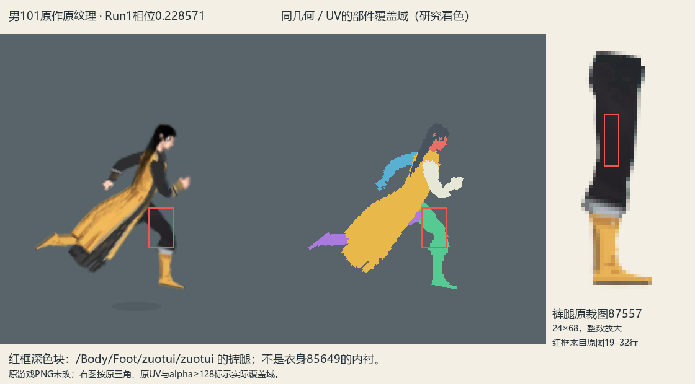

# 鬼谷局内素材形状与拼接研究

2026-11-04。当前阶段为用户要求的原作研究与汇报，暂停新素材生成、高清试装调参和默认接入。此前未验收试装保留作反例；默认试玩入口已恢复素材实验前版本，并完成45帧启动检查。本报告的原作事实不等于此前高清试装已经合格。

用户特别要求保留：**先研究透，再优化。** 后续允许有依据地改进腿与躯干连接、关节覆盖及转动接缝；原作是研究基准，不必机械保留所有结构。当前仍在研究汇报阶段，不据此提前恢复生成或接入。

## 核心结论

原作的素材形状、透明余量、统一像素密度、关节枢轴、蒙皮和遮挡是一套共同设计的装配关系。高清重绘应先保留或重新明确这套关系，再制作清晰的自有水墨部件。先分别生成大图、再把它们挤回旧UV，会改变袖口、手掌、发顶和鞋型，原网格相同也不能保证成品正确。

本轮已逐项核对本机男性101的实际资源、七个活动人物网格、六张独立部件图、源绑定矩阵、逐顶点权重和六段动作。女修10002只作为另一类服装个案，不能用其裸臂与额外挂布解释男性101长袖结构。

## 1. 研究对象与证据范围

男性来源由原ResourceManager的 `battle/human/humanrootman`、`battle/human/humanbodyman` 和 `battle/human/man/body/101/` 确认。读取本机安装资源，不修改原游戏文件。

- [男性原部件图集](../鬼谷原作网格与素材重构_20261104/原作男性候选素材图集.png)
- [男性衣袖网格及权重](../鬼谷原作网格与素材重构_20261104/原作男性101衣袖网格与权重.png)
- [男性原模型连续跑动](../鬼谷原作网格与素材重构_20261104/男修101原模型_Run_New1_连续动态.gif)
- [原模型组装与数据证据](../鬼谷原作网格与素材重构_20261104/原作男性101模型与素材复核.json)
- [原素材精确局部锚点](../鬼谷原作网格与素材重构_20261104/源模型局部锚点.json)
- [完整画布、裁切、Alpha与骨点对照](01_四种坐标不可混用.png)
- [原袖根、肩肘腕和衣身骨链](02_原袖根_关节_衣身骨链.png)
- [静站原部件叠放](03_静站真实部件叠放.png)、[跑动原部件叠放](04_跑动真实部件叠放.png)
- [原Sprite裁剪偏移、完整纹理与序列化字段](原Sprite裁剪偏移与完整纹理字段.json)，以及其中关联的原Texture2D完整PNG；并非只依据导出的紧裁图估算。
- [坐标、袖根、脸发与腿根插接实证](坐标与插接实证.md)，以及[静站腿根](05_静站腿根插接.png)、[跑动腿根](06_跑动腿根插接.png)。
- [原裤腿、靴子分区与足部细图](男性101原裤腿靴子分区与足部细图.png)、[对应源锚点](男性101原靴分区与源锚点.json)。

原网格对照按原绑定矩阵和已定位动画曲线求值，保留常量通道；未知Body路径未强行套用。它可用于研究原部件如何变形，尚不等于复现原游戏状态机、地面校正或DynamicBone完整运行过程。原素材放大图仅用于读结构，不作为本项目成品清晰度标准。

## 2. 原作怎样拆件

| 部件 | Sprite编号 | 原Sprite画布 | 提取后的局部裁图 | 实际组织 |
| --- | --- | --- | --- | --- |
| 连续衣身与袍摆 | 85649 | 60×100 | 42×95 | 40顶点、43三角、7骨；胸腰与两个下摆分支同属连续衣料 |
| 近侧袖臂和手 | 79543 | 60×60 | 16×44 | 35顶点、47三角、3骨；肩肘腕同一蒙皮，袖口及手有明确分区 |
| 远侧袖臂和手 | 84807 | 60×60 | 21×43 | 39顶点、53三角、3骨；独立轮廓，不是把近臂平移复制 |
| 裤腿和靴 | 87557 | 50×80 | 24×68 | 37顶点、43三角、3骨；左右腿共用图片、分别绑定各自髋膝踝链 |
| 头脸 | 65806 | 24×24 | 24×24 | 刚性头部片，依头节点装配 |
| 头发 | 87679 | 21×56 | 21×56 | 41顶点、54三角、5骨；发顶与拖发方向共同服务于头部轮廓 |

影子另作一件，不混入七个人物网格。男性101没有女修紫裙个案的独立五骨前臂挂布；不同服装的拆分方式必须分别核实。

## 3. 原始画布、裁图与锚点必须分清

原Sprite画布、TextureRect裁切区、可见Alpha轮廓、关节枢轴是四种信息。例如近臂原画布为60×60，Sprite声明的pivot为画布中心；实际提取裁图约16×44，肩关节在裁图约(8.58,7.99)，腕关节约(8.92,36.30)。画布中心、裁图中心和肩／腕都不是同一个点。

原部件共享100像素／源单位的像素密度；画布大小按身体部位需要不同。UV还包含裁切偏移与有效矩形，关节坐标须从源绑定关系换算，不能丢掉偏移后按裁图宽高随意对齐。

本轮另从原安装局部读出七个已知Sprite的完整Texture2D，并记录真实 `textureRectOffset`、`atlasRectOffset` 和原字段存在性。TextureRect的XY、显式offset字段和图集偏移分别保存，不因某些数值接近就将它们当成同一个字段。

高清换算应同时保留：完整部件坐标系、有效绘制区、裁切偏移、关节位置和透明余量。提高采样密度时要以统一人体尺度换算各部件，再根据明确模板绘制，不能让每张图独立采用不同的内部占位。

## 4. 肩、手、头发为什么能拼起来

袖根在肩关节上方还有一段衣料，旋转枢轴并不在袖图顶端。袖根与衣身存在实形重叠：近袖在衣身前、远袖在衣身后，不能笼统认为两个袖根都藏在躯干后面。重叠、各自Alpha与层序共同形成接缝，外露边界随肩肘蒙皮连续变形。对本项目的启发是同时设计圆润肩根、覆盖形状与正确层序，而不是只在袖图顶端画个圆。

男性近远袖分别设计，袖宽、倾斜方向和手的位置均不同。袖口在腕前结束，手掌有独立的形状与留边。高清重绘要先固定肩、肘、腕、袖口和手掌的关系，再画褶皱；只对齐一个腕点不足以保证整个手正确。

头脸与头发依同一个头颈装配关系定位。发图有明确的头冠、额前开口、耳侧避让、拖发方向和发尾，不可仅以图片中心或最高点重叠。发件自身还有五骨，头冠与长发末段承担的运动不同。原脸与原发的实形叠放、以及发图为脸留下的透明区域，是拼装关系的一部分。

从后向前，当前男性101的源根Z次序为：远袖、两条腿、衣身、头脸、近袖、头发。该顺序与各图的透明开口配合；头发位于前层不代表它应把整张脸涂黑，袖根藏到后层也不能替代正确的覆盖形状。

## 5. 脚与用户圈出的深色块

用户第二张截图中的深色块已按同相位三角形、UV和Alpha反查，属于87557裤腿，具体为 `Foot/zuotui/zuotui`，不是新增内衬或补缝黑片。上段由大腿骨驱动，下段逐渐过渡到小腿骨；袍衩和衣身遮挡让其在迈腿时显露。

原腿图包含裤腿、靴口束边、靴筒、踝部和脚掌。靴口位于裁图约42—46行，47行起是金色靴筒；不能仅设膝与踝两个点，再把这段整体线性压缩。脚型还需分别保留脚背拱、脚跟、前脚掌、鞋尖和鞋底厚度。

原网格外缘并非可见鞋轮廓：脚尖网格可延伸到裁图约x23.07，而原图的可见Alpha最右约x21，脚背也有落在透明区的网格顶点。这些是活动余量。高清图把余量画实，会在网格完全相同的情况下产生更长、更扁的楔形鞋；仅对齐一条脚底线无法修正。

原Run_New1本身包含后脚向后伸出、屈膝回收及腾空相位。研究脚型时要使用完全相同的动作时刻比较，区分原姿势和贴图变形，不能拿两个不同相位的脚强行对齐地面。

## 6. 衣摆的飘逸感来自什么

男性101衣身是一张连续蒙皮，上身骨、下摆根和下摆分叉共同作用。主要链为 `shenti2 → bone_5 → shenti2_1 → shenti2_2`，另有 `bone_5 → bone_3 → bone_4` 分支；它并非把一片平板绕腰向后旋转。

原长衣本身的前后衣缘、深色内缘和不对称下缘也是动态轮廓的一部分。后续高清设计须先确定对应款式的有效形状；不能画一张前后等长的钟形闭袍，再仅靠改锚点去适配另一种分衩长衣。

已定位Run曲线中有明确的倾身、交替腿、持架与反摆，以及衣摆持续后展基形。原 `bone_5` 上另有DynamicBone组件。由此可确认姿势、基形、分叉蒙皮和动态末段共同影响轮廓；原运行时阻尼、碰撞与状态混合尚未完整实机测量，不能编造其参数。

后续应分别讨论：腰口的稳定、根部后展、前后片区的连续牵连、末缘延迟，以及起停转向的惯性。不能用提高步频、放大整片旋转或只在末端微抖来代替这些关系。

## 7. 可举一反三的下一步

建议后续先建立一张完整人物的装配模板，在同一人体尺上固定头、肩、肘、腕、髋、膝、踝和脚底；再给每件标注完整画布、可见轮廓、透明禁止填区、隐藏覆盖区、关节和像素密度。尺寸倍率可提高，部件之间的关系必须共同换算。

模板和站立装配确认后，再原生绘制我们自己的高清水墨、无五官素材；先检查完整人物静站、抬臂、迈腿和左右朝向，再验证蒙皮与衣摆动态。当前[高清水墨装配标准](../局内人物高清水墨装配标准_20261104.md)仍属于未完成的试装草案，不将其中实验参数当成用户已经批准的最终美术标准。

腿根和躯干的连接可作为后续优化重点：以原作完整裤腿、独立髋膝踝链和袍内遮挡为依据，再讨论我们自己的连接过渡、隐藏重叠和屈髋时的外露轮廓。优化目标与源事实分别记录，不把拟议改进写成原作已经采用的机制。

本轮在研究与汇报阶段停止，不继续生成或替换素材。

## 未验收实验留存

此前的 `guigu_model_copy_skin.gd`、`guigu_hd_registered.gdshader` 和高清注册JSON均保留实验状态，不作为现行默认角色或已批准规范。暂停时注册JSON还含头发UV镜像对照，注册生成脚本与该镜像实验状态不同；此前361项数值／接口检查不代表画面通过。后续若继续，应先根据本研究重新确定模板和注册版本，再生成与验收，不能直接复用这些实验值。
