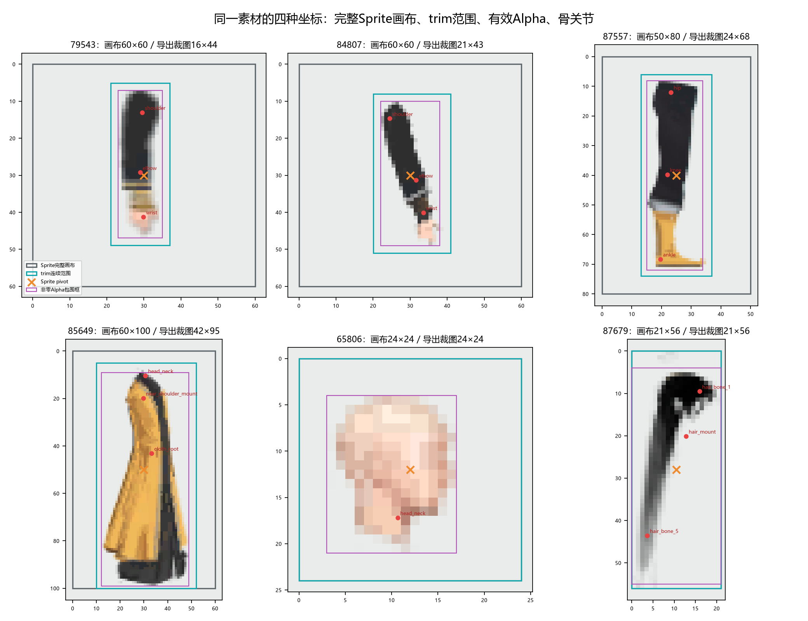
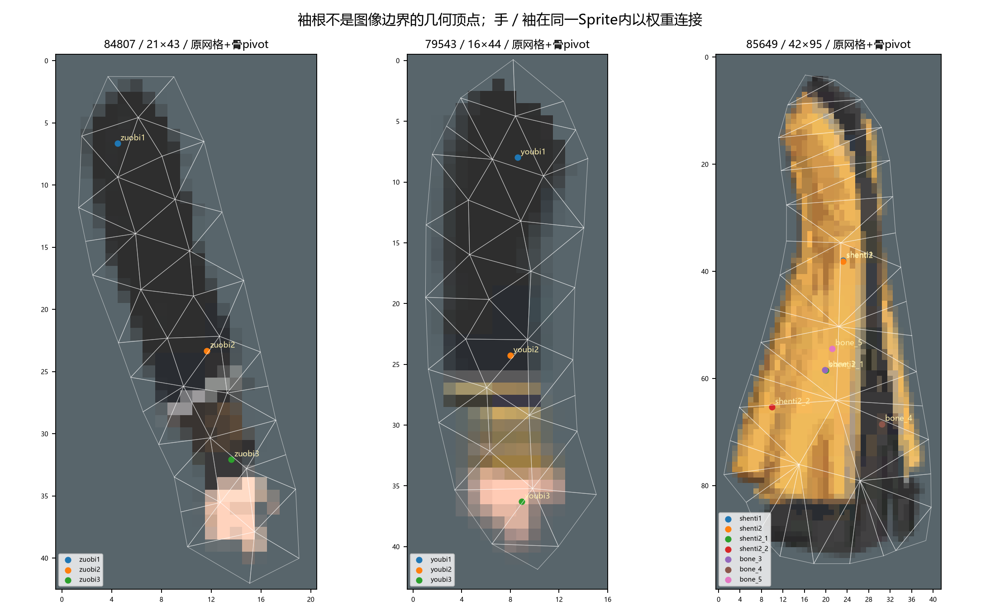
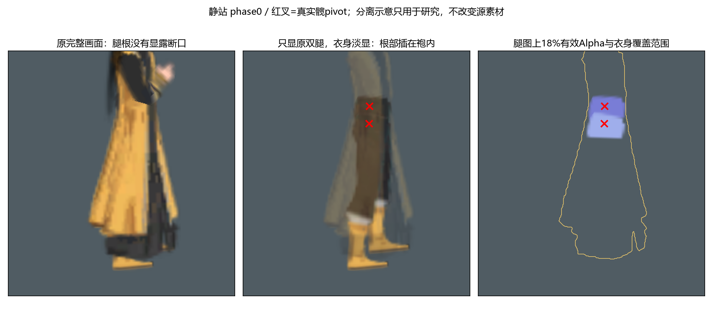
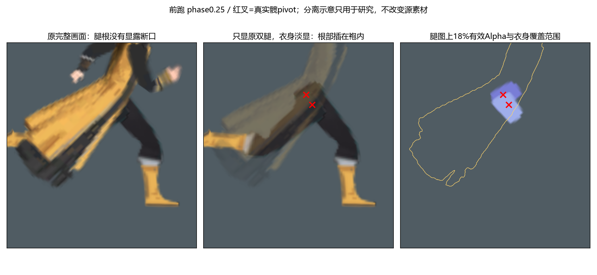

# 男性101：原素材坐标、袖根与腿根插接实证

2026-11-04。当前仅研究原作并汇报，不继续生成素材、调高清注册或修改运行实现。本文补充[研究主入口](README.md)，以本机男性101原Sprite、原网格、绑定矩阵和已定位曲线为证据。原作是研究基准；后续可以依据这些事实优化腿与躯干连接，不要求机械保留所有旧结构。本页不提前实施这些优化。

## 证据与限制

原安装来源为 `guigubahuang_Data/resources.assets`，SHA256为 `0d1e14ae4a2719b91055e201fadf294b600f730e5bfbba14f4806b7619ec3ced`。男性来源由 `battle/human/humanrootman`、`humanbodyman` 和 `battle/human/man/body/101/` 装配关系确认。

本文的装配图使用**原贴图、原三角、原权重和已定位曲线**，没有使用本项目的高清试装。它是只读重建，尚不等于原游戏实录：Run1／Run2各有一个未定位路径被排除，原Animator状态机、相机透明排序设置、地面校正及DynamicBone求解未完整复现。所有覆盖比例只描述注明的两个诊断相位，不能推广成全部动作都已验收。

## 1. 原画布、trim、Alpha与骨pivot是四件事

| 部件 | Sprite矩形／本组选中Texture2D尺寸 | 连续TextureRect宽高 | 导出的整数PNG |
| --- | --- | --- | --- |
| 近袖79543 | 60×60 | 15.897127×43.847755 | 16×44 |
| 远袖84807 | 60×60 | 20.897127×42.930344 | 21×43 |
| 裤腿87557 | 50×80 | 23.897127×67.880974 | 24×68 |
| 衣身85649 | 60×100 | 41.941448×94.973251 | 42×95 |
| 脸65806 | 24×24 | 24×24 | 24×24 |
| 发87679 | 21×56 | 21×56 | 21×56 |

这里的“画布”指资源中的完整Sprite矩形和纹理尺寸，未见原作者的PSD等绘画工程。不能据此断言其原始绘画文档只有这些像素。

本组Sprite声明的pivot均为完整矩形的 `(0.5,0.5)`，但它不是肩、髋或头颈关节。以近袖为例：

- 完整画布pivot是 `(30,30)`；trim在完整画布左上坐标中的起点约为 `(21.026751,5.076124)`。
- 肩的裁图UV约为 `(0.536488,0.181518)`，在16×44导出PNG中约为 `(8.584,7.987)`。
- 腕的裁图UV约为 `(0.557321,0.825070)`，在导出PNG中约为 `(8.917,36.303)`。
- 把肩换回完整画布，约为 `(29.556,13.035)`，显然不在完整画布中心，也不在裁图中心。

骨pivot来自**原bindpose的逆矩阵**；刚性脸和外部挂点来自**renderer矩阵与对应rig骨世界矩阵的换算**。Alpha包围框只是看得见的像素范围，不是关节位置。

本组PPU均为100。近袖的原UV变换为 `[100,30,100,30]`，设Sprite局部点为 `(x,y)`，先得到完整纹理中的左下坐标 `(100x+30,100y+30)`，再减去连续trim起点、除以连续trim宽高，最后翻转Y，才得到导出裁图的左上UV。整数PNG尺寸是最后一层取样尺寸，不能反过来代替60×60或连续trim参与人体尺度换算。

### 已直接核对的偏移字段

[原Sprite裁剪偏移与完整纹理字段](原Sprite裁剪偏移与完整纹理字段.json)保存原序列化字段，而不是从截图推算：本组选中Sprite的 `textureRectOffset` 与其TextureRect的x/y数值相同；`atlasRectOffset=(-1,-1)`、`m_Offset=(0,0)`、`settingsRaw=64`。`packingRotation`没有单独字段；补读记录按已安装UnityPy的SpriteSettings位定义解码为 `packed=false`、`packingRotation=0/kSPRNone`、`meshTypeTight`。这里明确区分原显式字段与读取库的解释，不把二者混称。完整原Texture2D也已只读导出到 `source_full_textures/`，与图中的画布范围交叉核对。

## 2. 袖根依靠重叠、枢轴与层次共同连接

近袖79543与远袖84807分别绘制，并不是同一张臂图平移复制。各自包含整段袖臂与手，以肩、肘、腕三骨连续蒙皮；手不是另外一张PNG贴在袖图的末端。

原图顶端是有面积的肩帽，肩骨位于肩帽内部，顶端之上和四周还有衣料。旋转围绕内部pivot发生，而不是围绕最顶端的透明边缘。因此不能把独立臂图的包围框顶点当作肩点，也不能把可见袖口色带当作腕pivot。

源根Z数值为远袖0.08、两腿0.07／0.06、衣身0.04、脸0.03、近袖0.01、发-0.02；这些renderer的sorting layer/order均为0。按这一源Z后到前重建，**远袖在衣身后，近袖在衣身前**。原游戏具体相机透明排序设置尚未独立实机核验，本文不把这组Z数值推广为所有场景的通用排序规则。

在本页4倍诊断栅格、Alpha≥0.7条件下，袖图上部25%的有效像素与衣身有以下重叠：

| 源相位 | 近袖肩帽与衣身重叠 | 远袖肩帽与衣身重叠 |
| --- | --- | --- |
| Idle 0 | 100% | 100% |
| Run_New1 0.25 | 100% | 约98.5% |

这证明这两个样本中，肩根有真实覆盖余量；不是两张边缘刚好相碰。它不证明所有动作都不会露缝。近袖在前层，意味着重叠区域的一部分由袖自己覆盖衣身；不能把“有重叠”误读为“两只袖根全部藏在躯干后面”。

## 3. 头脸与头发不是中心对中心

脸65806为4顶点刚性片，头发87679为41顶点、5骨蒙皮。两者都由头部装配关系定位，发件还继续通过自己的骨链变化。脸的头颈挂点在自身裁图UV约 `(0.443698,0.716127)`，同一个装配位置在发图里约为 `(0.609374,0.359025)`；两个UV不同完全正常。

脸图的实形、发图的额前开口与耳侧透明区、头冠和长发走向共同决定完整头型。只对齐两图中心、最高像素或总包围框，都会丢掉这套关系。

在本页Idle 0与Run1 0.25重建中，约48%的脸部核心Alpha与发部核心Alpha重叠；其余脸面保持可见。该比例不是新的设计标准，而是说明**透明开口和遮挡本身就是原部件的一部分**。仅保持头发网格和骨数，换图后把原透明区画实，仍会遮错脸。

独立发图的左右形状不能单独判定角色朝向。需要同时看原UV、renderer变换、骨链和完整装配。前一阶段的高清镜像对照属于未验收实验，不属于本文的原作结论。

## 4. 衣身连续，腿图完整，髋根插接在袍内

男装101衣身85649是一张40顶点、43三角、7骨的连续蒙皮。下摆包含 `shenti2 → bone_5` 后的两条分支，而不是前后两张独立板片。旧10002个案的四骨衣身与额外前臂挂布，不能代替男性101的实际结构。

双腿共用完整的87557裤腿／靴图，但分别绑定自身髋、膝、踝链。它们位于 `Body/Foot/...`，衣身位于 `Body/yifu/...`；并非把腿裁成露在袍外的一小截，也没有与衣身共用边缘顶点。实际连接依赖各自变换、动作同步与衣身前层覆盖。

本页把腿图上18%的有效Alpha作为“根部覆盖诊断区域”，得到：

| 源相位 | zuotui根部被衣身覆盖 | youtui根部被衣身覆盖 | 两个真实髋pivot |
| --- | --- | --- | --- |
| Idle 0 | 100% | 100% | 均落在衣身核心Alpha内 |
| Run_New1 0.25 | 100% | 约76.4% | 仍均落在衣身核心Alpha内 |

这说明静站时有完整插接余量，跑动时一部分大腿可以露出，但髋部连接点仍被袍覆盖。**“髋根连接藏住”与“整条大腿永远不可见”是不同要求。** 图中淡显衣身仅为看清原插接，不是对原素材的修改。

用户指出的深色大腿区域已在另一张同相位图中反查到87557裤料，不是补缝黑片；见[裤腿与靴子覆盖域研究](男性101裤腿靴子与覆盖域.md)。原衣身自身也画有深色衣缘，不能只按颜色判断归属。

原脚尖网格还包含透明活动余量：例如源顶点约在裁图x23.07，原可见Alpha右界却约为21。网格边缘不是必须画满的鞋轮廓。靴口、脚背、后跟与鞋底的具体研究另见同页，不在本页据低清像素补造精密足弓。

## 5. 可据此讨论的优化，尚未实施

原作提供的是一套可解释的装配基准，不表示它的每个层级和接缝都必须照搬。后续若优化腿与躯干连接，可以讨论统一髋挂点关系、改进根部转动覆盖及身体底层，但应同时保留完整的被遮住根部、可能露出的大腿形状和真实动作中的覆盖余量，再以同相位完整画面对照。不能只修一张静站图，也不应把露出的大腿误删成透明。

目前确定的是资源形状、坐标、蒙皮、层次和本页样本覆盖。尚未测定的是原状态混合、完整碰撞、原DynamicBone参数与所有动作的接缝表现。下一阶段如何改造应在本轮汇报后决定，本文不恢复此前试装。

完整测量、输入散列与诊断方法见[只读记录](原素材坐标与覆盖_只读测量.json)。
