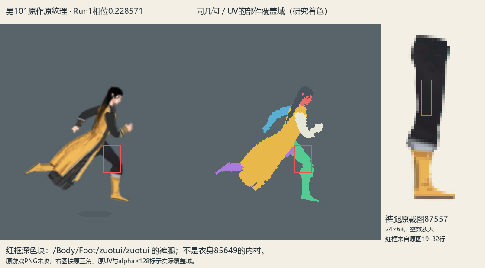
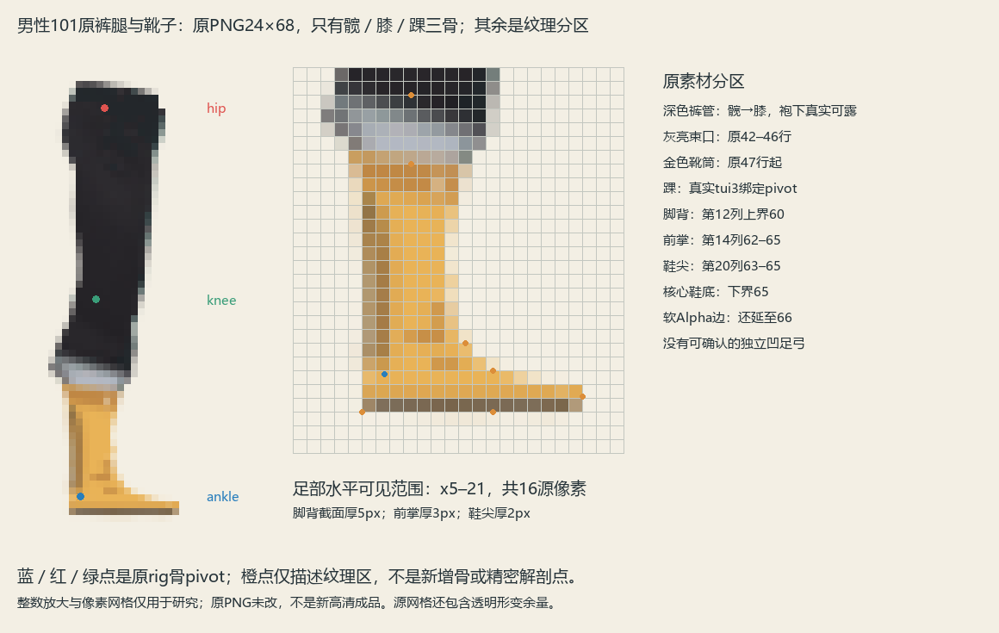

# 男性101裤腿、靴子与实际覆盖域

2026-11-04，只读原作研究。当前阶段先确认源形状和拼接关系，再汇报讨论；本研究未修改原PNG、运行适配器或高清注册，也未生成新美术。

## 一、画面里的深色大腿块来自哪里

本图使用男装101的原纹理、原几何和已定位原动画。时间为 `43/60` 秒，对应Run_New1源相位 `0.2285714704`，采样帧32／33及混合权重均已记录，和本轮第042帧对齐；没有用源第0帧代替当前跑动相位。

深色区域属于原Sprite **87557**，具体实例为 `/HumanRootMan/Root/Body/Foot/zuotui/zuotui`。这是连续裤腿上的裤料，从髋到膝延续，不是额外添加的一块衣服。原衣身85649自身也有深色衣缘，但该区域的采样没有落到衣身上。

使用原三角形重心坐标、原UV、原Alpha和逐顶点权重，获得以下可复核结果。屏幕坐标属于本页440×500原作复现图，不能直接套到任意缩放的用户截图。

| 复现图采样点 | 原87557裁图像素 | 主要源骨权重 |
| --- | --- | --- |
| (245, 290) | (12, 19) | `tui1 = 1` |
| (250, 300) | (11, 23) | `tui1 = 1` |
| (255, 310) | (10, 27) | `tui1 = 1` |
| (260, 320) | (8, 32) | `tui1 ≈ 0.628`，`tui2 ≈ 0.372` |
| (265, 330) | (7, 36) | `tui2 ≈ 0.899`，`tui1 ≈ 0.101` |

完整路径、三角索引、重心坐标、源RGBA及原权重见[深色大腿块与源覆盖域证据](深色大腿块与源覆盖域证据.json)。研究着色图按原UV的Alpha≥128显示每件实际覆盖区域，不是按颜色猜测部件。

## 二、原裤腿怎样和袍子拼在一起

男装101的裤腿和靴子画在同一张Sprite中，左右腿分别装配同一原图。每条腿有独立的髋／膝／踝骨链，衣袍则是另一张连续衣身，使用自己的七骨下摆和分叉。裤腿不与袍摆共用顶点，也不是把裤子裁成永远不露出的短块。

站立时长袍遮住大部分裤腿；迈步后衣袍拖后、腿前送，裤料自然从遮挡后露出。由这一结构可以确认，部件要同时准备“被遮住的完整连接”和“动作中可能露出的有效形状”，不能只依据一张站立图把衣服下方全当作不可见。

这也解释了为何同样的原模型，换一张裤腿图仍会显得不对：如果新图把裤管、束口、靴筒和足部画在另一组内部位置，原网格和骨骼不会自动替图片重新安排这些分区。接近的整体长宽比不足以保证动作中的形状和遮挡一致。

## 三、靴形由原Alpha与网格共同决定

原87557保留37顶点、43三角和3根蒙皮骨。部分网格外缘留在透明区，真实可见轮廓由纹理Alpha继续裁出。

例如，脚尖网格顶点在裁图坐标约 `(23.072, 65.038)`，但原PNG非零Alpha的最右边界为21；脚背顶点约 `(20.704, 60.118)`、`(15.311, 59.300)` 也位于原Alpha透明区。因此，**源网格的脚部包围边不能直接当成要画满的靴子轮廓**。若把余量填实，即使三角索引和骨骼完全不变，鞋仍可能变长、变尖或变成楔形。

脚尖、脚底的大部分原顶点由 `tui3` 单独控制；踝附近存在 `tui2/tui3` 混合，例如裁图约 `(9.220, 60.051)` 的顶点二者权重约0.483／0.517。鞋尖、脚跟、脚背没有另设独立骨，它们首先是该三骨蒙皮上的绘制区域。

原图42–46行可见灰亮束口，47行起进入金色靴筒；足部的最后数行再形成脚背、向前的鞋尖及薄的深色鞋底。束口位置本身属于造型分区，不能只用膝、踝和一条鞋底横线来概括。

[男性101原靴分区与源锚点](男性101原靴分区与源锚点.json)区分了实际髋／膝／踝绑定点和靴口、脚跟、脚背、前掌、鞋尖、鞋底等纹理观察点。以原裁图Alpha≥128和60–64行足部观察区计算，水平可见范围为X5–21，共16源像素；第12列脚背截面厚5像素，第14列前掌截面厚3像素，第20列鞋尖截面厚2像素，深色底缘约1像素。它表现为较薄鞋尖和保有体积的脚背、靴筒，不能把三者全部压成一条细底线。这些是明确截面上的低清像素比例，不是精密人体测量或新的游戏数值。

本相位的原后脚本来就存在向后下方伸出的尖头姿势。它和足部绘制是否被扭成细楔形是两个需要分别核对的现象：前者可在同相位原纹理中看到，后者必须比较真实Alpha与UV覆盖，不能看到尖端就擅自修改原动作。

## 四、不要混淆原画布、裁图与骨pivot

原腿Sprite的设计画布是50×80，pivot为完整画布的 `(0.5,0.5)`；提取到的原PNG只有24×68。原 `TextureRect` 是浮点裁区，宽高约23.897×67.881，随后才成为整数PNG尺寸。二者不是同一坐标系。

本页的裁图骨pivot由原bindpose的逆矩阵得到Sprite局部点，再通过原顶点到 `uvCropLowerLeft` 的精确仿射换算，并翻转Y。踝点在原24×68裁图约 `(6.632109, 62.310968)`，不是图片中心，也不是原50×80画布pivot。完整画布留白、裁区偏移、PNG整数尺寸和骨关节必须分别记录，不能用任一中心代替另一项。

本轮又从原安装局部补读了七个已知Sprite及其完整Texture2D；[原Sprite裁剪偏移与完整纹理字段](原Sprite裁剪偏移与完整纹理字段.json)保存 `textureRectOffset`、`atlasRectOffset`、`settingsRaw`、`m_Offset` 等实际字段及其存在标记，[完整原纹理目录](source_full_textures)保留原画布小PNG。原腿实际 `textureRectOffset` 为 `(13.02675056, 6.04290771)`；不能先把裁图中心当骨点，再用这个偏移补救。七个实例均为 `settingsRaw=64`，按明确的位解析得到 `packed=false`、`packingRotation=kSPRNone`，未把不存在的独立 `packingRotation` 属性伪报为原字段。

男女结构也必须分开：本页男101是长裤、长靴、连续长袍和双侧长袖；此前女10002紫裙的裸腿、部分裸臂及独立前臂挂布不构成本页男装规则。

## 五、研究边界与后续理解

足部词汇中的靴口、脚背、脚跟、前脚掌、鞋尖和鞋底用于描述原纹理区域，不代表源rig中有同名关节。低清原图里没有足够证据的足弓形状，不应补写成原作存在的精密解剖结构。

原作这一套素材组织可以归纳为：先用衣身、完整裤腿和靴子等部件确定造型及遮挡，再以实际绘制区安排骨点和混合权重，网格外缘留出形变余量，最后由Alpha决定可见边界。后续举一反三应同时复核这些关系，而不是只照某一个数值、UV中心或单张姿势。

腿与躯干连接仍有后续优化空间。可确认的源依据是：原裤腿不透明形状向髋pivot上方伸出，裁图Alpha顶边约Y2、髋pivot约Y5.924，保留约4源像素的上插覆盖；它靠完整裤管与袍衣的层叠共同接合。后续可以围绕腿根外形、衣下覆盖和迈步时的露出范围讨论优化，不必把原深色面积或每一条轮廓机械照搬。但不能只把当前露出的局部黑块硬裁掉，否则可能连被袍子遮住的连接余量一起破坏。本阶段仅记录这一事实依据，不进行造型、骨架或接入改动。

本页使用原绑定和已定位曲线的独立重建，未复现原游戏完整状态机、混合树、碰撞和DynamicBone求解。原安装与原素材没有修改；本阶段只提供研究证据，不表示此前高清试装已经通过。
