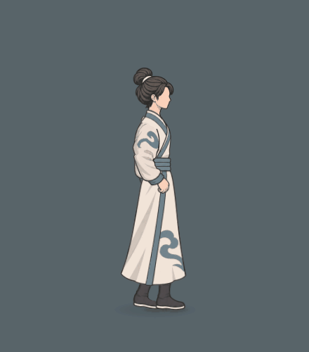

# 鬼谷持架跑姿与衣摆

2026-11-04。用户要求查看当前角色骨骼及本机《鬼谷八荒》，让跑动姿势和衣摆整体接近原作；针对旧版双臂交替的冲突，明确选择“手臂也按鬼谷参考的持架跑姿调整”。本轮以[当前主案页首裁定](../../plans/界面与美术/参考归墟行单一移动步态_20261104.md)为准。

## 实际画面

- [同输入：调整前后对照](改前与鬼谷式跑动_同输入5秒.gif)
- [实际局内尺寸：跑动与停步](鬼谷式跑动3秒与停步2秒_实际局内.gif)
- [跑姿、衣摆及停步四相位](跑姿衣摆与停步_四相位.png)

近景与战场均为Godot实际渲染；主段是连续3秒普通跑动及2秒松键，没有以纯跑动循环替代停步。保留原衣服、发型、骨长、静站和单一移速；持架只改变外观，不产生架招或格挡效果。首页「试演与预览 → 即时战斗·鬼谷式试玩」及同皮肤人物即时演练重新进入后加载新版。

## 骨骼与衣摆适配

本机原安装 `E:\SteamLibrary\steamapps\common\鬼谷八荒\guigubahuang_Data\resources.assets` 的SHA256已重新核对，与既有只读导出一致。研究对象为10002人物已定位骨链；Run_New1和Run_New2各采64相位，含常量轨道，排除未解析的Body绑定。前者作为前进参考，后者仅作为反向姿态参考，不根据名称推断原游戏状态机。

近侧对应原作youbi/right，屈肘持续持在肩前；远侧对应zuobi/left，随脚步大幅反摆。两臂按同一源相位取样；腕目标逐侧按原链长归一化，再使用玉虚自身上下臂长解算，避免直接搬角度后因两者臂长比例不同而抬高手腕。原静站和攻击、架招、运功、错步及四段拳掌保持专用姿态优先。

后脚提前屈膝回收、加深收腿并适度扩大迈步，步频和实际位移速度保持。身体轴随源腰颈重心曲线及本项目惯性弹簧倾身；肩髋挂点共同参与，头颈继续衔接。脚底沿自有鞋轮廓求接触，腿长不伸缩。

前后衣摆共同后展，后片承担主要拖曳；根部基形随同一跑步相位变化，中末段保留重力、弹性、加速度驱动与分段阻尼。松键后保留余势再自然回垂。原作DynamicBone的存在已确认，但本轮使用本项目二维惯性求解，没有声称复现其完整求解器或实机停步参数。

## 验收

最终源码与捕捉来源由[原生捕捉与验收记录](原生捕捉与验收记录.json)关联；[29项跑姿与衣摆专项](持架跑动专项检查.json)保存数值和逐项结果。

- 114／235两端近腕持续位于肩前约0.46–0.60倍自身臂长，远腕前后范围约-0.79至+0.40，形成明显不对称持架与反摆。膝屈峰约100.4°／104.7°，可见肩髋轴前倾约16–22°。这些是本项目结果，非原作直接数值。
- 专项覆盖1080帧，臂长最大误差约0.000134、腿长约0.000115、鞋底接触约0.000054骨架单位；衣料不透明采样未触地。另独立1080帧腿长及鞋底检查通过。
- 原静站与9种静止／专用姿态的非衣骨与本轮前基准一致；暂停冻结、世界朝向连续、停步衰减、时间重开与瞬移复位通过。旧交替臂及“仅衣摆改变、身体与v3完全相同”的断言已被用户本轮授权覆盖。
- 单一普通移动23项、大世界共享接口12项、主项目原试玩入口45帧启动通过；实际录像中移速114、体力6、生命100保持，敌人AI与镜头仍按原规则推进。

动作源：`tools/action_battle_test/reference_walk_skin.gd`；源关节轮廓：`tools/action_battle_test/guigu_run_pose_profile_20261104.json`；真实旧版快照：`tools/action_battle_test/reference_walk_pre_guigu_baseline_20261104.gd`。原衣摆与整体骨链事实见[原只读研究](../跑动衣摆后飘与停步回落_20261104/鬼谷衣摆结构复核.md)、[整体步态复核](../跑动衣摆后飘与停步回落_20261104/鬼谷整体步态骨骼复核.md)，其中旧“双臂自然摆动”取舍现由本页用户裁定覆盖。
