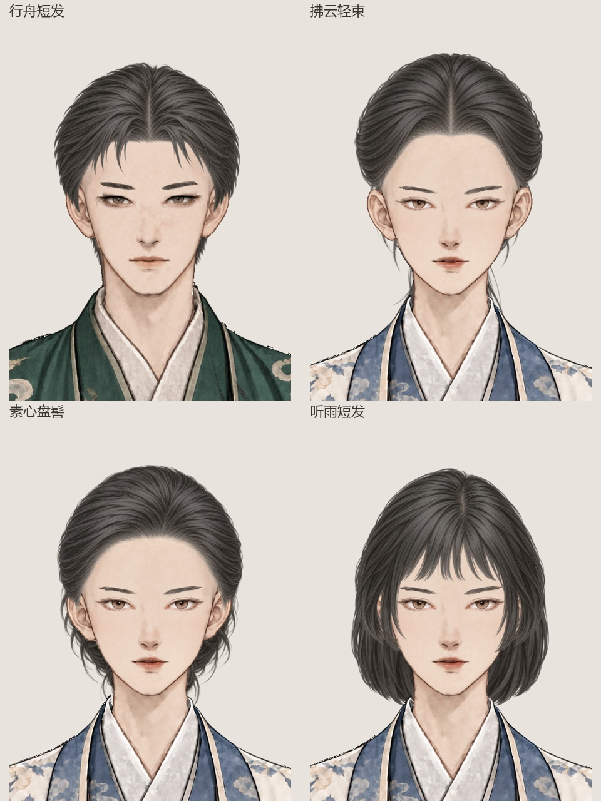
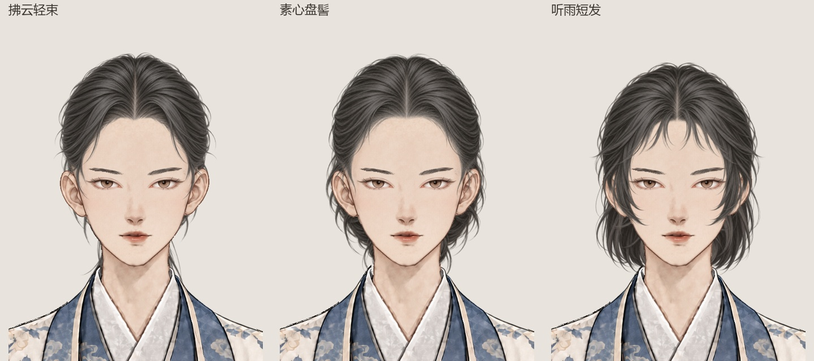
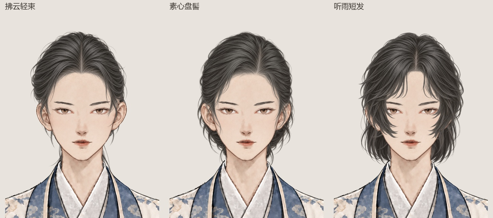
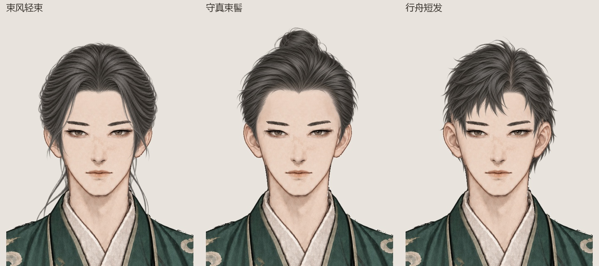

> 最新（2026-10-08）：玉虚仙宗杂役、外门、内门、真传男女常服已接入衣着选项。新增八张衣服层；原 88 项选款顺序不变，当前为 96 项有效选款、99 张部件图。

# 水墨九部位立绘测试包 · 2026-10-04

## 当前：玉虚四级常服接入（2026-10-08）

玉虚仙宗杂役、外门、内门、真传四级男女常服共八张已接入人物档案 → 装备 → 衣着。男、女服装各有七个选项；原三套的保存编号与选择顺序不变，新常服追加为编号 3–6。选择先进入预览，“换上”后沿用既有 `appearance_clothes_style`，同步人物立绘和对白选图，不改战斗数值、灵石、贡献或弟子身份。九部位开始菜单入口已逐项检查 96 种选款。

衣着列表暂不按宗门/弟子等级限制，也不增加购买或解锁条件；宗门资格规则和战斗皮影服饰仍待后续策划确认。服装来源与校验见[接入记录](source/yuxu_clothing_integration_20261008/integration_manifest.json)、[衣着入口验证](wardrobe_verification_20261008.json)、[九部位游戏入口验证](game_verification.json)和[四级男女拼接预览](../yuxu_daily_drafts_20261005/preview/yuxu_four_ranks_20261005.jpg)。

## 当前：短发鬓角修订

男款缩短耳前尖片，并收短耳垂后方向颈侧下扎的后发；女款去掉厚重内勾脸颊的长鬓，改为短鬓向后收拢，露出耳前与面颊。继续顺直、简洁、少碎发；肤色与五官保持自己的原版，发色、发质统一为炭黑、暖灰哑光水墨。前后层独立，耳朵仍来自脸型，不按耳形挖缺口。

使用**内置 imagegen**定向编辑三件：[男前发](male/hair_front/08.png)、[女前发](female/hair_front/08.png)、[男后发](male/hair_back/08.png)。[提示集与来源](source/short_sideburn_revision_20261006/selected_prompts.json)、[整层配准](source/short_sideburn_revision_20261006/registration.json)、[素材检查](source/short_sideburn_revision_20261006/asset_verification.json)均已保存。只做整层等比缩放、平移及材质色阶校准，没有局部扭曲。

查看[修改前后](preview/short_sideburn_before_after_20261006.jpg)、[左右鬓角细节](preview/short_sideburn_detail_20261006.jpg)、[独立拆件](preview/short_sideburn_split_20261006.jpg)、[七种脸型试拼](preview/short_sideburn_face_qa_20261006.jpg)、[十六种后发混搭](preview/short_sideburn_mix_20261006.jpg)、[浅深底](preview/short_sideburn_light_dark_20261006.jpg)。当前造型待用户评价。

已通过[三件导入纹理检查](source/short_sideburn_revision_20261006/runtime_texture_verification.json)与[实际游戏入口](game_verification.json)：88 项选款、72 种前后发组合、18 项显隐、男女记忆、锚点显示、随机／重置。当前标记为 `short_sideburn_revision_20261006`；查看实际[男短发](preview/male_short_sideburn_game_08.png)、[女短发](preview/female_short_sideburn_game_08.png)。

## 前一阶段：顺直简洁版（短发已由上节继续修订）

| 发型 | 新绘前层 | 新绘后层 |
| --- | --- | --- |
| 行舟短发 | [行舟短发](male/hair_front/08.png) | [行舟短垂](male/hair_back/08.png) |
| 拂云轻束 | [拂云露额](female/hair_front/06.png) | 原后发 06 沿用 |
| 素心盘髻 | [素心分缕](female/hair_front/07.png) | 原后发 07 沿用 |
| 听雨短发 | [听雨短帘](female/hair_front/08.png) | [听雨齐颈](female/hair_back/08.png) |

使用**内置 imagegen**新绘六件，减少碎发、尖刺、卷曲鬓丝与羽状侧发，统一原有炭黑、暖灰哑光高光及细密水墨笔触。肤色与五官沿用。[完整提示集](source/straight_hair_redesign_20261006/selected_prompts.json)、[原稿来源](source/straight_hair_redesign_20261006/generation_results.json)、[实际头壳配准](source/straight_hair_redesign_20261006/registration.json)、[废稿留档](source/straight_hair_redesign_20261006/rejected/)已保存。每件只做整层等比缩放与平移，无局部拉伸。

此前男修发帽在太阳穴处收窄过早。现在按自己的脸型 01 在 y180–340 的左右实色头壳边界逐行检查，未被前发覆盖的边界像素由 34 变为 0；另外记录十行左右宽度，查看[男头壳叠图](preview/straight_male_skull_overlay_20261006.jpg)与[女头壳叠图](preview/straight_female_skull_overlay_20261006.jpg)。检查只针对该头壳区域，不是完整解剖分割，也不等于三点残差认证或用户审美验收。

已查看[废稿与新稿对照](preview/straight_hair_before_after_20261006.jpg)、[十五张不同脸型试装](preview/straight_hair_face_qa_20261006.jpg)、[女修九种组合](preview/straight_female_hair_mix_20261006.jpg)、[原后发组合](preview/straight_hair_old_mix_20261006.jpg)及[六件浅深底拆分](preview/straight_hair_split_20261006.jpg)。[素材检查](source/straight_hair_redesign_20261006/asset_verification.json)确认六件 1024×1536 RGBA，其余 85 张部件保持原哈希，原名称及选择配置逐字节保持。

开始菜单 → 立绘测试，原名称现在读取顺直版。当前[纹理检查](source/straight_hair_redesign_20261006/runtime_texture_verification.json)与[游戏检查](game_verification.json)随此次替换更新，造型待用户评价。

运行结果标记 `straight_hair_redesign_20261006`，通过六张导入纹理、88 项选款、72 种前后发组合、18 项显隐、锚点显示、男女记忆及随机／重置。实际截图：[行舟](preview/male_straight_hair_game_08.png)、[拂云](preview/female_straight_hair_game_06.png)、[素心](preview/female_straight_hair_game_07.png)、[听雨](preview/female_straight_hair_game_08.png)。

## 废稿：四款前发重绘（用户已否定）

此四款曾通过技术检查，随后因整体造型与男修发帽过窄被用户否定；下图及记录只供追溯。

| 名称 | 修订内容 | 独立前发 |
| --- | --- | --- |
| 行舟短发 | 减少尖刺，柔顺碎刘海、短鬓 | [男 08](male/hair_front/08.png) |
| 拂云露额 | 居中分缝，平衡两侧鬓角与发量 | [女 06](female/hair_front/06.png) |
| 素心分缕 | 减少偏分、单侧膨起，正视梳拢 | [女 07](female/hair_front/07.png) |
| 听雨短帘 | 缩短刘海，厚发束移向脸侧外缘 | [女 08](female/hair_front/08.png) |

使用**内置 imagegen**逐件新绘，统一第一款的炭黑、暖灰哑光高光与细密水墨发丝。[选定提示集](source/hair_front_refinement_20261006/selected_prompts.json)、[原稿来源](source/hair_front_refinement_20261006/generation_results.json)、[本项目配准](source/hair_front_refinement_20261006/registration.json)、[四张上一版](source/hair_front_refinement_20261006/previous/)已保存。只做整层等比缩放、平移与色阶校准，不局部拉伸。前层不含耳朵、皮肤或眉眼，后发经试拼继续沿用。

已查看[前后对照](preview/hair_front_refinement_before_after_20261006.jpg)、[女修九种新款组合](preview/female_hair_front_refined_mix_20261006.jpg)、[四种脸型试拼](preview/female_hair_front_refined_face_qa_20261006.jpg)、[原后发混搭](preview/hair_front_refined_old_back_mix_20261006.jpg)及[浅深底拆件](preview/hair_front_refined_split_20261006.jpg)。[素材检查](source/hair_front_refinement_20261006/asset_verification.json)确认四张 1024×1536 RGBA，其余 87 张部件保持原哈希，肤色、五官及选择配置沿用；仍为视觉试装候选，造型待用户评价。

当前[游戏入口检查](game_verification.json)及[导入纹理检查](source/hair_front_refinement_20261006/runtime_texture_verification.json)随修订更新。入口仍为开始菜单 → 立绘测试；原名称直接读到重绘版。

运行检查标记 `hair_front_refinement_20261006`，通过四张导入纹理、88 项选款、72 种前后发交叉组合、18 项显隐、锚点显示、男女记忆及随机／重置。实际截图：[行舟](preview/male_hair_front_refined_game_08.png)、[拂云](preview/female_hair_front_refined_game_06.png)、[素心](preview/female_hair_front_refined_game_07.png)、[听雨](preview/female_hair_front_refined_game_08.png)。[四款当前预览](preview/hair_front_refined_four_20261006.jpg)已保存。

## 前一阶段：女修三组发型（前发已由上节修订）

| 整套感觉 | 独立前发 | 独立后发 |
| --- | --- | --- |
| 拂云轻束 | [拂云露额](female/hair_front/06.png) | [拂云轻束](female/hair_back/06.png) |
| 素心盘髻 | [素心分缕](female/hair_front/07.png) | [素心盘髻](female/hair_back/07.png) |
| 听雨短发 | [听雨短帘](female/hair_front/08.png) | [听雨齐颈](female/hair_back/08.png) |

使用**内置 imagegen**逐件绘制，短发前层另做定向编辑清除耳部残留。[选定提示集](source/female_practical_hair_expansion_20261006/selected_prompts.json)、[原稿来源](source/female_practical_hair_expansion_20261006/generation_results.json)、[本项目配准记录](source/female_practical_hair_expansion_20261006/registration.json)均已保存。发色统一为自己的炭黑与暖灰高光，发丝保持细密哑光水墨笔触；前层不携带耳朵、皮肤或眉眼，后发连续覆盖后脑与颈后，不挖耳形缺口。按女修自己的头轴 x519 整层等比试装，无局部拉伸。

已查看[九种新件混搭](preview/female_practical_hair_mix_20261006.jpg)、[六种原款混搭](preview/female_practical_hair_original_mix_20261006.jpg)、[四种脸型试拼](preview/female_practical_hair_face_qa_20261006.jpg)与[浅深底拆件](preview/female_practical_hair_split_20261006.jpg)。[素材检查](source/female_practical_hair_expansion_20261006/asset_verification.json)确认六件 1024×1536 RGBA、原有 85 张部件保持原哈希，肤色及五官沿用；[导入纹理检查](source/female_practical_hair_expansion_20261006/runtime_texture_verification.json)通过六件。造型仍待用户评价。

开始菜单 → 立绘测试 → 女修。新前发追加为选择序号 5–7、新后发为 6–8，均对应物理文件 06–08，可分别选择。当前[游戏检查](game_verification.json)与实际截图：[拂云](preview/female_practical_hair_game_06.png)、[素心](preview/female_practical_hair_game_07.png)、[听雨](preview/female_practical_hair_game_08.png)。

当前入口检查通过 88 项选款、男女共 72 种新／原前后发交叉组合（女修 36 种）、18 项显隐、锚点显示、男女选择记忆、随机／重置及参考女修预设。[数量说明检查](source/female_practical_hair_expansion_20261006/ui_summary_verification.json)确认男女均前发 7 款／后发 8 款，性别切换同步刷新。

## 前一阶段：男修三组干练发型（继续沿用）

| 整套感觉 | 独立前发 | 独立后发 |
| --- | --- | --- |
| 束风轻束 | [束风露额](male/hair_front/06.png) | [束风短尾](male/hair_back/06.png) |
| 守真束髻 | [守真拢发](male/hair_front/07.png) | [守真束髻](male/hair_back/07.png) |
| 行舟短发 | [行舟短发](male/hair_front/08.png) | [行舟短垂](male/hair_back/08.png) |

使用**内置 imagegen**新绘，完整[选定提示集](source/practical_hair_expansion_20261006/selected_prompts.json)、[原稿来源](source/practical_hair_expansion_20261006/generation_results.json)、[配准记录](source/practical_hair_expansion_20261006/registration.json)已保存。统一第一款的炭黑发色、暖灰高光和细密哑光水墨发丝；前侧颅顶、鬓发与刘海归前发，后髻及颈后／肩后发归后发，不挖耳形缺口。每件一次整层等比缩放和平移，不局部形变。仍为视觉试装候选，待用户评价。

已查看[九种新件混搭](preview/male_practical_hair_mix_20261006.jpg)、[六种原款混搭](preview/male_practical_hair_original_mix_20261006.jpg)、[三种脸型试拼](preview/male_practical_hair_face_qa_20261006.jpg)、[浅深底独立拆件](preview/male_practical_hair_split_20261006.jpg)。[素材检查](source/practical_hair_expansion_20261006/asset_verification.json)确认六张 1024×1536 RGBA 与原有 79 张素材哈希保持；[导入纹理检查](source/practical_hair_expansion_20261006/runtime_texture_verification.json)通过六件；[该阶段入口检查](source/female_practical_hair_expansion_20261006/previous/game_verification.before.json)通过 82 项选款、36 种前后发混搭、18 项显隐、原锚点、男女记忆和随机／重置。实际入口截图：[束风](preview/male_practical_hair_game_06.png)、[守真](preview/male_practical_hair_game_07.png)、[行舟](preview/male_practical_hair_game_08.png)。

开始菜单 → 立绘测试；新款已追加在男修前发和后发列表。现有前发选择序号 1–4 保持，新增为 5–7，分别对应物理文件 06–08；后发新增为选择序号 6–8。可独立组合。[鬼谷八荒原素材研究](../../../docs/美术规范/鬼谷八荒发型多样性研究_20261006.md)只借鉴形态变化，未复制原游戏像素与定位。

入口状态栏读取当前性别的配置数量；该阶段男修前发 7 款／后发 8 款、女修 4／5。[该阶段说明冒烟检查](source/practical_hair_expansion_20261006/ui_summary_verification.json)通过性别切换与三组新截图；当时编译零警告、零错误。女修增补后的当前数量为男女均 7／8。

## 历史：缩短每只眼睛的横向长度（当前眼睛仍沿用）

[修改前后同脸同眉对照](preview/male_eye_width_before_after_20261006.jpg)、[第一款同尺度对照](preview/male_eye_width_first_comparison_20261006.jpg)、[独立透明眼睛层](preview/male_eye_width_split_20261006.jpg)、[三种脸型试拼](preview/male_eye_width_qa_20261006.jpg)。

| 名称 | 独立透明素材 | 眼缘辅助指标：修改前 → 本次 |
| --- | --- | --- |
| 凝岳沉目 | [04.png](male/eyes/04.png) | 73×20 → 60×20 |
| 长风清目 | [08.png](male/eyes/08.png) | 64×21 → 52×19 |
| 苍山静目 | [09.png](male/eyes/09.png) | 74×21 → 58×22 |

指标采用同一画布区域和色阈值，包含眼睑笔触，不是精确眼球或虹膜分割。宽度缩短约 18% / 19% / 22%，纵向开合基本保留；没有单独挤压眼睛、压扁虹膜或改变瞳孔锚点。每整对只做一次等比配准，原稿瞳孔间距变化所造成的放大另行检查，未通过的凝岳前两稿留档废弃。

使用**内置 imagegen**重绘，见[选定提示集](source/eye_width_revision_20261006/selected_prompts.json)、[原稿来源](source/eye_width_revision_20261006/generation_results.json)与[配准记录](source/eye_width_revision_20261006/registration.json)。只清理底色、做整对等比配准；保留短睫毛、水墨边缘与柔和色阶。原瞳孔仍为 `(464,375)`、`(569,375)`。

[素材检查](source/eye_width_revision_20261006/asset_verification.json)确认仅替换三张 1024×1536 RGBA 男眼，其他 76 张磁盘部件保持原哈希。眉毛完全独立；第一款、肤色、头发、名称和选款编号保持原样。18 种无前发试拼已查看，造型待用户视觉评价。

[当前导入纹理检查](source/eye_width_revision_20261006/runtime_texture_verification.json)通过 14 张眉眼校验；[当前实际入口检查](game_verification.json)标记 `eye_width_revision_20261006`，通过全部 76 项选款、30 种眉眼交叉组合、18 项显隐、原锚点、男女记忆和随机/重置。已查看实际游戏截图：[凝岳](preview/male_eye_width_game_04.png)、[长风](preview/male_eye_width_game_08.png)、[苍山](preview/male_eye_width_game_09.png)。

当前重建工具为 `tools/build_eye_width_revision_20261006.py`；上一阶段多样性构建器已禁止覆盖当前修订。

## 历史：三款男眼开合与多样性（横向长度已由上节修订）

[修改前后同脸同眉对照](preview/male_eye_diversity_before_after_20261006.jpg)、[独立眼睛层浅深底](preview/male_eye_diversity_split_20261006.jpg)、[三种脸型试拼](preview/male_eye_diversity_qa_20261006.jpg)。

| 名称 | 新轮廓 | 独立透明素材 |
| --- | --- | --- |
| 凝岳沉目 | 舒展上挑凤目 | [04.png](male/eyes/04.png) |
| 长风清目 | 中央弧度较圆、开合更充分 | [08.png](male/eyes/08.png) |
| 苍山静目 | 上睑较平、覆睑沉稳、外角更放松 | [09.png](male/eyes/09.png) |

使用**内置 imagegen**绘制，见[选定提示集](source/eye_diversity_revision_20261006/selected_prompts.json)、[原稿来源与哈希](source/eye_diversity_revision_20261006/generation_results.json)及[整对配准记录](source/eye_diversity_revision_20261006/registration.json)。原图中的浅色眼周底色转为连续透明笔触并柔化远端底色；眼睛本体和短睫毛保留。整对只做等比缩放和平移，不分别拉伸、旋转或程序绘画。

[素材检查](source/eye_diversity_revision_20261006/asset_verification.json)确认仅替换上述三张，其他 76 张磁盘部件保持原哈希。每件 1024×1536 RGBA，眉毛完全独立；第一款、肤色、发型、选款配置均保持原样。已查看三款 × 三种脸型 × 浅深底共 18 种无前发试拼，造型仍待用户评价。

[鬼谷八荒多款男眼研究记录](../../../docs/美术规范/鬼谷八荒眼型多样性研究_20261006.md)区分实际轮廓差异与仅换瞳色的款式。圆杏款另参考原游戏 121 的圆开合概念，绘制风格和颜色取本项目第一款，未复制原游戏像素或锚点。

[该阶段导入纹理检查](source/eye_diversity_revision_20261006/runtime_texture_verification.json)通过 14 张眉眼透明度与颜色校验。[该阶段实际入口检查](source/eye_width_revision_20261006/previous/game_verification.before.json)标记 `eye_diversity_revision_20261006` 并通过全部 76 项选款、30 种眉眼交叉组合、18 项显隐、原锚点、男女记忆及随机/重置。当时游戏截图：[凝岳](preview/male_eye_diversity_game_04.png)、[长风](preview/male_eye_diversity_game_08.png)、[苍山](preview/male_eye_diversity_game_09.png)。

本节记录上一阶段多样性修订；当前横向长度由上节重绘，上一阶段构建器已禁止覆盖当前版本。

## 历史增补：以第一款统一画风（08、09 眼睛已由上节替换）

[第一款与三组新款对照](preview/male_first_style_comparison_20261006.jpg)、[独立拆件浅深底对照](preview/male_first_style_split_20261006.jpg)、[三种脸型试拼](preview/male_first_style_qa_20261006.jpg)。第一款母件本身保持原样；早先本轮的粗颗粒稿未进入选项，留档在 `source/style_expansion_20261006/rejected_style_mismatch/`。

| 气质 | 独立眉毛 PNG | 独立眼睛 PNG |
| --- | --- | --- |
| 温润 | [温玉柔眉](male/eyebrows/07.png) | [温玉和目](male/eyes/07.png) |
| 英挺 | [长风平眉](male/eyebrows/08.png) | [长风清目](male/eyes/08.png) |
| 沉稳 | [苍山厚眉](male/eyebrows/09.png) | [苍山静目](male/eyes/09.png) |

- 采用内置 imagegen 模式分别绘制六张原稿：[完整提示](source/style_expansion_20261006/first_style_jobs.json)、[选定来源](source/style_expansion_20261006/first_style_generation_results.json)、[第一款参考记录](source/style_expansion_20261006/reference_first/reference_record.json)。参考放大只供绘制观察，不替换原件。
- [配准与色阶记录](source/style_expansion_20261006/first_style_registration.json)。成对眉眼只作整层等比缩放和平移，沿用本项目锚点；眉毛使用第一款的墨色与透明度，绘制稿的细毛反差保留在连续透明笔触中。眼睛只保留眼球、眼缘和克制短睫毛，没有眉毛或眼周不透明皮肤底片。
- [素材检查](source/style_expansion_20261006/asset_verification.json)确认只新增六件，原有 73 张磁盘部件保持原哈希。六张均为 1024×1536 RGBA，透明 RGB 清零；已查看三种脸型、浅深底共 18 种无前发试拼。仍为待用户视觉评价的候选，未宣称通过正式三点残差认证。
- 本节记录初次增补阶段，当前 08、09 眼睛由上节替换；该阶段构建器已禁止覆盖最新版本。

## 历史：2026-10-05 三款眼睛修订（04 已由上节替换）

- [上一版与本次对照](preview/male_natural_eye_before_after_20261005.jpg)、[原有大小基准对照](preview/male_natural_eye_reference_20261005.jpg)、[独立眼睛层浅深底](preview/male_natural_eye_split_20261005.jpg)。
- 最终透明素材：[凝岳沉目](male/eyes/04.png)、[磐石朗目](male/eyes/05.png)、[凌锋锐目](male/eyes/06.png)。只替换这三张眼睛层，其他 70 张磁盘部件及全部眉毛保持原哈希。原瞳孔锚点和选款编号沿用。
- 使用内置 imagegen 定向编辑：[初次编辑提示](source/natural_eye_scale_20261005/prompts.json)、[凝岳选定提示](source/natural_eye_scale_20261005/ningyue_geometry_preserving_prompt.txt)、[选定原稿来源](source/natural_eye_scale_20261005/generation_results.json)。
- [配准记录](source/natural_eye_scale_20261005/registration.json)、[素材检查](source/natural_eye_scale_20261005/asset_verification.json)。整对只作等比缩放和平移，不单独拉伸眼睛；三款各搭配三种脸型、浅深底，共 18 种无前发预览已查看。
- 相同区域和色阈值下，本次眼缘宽高均小于上一版；宽度 68 / 66 / 66 px，在原有男眼 65–72 px 范围内；高度 16 / 16 / 18 px。凝岳比自身原基准宽 3 px，其余两款比自身原基准窄。浅色露白指标相对原基准及上一版均减少。这些指标只辅助视觉检查，不作为精确眼球分割。
- 本节记录当时的缩小阶段，当前 04 眼睛由上节替换；该阶段构建器已禁止覆盖最新版本。
- [该阶段运行时纹理检查](source/natural_eye_scale_20261005/runtime_texture_verification.json)通过，眼睛与眉毛导入纹理匹配当时 PNG（应用既有透明边缘修复）。[该阶段游戏检查](source/style_expansion_20261006/previous/game_verification.json)标记 `natural_eye_scale_20261005`，通过 70 项选款及名称、九种新眉眼交叉组合、18 项显隐、原锚点、随机/重置及男女选择记忆。
- 已查看当前实际入口：[凝岳](preview/male_natural_eye_game_1.png)、[磐石](preview/male_natural_eye_game_2.png)、[凌锋](preview/male_natural_eye_game_3.png)。

## 上一轮减少露白（已继续修订）

- [减少露白前后对照](preview/male_sclera_before_after_20261005.jpg)、[三款完整拼接](preview/male_sclera_three_20261005.jpg)、[独立眼睛层浅深底](preview/male_sclera_split_20261005.jpg)。
- 该阶段曾只替换三张眼睛层，其他 70 张磁盘部件保持原哈希，包括全部眉毛；当前眼睛已由上节继续修订，旧稿保存在 `source/natural_eye_scale_20261005/previous/male/eyes/`。
- 使用内置 imagegen 定向编辑：[三款编辑提示](source/sclera_refinement_20261005/prompts.json)、[凝岳二次收睑提示](source/sclera_refinement_20261005/ningyue_second_edit_prompt.txt)、[选定原稿来源](source/sclera_refinement_20261005/generation_results.json)。
- [配准记录](source/sclera_refinement_20261005/registration.json)、[素材检查](source/sclera_refinement_20261005/asset_verification.json)、[运行时纹理检查](source/sclera_refinement_20261005/runtime_texture_verification.json)。三款各搭配三种脸型、浅深底，共 18 种无前发预览已查看。浅色眼白像素指标在相同 ROI 和色阈值下均下降，仅作图像辅助比较，不作为解剖分割面积。
- 该阶段构建器 `tools/build_sclera_refinement_20261005.py` 已禁止发布旧稿覆盖当前眼睛。
- [该阶段游戏检查](source/natural_eye_scale_20261005/previous/game_verification.json)通过全部 70 项选款、九种新增眉眼交叉组合和原有显隐/锚点/随机/重置功能。历史入口：[凝岳](preview/male_sclera_game_1.png)、[磐石](preview/male_sclera_game_2.png)、[凌锋](preview/male_sclera_game_3.png)。

## 上一轮柔和眉眼修订

- [原有眉眼与三组修订对照](preview/male_soft_revision_20261005.jpg)、[眉毛与眼睛独立拆件](preview/male_soft_split_parts_20261005.jpg)。
- [凝岳实际入口](preview/male_soft_game_1.png)、[磐石实际入口](preview/male_soft_game_2.png)、[凌锋实际入口](preview/male_soft_game_3.png)。
- [内置 imagegen 生成记录](source/masculine_soft_revision_20261005/generation_jobs.json)、[本项目锚点配准](source/masculine_soft_revision_20261005/registration.json)、[六件素材检查](source/masculine_soft_revision_20261005/asset_verification.json)。
- [该阶段运行时纹理检查](source/masculine_soft_revision_20261005/runtime_texture_verification.json)确认六张重新导入的纹理与当时绘制稿一致；遵循既有透明边缘修复设置。
- 此轮曾替换 `male/eyes/04.png`–`06.png` 与 `male/eyebrows/04.png`–`06.png`；当时其他 67 张磁盘部件保持原哈希。眼睛现由最上节版本继续修订，眉毛仍沿用此轮。三组眉眼支持九种自由搭配；外观仍待用户评价。
- 上一批尖眉眼仅保留在 `source/masculine_soft_revision_20261005/rejected_previous/`，不得重新发布为当前版本。

## 现行内容

- 当前可选 88 件；磁盘含 91 张部位 PNG，其中已废弃的男眼 `03.png` 和男女前发 `05.png` 继续排除。男女前发各七款、后发各八款，男修眉毛九款、眼睛八款。选项通过配置映射跳过废稿，旧款选择编号保持兼容。
- 现行组合保留既有前后发及女性参考五官第四款，并追加男女各三组干练发型；实际选项范围以 `InkPortraitTestComposer.VariantCount` 和本包 `appearance_parts.json` 为准。
- 游戏开始菜单的九部位试装、开局外观选择、角色档案、NPC 档案与对话通过共用配置读取本包的 88 个有效选项及其名称。NPC 性别和立绘种子按稳定人物 ID 派生并写入人物快照。
- 素材仍是待视觉验收的候选；接入运行时不代表美术验收通过。局内战斗皮影不读取这套局外立绘。

## 早期预览与历史记录

- [已撤回的眼形与发型调整前后](preview/shape_eye_before_after.jpg)
- [已撤回的眼形与发型造型图](preview/shape_eye_pair.png)
- [男性搭配检查](preview/male_shape_eye_mix.jpg)、[女性搭配检查](preview/female_shape_eye_mix.jpg)

- [参考五官与现有款对照](preview/reference_face_comparison.png)
- [男女四组新造型](preview/ethereal_four_sets.jpg)
- 历史阶段：[低颅顶版本](preview/high_lowcrown_pair.png)、[低颅顶修订前后](preview/high_lowcrown_before_after.jpg)
- [男性新前发与五款后发组合](preview/male_ethereal_mix.jpg)
- [女性新前发与五款后发组合](preview/female_ethereal_mix.jpg)
- [女修实际入口](preview/female_game_ethereal_4.png)、[男修实际入口](preview/male_game_ethereal_5.png)

## 素材、生成与定位

**已废弃的眼形／圆弧发顶修订**曾使用内置 imagegen：原稿与提示见 [shape_eye_revision/prompts.json](source/shape_eye_revision/prompts.json)，历史定位见 [shape_eye_revision/registration.json](source/shape_eye_revision/registration.json)。对应男修眼睛第三款和男女前发第五款均已排除，不属于当前可选内容。

该历史阶段第五款前发宽度（Alpha>180）男 310→292 px、女 324→283 px；中央发顶分别恢复 9／11 px 高度，发际线基本保留。只采用整层等比定位，不横向挤压发丝。男修眼睛成对共用原眼位，以虹膜／眼白核心与半透明眼缘笔触构成；眼周没有不透明肤色底片。其余 64 张当时的最终件哈希不变。查看 [历史修订验证](source/shape_eye_revision/verification.json)。

研究参考及具体适用边界见[拼接研究补充](../../../docs/美术规范/鬼谷八荒五官拼接研究_20261003.md)：Live2D 官方 Hiyori 分件教程、Unity 换件示例及 CLIP STUDIO 发型体积教程。

本次使用内置 imagegen：先绘制同一女性面部母稿及无五官底稿，再以连续透明笔触拆出四组五官；同一整层等比变换保留五官之间的关系。原稿和参考在 `source/ethereal_revision/`。

- [面部母稿提示](source/ethereal_revision/face_prompt.txt)
- [去五官及八件新发型提示](source/ethereal_revision/prompts.json)
- [前发完整圆弧发顶修订提示](source/ethereal_revision/front_cap_fix_prompt.txt)
- [无垂鬓重绘提示（内置 imagegen）](source/ethereal_revision/no_side_locks_prompt.txt)
- [低颅顶与低发际线重绘提示（内置 imagegen）](source/ethereal_revision/low_crown_prompts.json)
- [新件定位记录](source/ethereal_revision/registration.json)
- [总清单](portrait_manifest.json)：新增件以 `ethereal_revision.records` 为准；旧 `latest_revision` 内的碎刘海已标记撤回。

全部新发使用同一炭黑与暖灰发丝色阶；后发保留合理阴影。发结、后脑和肩后披发归后发；前层保留完整自然发顶，无耳形缺口。清雅半束保留胸前发束，高束款按最新要求重绘为两侧向后梳拢、无垂鬓的完整发顶，可搭配其他后发。女性第四款肤色按共同暖哑光标准配准，额头同区域中位数为 RGB233/209/192。

## 验证与边界

[素材检查](asset_verification.json)验证 67 张全幅 RGBA、各槽款式互异、全透明 RGB 清零与碎刘海撤回。已查看 20 种新增前发／现有后发混搭；未宣称逐一视觉检查全部组合。

实际入口检查结果见 [游戏验证](game_verification.json)，覆盖全部可选款、显隐、锚点、随机、恢复、男女状态与参考五官按钮。项目既有空 autoload 启动诊断及退出纹理诊断仍单独记录。

素材为待用户视觉验收的试装候选。定位采用本项目自己的脸型与坐标，不复制鬼谷八荒的贴图或点位；当前未宣称满足正式三点残差认证。正式规范见 [本轮锚点规范](../../../docs/美术规范/本轮男女立绘锚点规范_20261003.md)。

无垂鬓修订仅改变男女 `hair_front/05.png` 两张最终素材，其余 65 张文件哈希不变；查看男女各与五款后发的 10 种组合。原生成稿为 `source/ethereal_revision/{male|female}_front_high_nosides.png`，整体定位写入 `registration.json`，检查见 [无垂鬓修订验证](source/ethereal_revision/no_side_locks_verification.json)。

上述无垂鬓稿及低颅顶稿均为前一阶段记录。低颅顶修订曾使用 `{male|female}_front_high_lowcrown.png`：第五款前发中央发顶为男 y162／女 y151，发际线为男 y287／女 y285；后层发髻向下 35 px。第四款前发男向下 10 px、女向下 14 px。该阶段改变六张最终素材。历史详情见 [低颅顶验证](source/ethereal_revision/low_crown_verification.json)。第五款前发曾再由 `shape_eye_revision` 重绘，后已按用户裁定作废。
