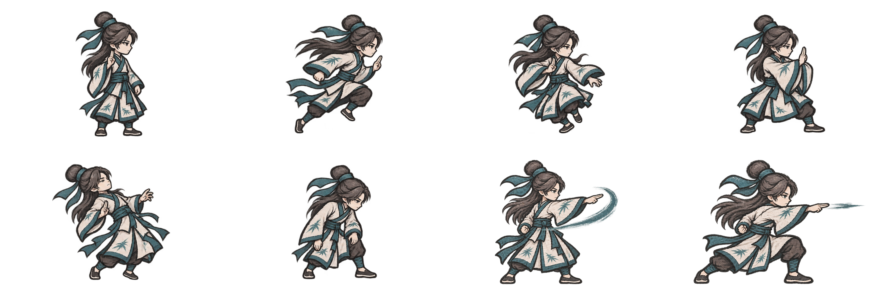

# 水墨手绘战斗动作样稿

这是一套局内人物动作状态原画候选，沿用项目剑修的白衣、青绿滚边、深色高束发与青色发带。画面采用厚重墨线、干笔纹理和少量青绿设色。

## 动作状态

图集为四列两行，按从左到右、从上到下排列：待机、移动、闪避、防御、受击、失衡、斩击、突刺。每个单动作文件为 768×512 RGBA 透明 PNG。

## 范围与状态

- 每个动作目前是一张完整人物关键姿势图，可用于评估状态差异和整体风格。
- 当前不是逐帧动画：没有补齐动作中间帧、骨骼绑定或游戏运行时切换。
- 仅用于美术方向评审；未安装、未接入战斗，也不代表用户已认可。
- 斩击、突刺使用了留白更大的补图，避免拆分时相邻动作串入。
- 原始生成图与 SHA-256 见 source 文件夹。
