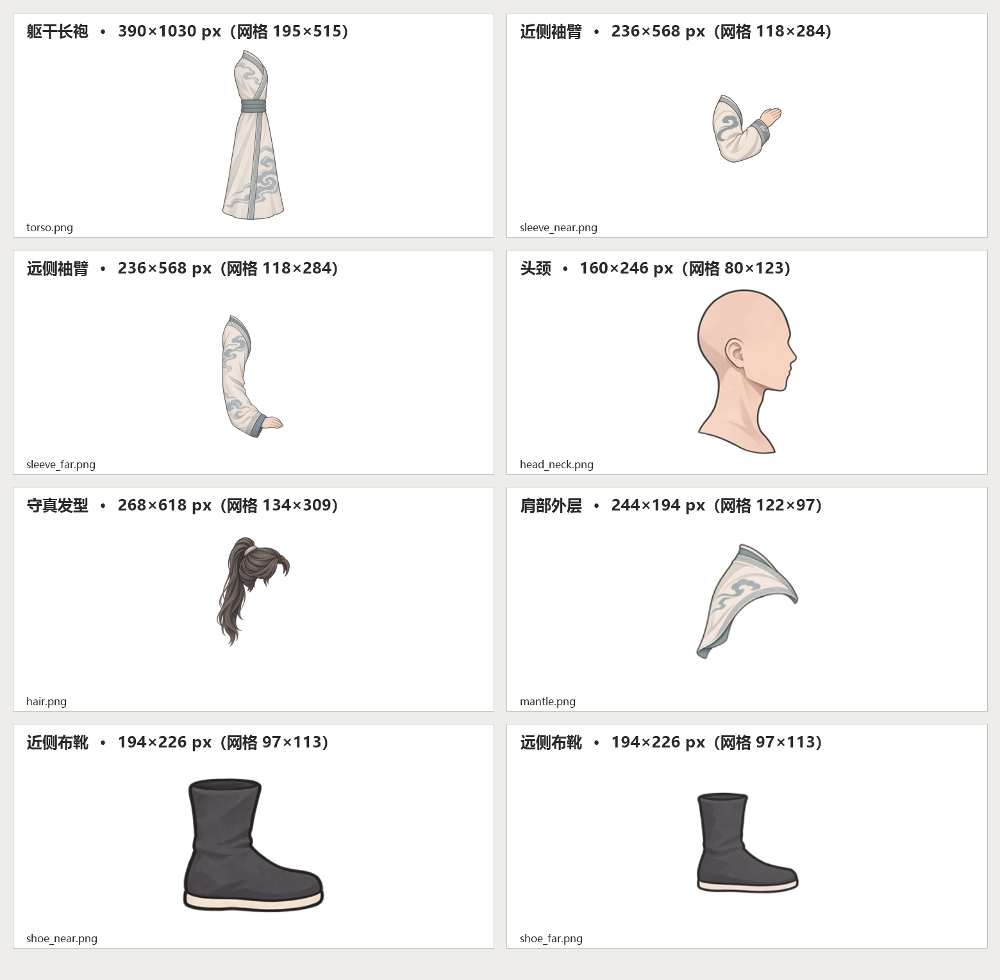

# 玉虚守真侧视骨骼分件候选（2026-11-15）

> 状态：过程稿，已由 [v2 候选包](../yuxu_shouzhen_bone_redraw_20261115_v2/README.md) 替代；请以 v2 为当前审阅版本。本目录保留原图和历史记录。

本目录是一套重新生成的侧视分件候选，按本机《归墟行：人界篇》局内骨骼分件模板的贴图尺寸整理。它只借用尺寸作为制作规格，不包含旧试作的贴图、分件、骨架层级或权重。

## 来源与造型

- 角色朝右，无五官，延续项目已确认的小比例玉虚侧视画风。
- 衣装参照 `mods/appearance/ink_three_variants_20261004/male/clothing/06.png`：内门常服的象牙白、灰蓝云纹与青灰边饰。
- 发型参照真实映射 `male/hair_front/07.png` 与 `male/hair_back/07.png`：露额拢发、浅色束带、长束尾。
- 侧面轮廓与绘画风格参照 `tools/action_battle_test/art/yuxu_fullbody_v15/` 中已确认的自有素材。
- `source_generated/` 保留本轮全尺寸原图；`parts/` 是贴合网格模板尺寸的透明PNG。

## 分件尺寸

| 部件 | 贴图像素 | 网格像素 | 文件 |
| --- | ---: | ---: | --- |
| 躯干长袍 | 390×1030 | 195×515 | `parts/torso.png` |
| 近侧袖臂 | 236×568 | 118×284 | `parts/sleeve_near.png` |
| 远侧袖臂 | 236×568 | 118×284 | `parts/sleeve_far.png` |
| 头颈 | 160×246 | 80×123 | `parts/head_neck.png` |
| 守真发型 | 268×618 | 134×309 | `parts/hair.png` |
| 肩部外层 | 244×194 | 122×97 | `parts/mantle.png` |
| 近侧布靴 | 194×226 | 97×113 | `parts/shoe_near.png` |
| 远侧布靴 | 194×226 | 97×113 | `parts/shoe_far.png` |

## 当前状态

素材仍是待审候选：**未进行骨骼绑定、未接入角色运行时、未安装到战斗，也未获得用户最终美术认可。** 后续若继续，需要按模板校准各片锚点和遮挡、接入项目自己的骨骼，并单独检查完整静态组合与动作变形。

完整部件来源、文件哈希与尺寸记录见 `parts_manifest.json`。
