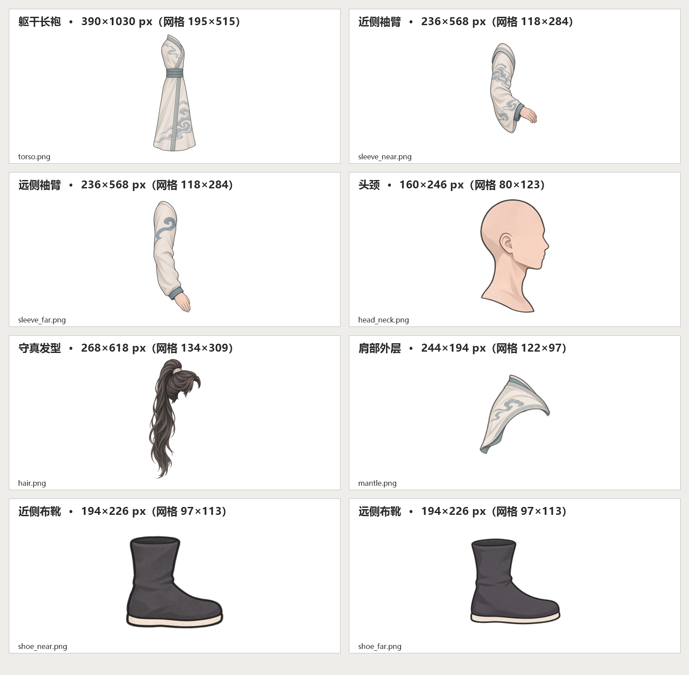

# 玉虚守真侧视骨骼分件候选 v2（2026-11-15）

本目录是重新生成的侧视人物分件候选。贴图像素尺寸与网格尺寸按本机《归墟行：人界篇》局内骨骼分件模板整理；仅借用尺寸规格，没有复制旧试作的贴图、分件、骨架层级或权重。v1 留作过程稿，本版修订了透明留白、袖臂比例与远侧布靴大小。

## 来源与造型

- 朝右侧视、无五官；画风跟随项目已确认的小比例玉虚人物。
- 衣装参照 `mods/appearance/ink_three_variants_20261004/male/clothing/06.png`：内门常服的象牙白、灰蓝云纹与青灰边饰。
- 发型参照真实映射 `male/hair_front/07.png` 与 `male/hair_back/07.png`：露额拢发、浅色束带、长束尾。
- 侧面轮廓和笔触参照 `tools/action_battle_test/art/yuxu_fullbody_v15/` 的自有素材。
- `source_generated/` 保留本轮全尺寸原图；`parts/` 为贴合目标模板的透明PNG。原图未被缩放覆盖。

## 分件尺寸

| 部件 | 贴图像素 | 网格像素 | 文件 |
| --- | ---: | ---: | --- |
| 躯干长袍 | 390×1030 | 195×515 | `parts/torso.png` |
| 近侧袖臂 | 236×568 | 118×284 | `parts/sleeve_near.png` |
| 远侧袖臂 | 236×568 | 118×284 | `parts/sleeve_far.png` |
| 头颈 | 160×246 | 80×123 | `parts/head_neck.png` |
| 守真发型 | 268×618 | 134×309 | `parts/hair.png` |
| 肩部外层 | 244×194 | 122×97 | `parts/mantle.png` |
| 近侧布靴 | 194×226 | 97×113 | `parts/shoe_near.png` |
| 远侧布靴 | 194×226 | 97×113 | `parts/shoe_far.png` |

## 当前状态

素材仍是待审候选：**未做骨骼绑定、未接入角色运行时、未安装到战斗，也未获得用户最终美术认可。** 后续如继续，需要校准贴图锚点、遮挡与骨骼权重，并分别检查正常尺寸完整组合和动作变形。

完整部件来源、文件哈希与尺寸记录见 `parts_manifest.json`。
